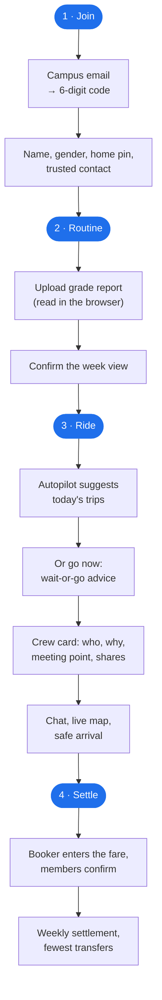

# 01 · Product

## 1. The problem in one paragraph

At AIUB, 83% of class releases on teaching days happen at just ten clock times, and 75% of
sections meet on paired days. The same people leave campus at the same moments, in the same
directions, every week. Yet each one finds, waits for, and pays for a CNG, rickshaw or Uber
alone. Pulse uses the official timetable to predict who will travel when, groups them into fair,
safe crews, and settles the shared fares exactly.

## 2. Roles

One app, one account type. The `role` on `app_user` decides which screens and endpoints a person
can use. A person has exactly one role per campus.

| Role             | Who                          | Can do                                                                                     | Signs up how                                 |
| ---------------- | ---------------------------- | ------------------------------------------------------------------------------------------ | -------------------------------------------- |
| `student`        | Enrolled student             | Everything a rider does: routine, requests, crews, trips, wallet, safety                   | Campus email code; routine from grade report |
| `faculty`        | Teacher                      | Same as student; picks the sections they teach instead of uploading a grade report         | Campus email code                            |
| `staff`          | Office staff                 | Same as student; enters office hours (`schedule_block`)                                    | Campus email code                            |
| `operator`       | Shuttle operator (simulated) | Fleet, demand board, runs, check-in, earnings. Also a rider if they want                   | Signs in, applies; a campus admin approves   |
| `campus_admin`   | Runs one university's setup  | Catalog, calendar, zones, meeting points, operators, reports, playground, analytics, flags | Appointed by a platform admin                |
| `platform_admin` | Runs Pulse itself            | Creates campuses, appoints campus admins, manages models; everything a campus admin can do | Seeded (first one) or appointed by another   |

"Rider" in this plan means student, faculty or staff.

## 3. The main journey (student)

## 4. Feature list

Every feature from the proposal is here. **Wave** is the build priority (see
[12 Roadmap](12-roadmap.md)): wave 1 is the core journey, wave 2 is money and safety, wave 3 is
AI, shuttles and the simulator. **Owner**: A = Ashfak, M2, M3.

### 4.1 Identity and campus

| ID  | Feature                                                                                    | Wave | Owner | API module |
| --- | ------------------------------------------------------------------------------------------ | ---- | ----- | ---------- |
| F01 | Campus-email sign-in with a 6-digit code (hashed, 10 min, 5 attempts, rate limits)         | 1    | M2    | auth       |
| F02 | Sessions: short access token + rotating refresh token, sign out everywhere                 | 1    | M2    | auth       |
| F03 | Bot check on sign-up (Cloudflare Turnstile, behind a flag)                                 | 2    | M2    | auth       |
| F04 | Profile: name, gender, department, photo, phone (hidden)                                   | 1    | M2    | users      |
| F05 | Preferences: home pin as a coarse H3 cell, modes, gender preference, max wait, quiet hours | 1    | M2    | users      |
| F06 | Own vehicles (car, bike) with seats                                                        | 1    | M2    | users      |
| F07 | Trusted contacts (up to 3)                                                                 | 2    | M2    | users      |
| F08 | Platform admin: create campus, email domains, location, catalog format, appoint admins     | 1    | A     | campus     |
| F09 | Campus admin: gates, zones (polygons), meeting points, terms                               | 1    | M2    | campus     |
| F10 | Download my data; delete my account                                                        | 3    | M2    | users      |

### 4.2 Routine and calendar

| ID  | Feature                                                                                                                 | Wave | Owner | Module        |
| --- | ----------------------------------------------------------------------------------------------------------------------- | ---- | ----- | ------------- |
| F11 | Catalog import of the AIUB offered-course report (adapter, error report, activate term)                                 | 1    | M3    | catalog       |
| F12 | Routine import from the grade report, parsed in the browser (pdf.js); server gets term + class IDs + course titles only | 1    | M3    | routine       |
| F13 | Section search; faculty pick taught sections; staff office hours                                                        | 1    | M3    | routine       |
| F14 | Week view: classes, calendar overrides, planned trips                                                                   | 1    | M3    | routine       |
| F15 | Campus calendar: holidays, exam periods, campus-wide changes                                                            | 1    | M3    | calendar      |
| F16 | Class change reports (cancelled / moved / extra) that re-plan affected trips within 10 s                                | 2    | M3    | calendar      |
| F17 | Calendar feed (ICS) for Google Calendar                                                                                 | 3    | M3    | notifications |

### 4.3 Requests, forecasting and matching

| ID  | Feature                                                                                       | Wave | Owner | Module        |
| --- | --------------------------------------------------------------------------------------------- | ---- | ----- | ------------- |
| F18 | Go now: request any moment; going alone always offered                                        | 1    | M3    | requests      |
| F19 | Plan for later: date, time, place, flexibility; repeat weekly                                 | 1    | M3    | requests      |
| F20 | Typed requests in English and Banglish: rule-based parser                                     | 1    | M3    | requests      |
| F21 | Typed requests: lab-trained small model (ONNX) with the rule parser as fallback               | 3    | A     | requests / ai |
| F22 | Habit learning (statistical blend of own and campus average delay)                            | 2    | A     | forecast      |
| F23 | Autopilot: daily suggested trips, one-tap confirm, skip a day                                 | 2    | M3    | requests      |
| F24 | Match-chance forecast and wait-or-go advice (baseline)                                        | 2    | A     | forecast      |
| F25 | LightGBM quantile forecast (ONNX) that beats the baseline                                     | 3    | A     | forecast      |
| F26 | Matching: H3 candidates, time windows, blossom pairs, exact small groups, Clarke–Wright + LNS | 1    | A     | matching      |
| F27 | Road distances from OpenStreetMap, precomputed with Dijkstra (C++)                            | 1    | A     | geo           |
| F28 | Walkable meeting points minimising detour plus walking                                        | 1    | A     | matching      |
| F29 | Reliability score (Beta–Bernoulli) used in matching                                           | 2    | A     | matching      |
| F30 | Standby backfill when someone declines or no-shows                                            | 2    | A     | trips         |
| F31 | Long-term fairness: rotate booker, longest detour, last drop-off                              | 2    | A     | matching      |
| F32 | "Why this crew" explanation on every match                                                    | 1    | A     | matching      |
| F33 | Route waitlists that unlock crews when enough people join; invite link                        | 3    | M3    | requests      |

### 4.4 Crews, trips and safety

| ID  | Feature                                                                  | Wave | Owner | Module   |
| --- | ------------------------------------------------------------------------ | ---- | ----- | -------- |
| F34 | Crew card: members, why matched, vehicle, meeting point, booker, share % | 1    | M3    | trips    |
| F35 | Confirm, decline, leave, "running late"                                  | 1    | M3    | trips    |
| F36 | Trip state machine with a scheduler that survives restarts               | 1    | A     | trips    |
| F37 | Assisted booking: Uber deep link, Pathao with destination copied         | 2    | M3    | trips    |
| F38 | Crew chat (real time)                                                    | 1    | A     | realtime |
| F39 | Live location during the trip only, crew only, deleted after             | 2    | A     | realtime |
| F40 | SOS: alert crew, admin and trusted contact (simulated SMS)               | 2    | A     | safety   |
| F41 | Safe-arrival check with escalation to the trusted contact                | 2    | A     | safety   |
| F42 | Kalman smoothing + HMM map matching + route-deviation checks             | 3    | A     | safety   |
| F43 | Ratings, reports, blocking; own reliability score                        | 2    | M3    | safety   |
| F44 | Moderation: admins review reports, warn or suspend                       | 2    | M2    | admin    |

### 4.5 Money

| ID  | Feature                                                                        | Wave | Owner | Module |
| --- | ------------------------------------------------------------------------------ | ---- | ----- | ------ |
| F45 | Fare entry with receipt by the booker; members confirm (24 h) or dispute       | 2    | M2    | ledger |
| F46 | Shapley fair split (exact for ≤ 4 members), shares sum exactly to the fare     | 2    | M2    | ledger |
| F47 | Double-entry ledger in paisa: every entry sums to zero, append-only            | 2    | M2    | ledger |
| F48 | Weekly settlement with the proven minimum number of transfers; simulated bKash | 2    | M2    | ledger |
| F49 | Disputes and receipts                                                          | 2    | M2    | ledger |
| F50 | Savings card: money saved this semester, shareable                             | 3    | M3    | ledger |

### 4.6 Shuttles

| ID  | Feature                                                                            | Wave | Owner | Module  |
| --- | ---------------------------------------------------------------------------------- | ---- | ----- | ------- |
| F51 | Operator onboarding and approval; fleet (vehicles, seats, drivers)                 | 3    | M2    | shuttle |
| F52 | Demand board with differential privacy (Laplace noise, counts < 3 hidden)          | 3    | M2    | shuttle |
| F53 | Suggested runs from forecast demand; publish runs with stops and seat price        | 3    | M2    | shuttle |
| F54 | Seat booking, optimal seat assignment (min-cost max-flow), boarding pass, check-in | 3    | M2    | shuttle |
| F55 | Run day (depart, arrive) and simulated earnings                                    | 3    | M2    | shuttle |

### 4.7 Notifications

| ID  | Feature                                                                                      | Wave | Owner | Module        |
| --- | -------------------------------------------------------------------------------------------- | ---- | ----- | ------------- |
| F56 | In-app notification centre                                                                   | 1    | A     | notifications |
| F57 | Web Push (VAPID), email fallback; per-user daily budget; quiet hours; actionable alerts only | 2    | A     | notifications |

### 4.8 Admin, AI and platform

| ID  | Feature                                                                                    | Wave | Owner | Module    |
| --- | ------------------------------------------------------------------------------------------ | ---- | ----- | --------- |
| F58 | Admin panel: catalog review, calendar, zones and meeting points map editor                 | 2    | M2    | admin     |
| F59 | Campus onboarding agent (Gemini, public files only, declarative spec, validator, approval) | 3    | A     | ai        |
| F60 | Matching playground: replay a day on a map; compare algorithms in shadow mode              | 3    | M2    | admin     |
| F61 | Analytics: users, trips, match rate, forecast accuracy, savings, fairness                  | 3    | M2    | admin     |
| F62 | Feature flags per campus (every AI feature has one)                                        | 1    | A     | flags     |
| F63 | Model registry: activate a trained model version                                           | 3    | A     | ai        |
| F64 | Audit log of admin actions                                                                 | 2    | M2    | admin     |
| F65 | Campus simulator: synthetic campus from the real catalog; load tests; replay               | 3    | A     | simulator |
| F66 | PWA: installable, offline shell, push on iPhone after "Add to Home Screen"                 | 2    | M3    | web       |

## 5. Out of scope (from the proposal, unchanged)

Paid features, real payments, real shuttle operators, real SMS, native apps, background
location tracking, ID or background checks, a hosted LLM in production, a Bangla interface, fare
estimates, Temporal, Kubernetes, a production monitoring stack.

## 6. What "done" means: success criteria

These are the proposal's five objectives turned into checks we can run.

| #   | Objective                         | Check                                                                                                                                                                                       | Where it is tested          |
| --- | --------------------------------- | ------------------------------------------------------------------------------------------------------------------------------------------------------------------------------------------- | --------------------------- |
| O1  | Read real timetable data          | Golden-file tests on the real AIUB report; ≥ 20 volunteer grade reports: every active class resolved, dropped classes excluded, no grade bytes sent                                         | `catalog-adapters`, web e2e |
| O2  | Optimal, valid groups             | 3,000-user simulated day, each batch < 5 s; property tests (capacity, windows, detour ≤ 30%, gender, blocks); blossom = brute force on small inputs; savings vs solo and vs greedy reported | `matching`, simulator       |
| O3  | AI better than the simple version | LightGBM beats the habit blend on pinball loss, 80% intervals cover ~80%; request model beats rules on field accuracy on unseen sentences                                                   | `services/*` eval reports   |
| O4  | Never lose or repeat an event     | Fault injection (Toxiproxy cuts, killed consumers): 0 lost, 0 double-applied; re-plan after class change < 10 s; replaying a day gives identical crews                                      | worker integration, nightly |
| O5  | Exact money, real people          | Every entry sums to zero; shares sum to the fare; settlement transfers = proven minimum; survey ≥ 50 students; pilot ≥ 30 users for 2 weeks                                                 | `money`, pilot report       |

"Deploy-ready" means: every app builds to a Docker image, starts from environment variables
alone, reports health, runs migrations as one step, and the whole stack comes up on a fresh Linux
host with one Compose command ([11](11-quality-and-ops.md)).
