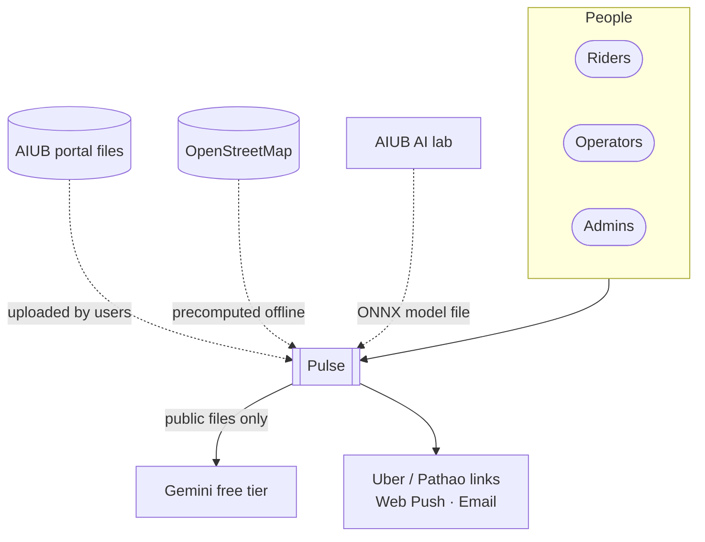
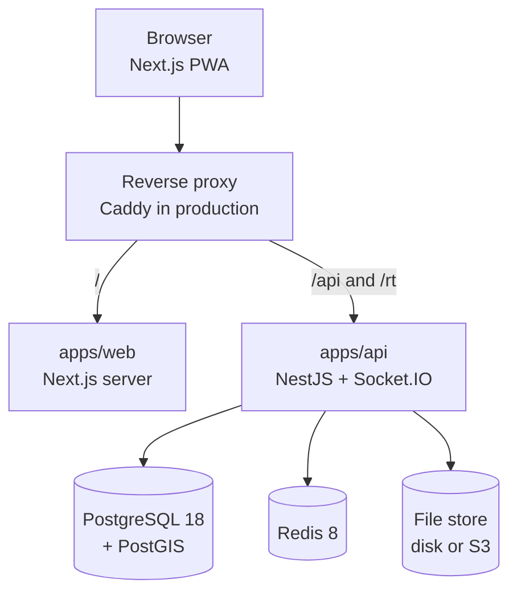
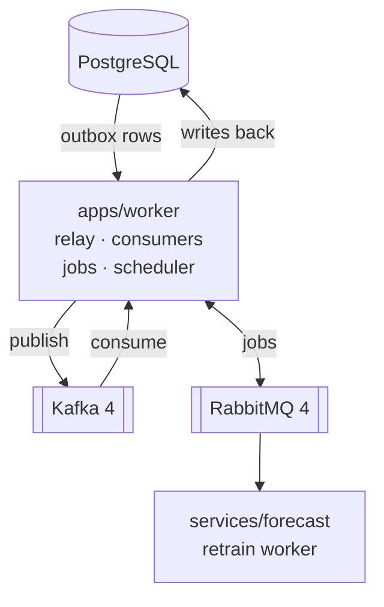
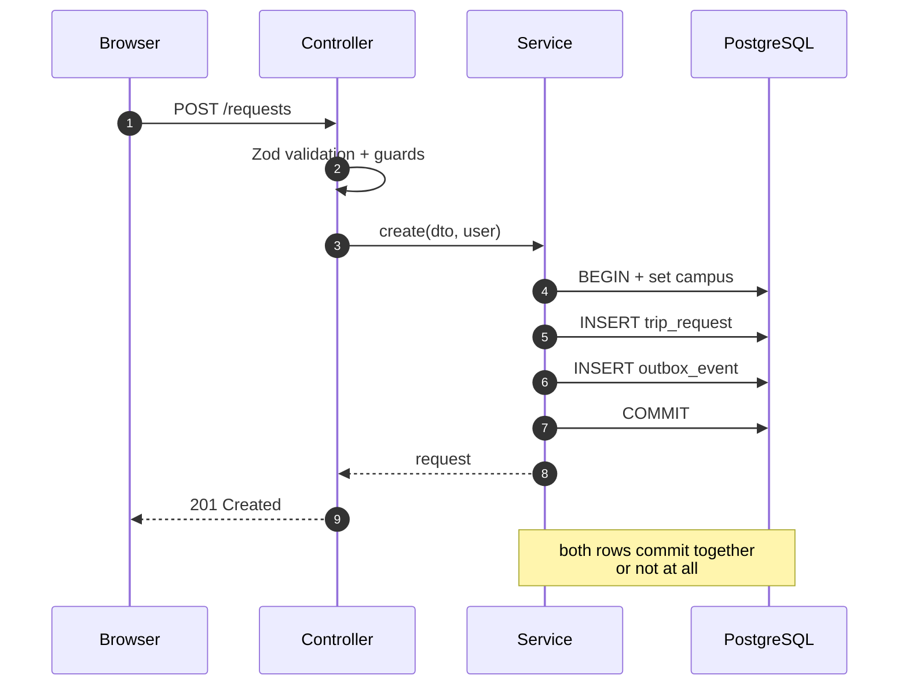
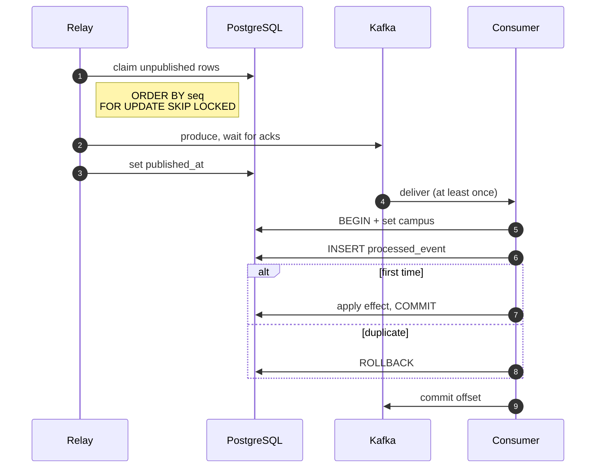
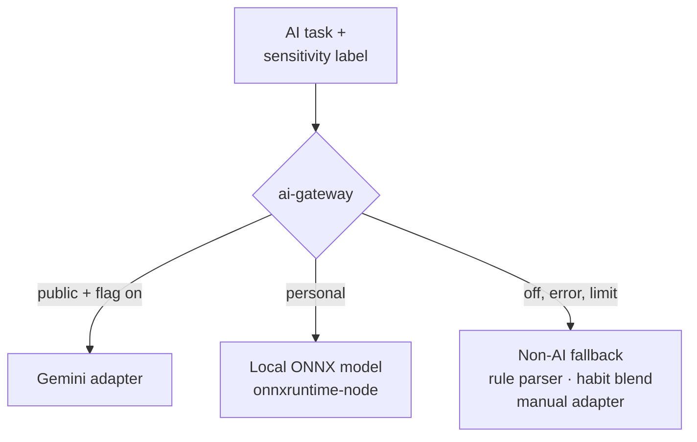

# 02 · Architecture

## 1. The style, in plain words

Pulse is **one main program (the API) split into rooms (modules)**, plus **helpers (workers)**
that react to news. The database is the single notebook everyone trusts. When the API changes
something important, it writes the change and a note saying "this happened" on the same page, at
the same time (the **outbox**). A messenger (the **relay**) carries those notes to Kafka, a
noticeboard that many helpers read at their own pace. When a helper must do a one-off task, like
sending an email, it drops a ticket into RabbitMQ, a queue where exactly one worker picks it up.

| Term                              | Meaning in Pulse                                                                                                      |
| --------------------------------- | --------------------------------------------------------------------------------------------------------------------- |
| Modular monolith                  | One NestJS app, ~20 modules with clear boundaries, one database. Not microservices.                                   |
| Event-driven, not event-sourced   | PostgreSQL holds the truth. Kafka events announce changes; they are not the data store.                               |
| Functional core, imperative shell | `matching`, `money`, `geo` are pure functions; NestJS, PostgreSQL, Kafka, RabbitMQ are the shell.                     |
| Ports and adapters                | AI providers, timetable formats, request parsers, file storage and SMS are interfaces with swappable implementations. |

## 2. System context (C4 level 1)



The running app never calls the lab. Personal data never goes to Gemini.

## 3. Containers (C4 level 2)

**Request path**: what happens while a person uses the app.



**Background path**: what happens after the API has committed.



`apps/simulator` sits outside both paths: it calls the API over HTTP as simulated users.

| Container                | Tech                                                       | Responsibility                                                                             |
| ------------------------ | ---------------------------------------------------------- | ------------------------------------------------------------------------------------------ |
| `apps/web`               | Next.js (App Router), Tailwind, shadcn/ui, Serwist         | All screens; parses the grade report in the browser; installable PWA                       |
| `apps/api`               | NestJS 12 on Node, Drizzle, Socket.IO                      | Every HTTP endpoint and WebSocket; writes business rows + outbox in one transaction        |
| `apps/worker`            | Node, Kafka client, amqplib                                | Outbox relay, Kafka consumers, RabbitMQ job handlers, scheduler. Roles chosen by env       |
| `apps/simulator`         | Node CLI                                                   | Synthetic campus and users from the real catalog; drives load through the real API         |
| `services/forecast`      | Python (uv), LightGBM, onnxmltools                         | Trains forecast models; consumes `forecast.retrain` jobs; writes ONNX + `ml_model` row     |
| `services/request-model` | Python (uv), transformers, optimum                         | Trains the request model in the lab; exports ONNX. Not deployed                            |
| `services/roadgraph`     | C++17                                                      | Reads an OSM extract; Dijkstra from every H3 cell; writes `cell_distance` CSV + road graph |
| PostgreSQL + PostGIS     | `postgis/postgis:18-3.6`                                   | Source of truth; RLS per campus                                                            |
| Redis                    | `redis:8.8`                                                | Rate limits, OTP throttles, Socket.IO adapter, live locations (TTL), flag cache, caches    |
| Kafka                    | `apache/kafka-native:4.4.0` (dev), `apache/kafka` (prod)   | Event log (topics in [05](05-events-and-jobs.md))                                          |
| RabbitMQ                 | `rabbitmq:4-management`                                    | Job queues with retry tiers and `jobs.dead`                                                |
| File store               | Port `FileStore`: local disk (dev) or S3-compatible (prod) | Timetable uploads, receipts, photos, exports, model artifacts                              |

## 4. Repository map (final)

```text
apps/
  web/            Next.js PWA (M2 + M3)
  api/            NestJS modular monolith
  worker/         relay, consumers, job workers, scheduler
  simulator/      synthetic campus CLI
packages/
  contracts/      Zod schemas for every API request/response + error shape
  events/         Kafka envelope, topics, event schemas, add-only baselines
  jobs/           RabbitMQ topology, job schemas, retry tiers
  db/             Drizzle schema, migrations, withCampus(), test helpers
  matching/       pure: candidates, blossom, set partitioning, Clarke–Wright, LNS, seats, wait-or-go, DP noise
  money/          pure: largest remainder, Shapley, postings, balances, minimum transfers
  geo/            pure: H3 helpers, distances, meeting points, Kalman, HMM map matching, deviation
  catalog-adapters/ AIUB adapter, declarative-spec adapter, validator
  request-parser/ rule-based parser + parser port
  ai-gateway/     AI provider port, Gemini adapter, sensitivity labels, rate limits
  ui/             shared React components (shadcn-based)
services/
  forecast/  request-model/  roadgraph/
infra/
  compose/        profiles: core, events, queue, tools, console, prod
  caddy/          production reverse proxy config
docs/  .github/  .claude/
```

## 5. API modules (NestJS)

Each module owns its tables. Another module may read them only through the owner's service,
never by querying the tables directly. This keeps a module movable later.

| Module            | Owns tables                                                                                                                         | Publishes events (topic)                                                                          |
| ----------------- | ----------------------------------------------------------------------------------------------------------------------------------- | ------------------------------------------------------------------------------------------------- |
| `health`          | none                                                                                                                                | none                                                                                              |
| `auth`            | `email_otp`, `session`                                                                                                              | `UserRegistered` (profiles)                                                                       |
| `campus`          | `campus`, `campus_gate`, `term`, `zone`, `meeting_point`                                                                            | `CampusCreated`, `CampusUpdated`, `TermActivated` (campuses)                                      |
| `users`           | `app_user`, `preference`, `vehicle`, `trusted_contact`, `push_subscription`, `data_export`                                          | `ProfileChanged`, `UserDeleted` (profiles)                                                        |
| `catalog`         | `catalog_import`, `section`, `section_meeting`                                                                                      | `CatalogImported` (campuses)                                                                      |
| `routine`         | `enrollment`, `schedule_block`                                                                                                      | `RoutineChanged` (profiles)                                                                       |
| `calendar`        | `calendar_event`, `class_change_report`, `class_change_confirmation`                                                                | `ClassCancelled`, `ClassRescheduled`, `ExtraClassAdded`, `HolidayDeclared` (calendar)             |
| `requests`        | `trip_request`, `recurring_plan`, `autopilot_suggestion`, `request_text_sample`, `route_waitlist`                                   | `TripRequested`, `TripRequestCancelled`, `TripRequestExpired`, `WaitlistUnlocked` (trip-requests) |
| `forecast`        | `travel_habit`                                                                                                                      | none                                                                                              |
| `matching`        | `match_batch`, `cell_distance` (read-only)                                                                                          | (written by the worker's matcher: `TripProposed`)                                                 |
| `trips`           | `crew`, `crew_member`, `trip`, `trip_participant`, `trip_transition`                                                                | all `trips` events                                                                                |
| `realtime`        | `message` (and Redis keys)                                                                                                          | `MessagePosted` (trips), `LocationReported` (locations)                                           |
| `safety`          | `sos_event`, `safety_check`, `rating`, `report`, `block`, `moderation_action`, `reliability`, `fairness_balance`, `sim_sms`         | `SosRaised`, `SafetyCheckStarted`… (trips), `UserReported`, `UserSuspended`… (moderation)         |
| `ledger`          | `fare_claim`, `fare_claim_vote`, `ledger_account`, `journal_entry`, `posting`, `dispute`, `settlement_run`, `settlement`            | all `ledger` events                                                                               |
| `shuttle`         | `operator`, `shuttle_vehicle`, `shuttle_route`, `shuttle_stop`, `shuttle_run`, `seat_booking`, `operator_payout`, `demand_snapshot` | all `shuttles` events                                                                             |
| `notifications`   | `notification`, `notification_attempt`, `calendar_feed_token`                                                                       | none (it consumes)                                                                                |
| `files`           | `file_object`                                                                                                                       | none                                                                                              |
| `ai`              | `onboarding_spec`, `ml_model`                                                                                                       | `OnboardingSpecProposed`, `OnboardingSpecApproved` (campuses), `ModelActivated` (campuses)        |
| `flags`           | `feature_flag`                                                                                                                      | none                                                                                              |
| `admin`           | `audit_log`, `analytics_daily` (read); playground and analytics endpoints                                                           | none                                                                                              |
| `outbox` (shared) | `outbox_event`, `idempotency_key`                                                                                                   | n/a                                                                                               |

## 6. Three ways parts talk

| Kind             | When                                                             | How                                                                                                                                           |
| ---------------- | ---------------------------------------------------------------- | --------------------------------------------------------------------------------------------------------------------------------------------- |
| Request/response | A person does something in the app                               | Browser → proxy → NestJS REST. JSON validated by `@pulse/contracts`. Cookie auth.                                                             |
| Events (Kafka)   | Something happened that other parts react to; must be replayable | API or worker writes business rows + `outbox_event` in one transaction → relay publishes → consumers (idempotent via `processed_event`)       |
| Jobs (RabbitMQ)  | Exactly one worker must do a task, with retries                  | Consumer or scheduler publishes to exchange `jobs` with a routing key → quorum queue → handler acks after success → retry tiers → `jobs.dead` |
| Live push        | The browser must update now (chat, crew formed, location)        | Socket.IO rooms. The worker pushes through `@socket.io/redis-emitter`; the API gateway delivers                                               |

### 6.1 The write path (every state change)



### 6.2 The event path (every consumer)



## 7. The worker app

One codebase, several **roles**. `WORKER_ROLES` picks which run in a process: in development
one process runs all; in production they can run as separate containers from the same image.

| Role        | What it does                                                                                                                                                                       | Scales how                |
| ----------- | ---------------------------------------------------------------------------------------------------------------------------------------------------------------------------------- | ------------------------- |
| `relay`     | Outbox → Kafka, in `seq` order. Single active instance (Postgres advisory lock)                                                                                                    | 1 active, others stand by |
| `consumers` | Kafka consumer groups: `notifier`, `matcher`, `replanner`, `projector`, `realtime-fanout`, `location-monitor`, `analytics`, `matcher-shadow`                                       | Partitions per topic (3)  |
| `jobs`      | RabbitMQ handlers: `notify.*`, `import.timetable`, `ai.onboarding`, `ledger.settle`, `autopilot.generate`, `export.user`, `demand.snapshot`, `analytics.rollup`, `retention.purge` | Prefetch per queue        |
| `scheduler` | Every 5 s: claims due trips (`next_action_at`) and applies transitions; cron-like publisher for periodic jobs, once per period via `scheduled_run`                                 | 1 active (advisory lock)  |

### 7.1 Matcher ownership

The `trip-requests` topic is keyed by `campusId`, so one consumer in the `matcher` group owns each
campus. The matcher keeps a "dirty" set of owned campuses. Every 30 s (live) it runs a batch for
each dirty campus: it loads open requests from PostgreSQL (the truth, not the event), calls the
pure `planBatch()`, and writes crews, trips, participants and `TripProposed` outbox rows in one
transaction. During a Kafka rebalance two instances could briefly overlap, so the batch also takes
`pg_try_advisory_xact_lock(hash(campus_id))` as a safety net. Planned requests are matched in a
"planned" batch 2 hours before their window and finalised 20 minutes before.

## 8. Realtime

- Socket.IO server inside the API, namespace `/rt`, path `/rt/socket.io`, Redis adapter so
  several API instances share rooms.
- Rooms: `user:{userId}`, `trip:{tripId}`, `admin:{campusId}`, `operator:{operatorId}`.
- The handshake reads the access-token cookie; joining `trip:{id}` checks membership.
- Workers never hold sockets: they emit through `@socket.io/redis-emitter`.
- Live location: the client sends `location:update` every 5 s during a trip. The gateway checks
  membership and trip status, writes `loc:{tripId}:{userId}` in Redis (TTL 120 s), broadcasts to
  the trip room, and publishes `LocationReported` to the `locations` topic for the safety monitor.
  This direct publish is an **exception to the outbox rule** and needs an ADR before it is built
  ([13](13-decisions-and-risks.md), D18).

## 9. Files

`FileStore` port with two adapters: `LocalDiskStore` (dev, a Docker volume) and `S3Store`
(production, any S3-compatible bucket). The API never serves file bytes from a public path: it
returns a short-lived signed link (`GET /files/:id/url`, 5 min, HMAC token). Uploads are checked
for type (magic bytes) and size, recorded in `file_object`, and parsed by a worker job, never in
the request handler.

## 10. AI gateway



Every AI call names its sensitivity (`public` or `personal`). `personal` can never reach a remote
provider: the gateway refuses at the type level and at runtime. Details in [09](09-ai-and-ml.md).

## 11. Environments

| Environment   | Where                          | What runs                                                              | Data                    |
| ------------- | ------------------------------ | ---------------------------------------------------------------------- | ----------------------- |
| Local         | Each 8 GB laptop               | `pnpm infra:up` (core + events + queue), `pnpm dev` for api/web/worker | Seed + simulator        |
| Test          | Vitest + Testcontainers        | Fresh PostGIS, Kafka, RabbitMQ, Redis per suite                        | Fixtures                |
| CI            | GitHub Actions                 | quality, migrations, integration, e2e, security jobs                   | Fixtures                |
| Staging/pilot | Chosen host (decide by week 3) | Full stack from `infra/compose/compose.prod.yaml`, HTTPS               | Real pilot users (AIUB) |

Memory budget for the production host, measured targets: PostgreSQL 512 MB, Kafka 768 MB,
RabbitMQ 256 MB, Redis 64 MB, API 256 MB, worker 384 MB, web 256 MB, Caddy 32 MB, forecast
worker 512 MB when training. Total ≈ 3 GB, so a 4 GB host is the minimum.

## 12. Technology choices

| Area         | Choice                                                                                                                            | Status              |
| ------------ | --------------------------------------------------------------------------------------------------------------------------------- | ------------------- |
| Language     | TypeScript 6 strict, ESM; Python 3.13 (uv); C++17                                                                                 | in repo             |
| Monorepo     | pnpm workspaces + Turborepo                                                                                                       | in repo             |
| API          | NestJS 12, own Zod pipe (ADR 0002), helmet                                                                                        | in repo             |
| Database     | PostgreSQL 18 + PostGIS 3.6, Drizzle + node-postgres (ADR 0003)                                                                   | in repo             |
| Events       | Kafka 4 KRaft (ADR 0004), JSON envelope + Zod (ADR 0005)                                                                          | in repo             |
| Kafka client | `@platformatic/kafka` (pure TypeScript, no native build)                                                                          | ADR 0006 (proposed) |
| Jobs         | RabbitMQ 4, `amqplib` + `amqp-connection-manager`                                                                                 | decide in S11 (D6)  |
| Realtime     | Socket.IO + `@socket.io/redis-adapter` + redis-emitter                                                                            | proposed (D22)      |
| Auth         | Email OTP, JWT access (15 min) + opaque rotating refresh, cookies                                                                 | proposed (D20)      |
| Geo          | `h3-js` (resolution 8 home cells), PostGIS, OSM                                                                                   | proposed            |
| ML runtime   | `onnxruntime-node`                                                                                                                | proposed            |
| Frontend     | Next.js, Tailwind, shadcn/ui, TanStack Query, react-hook-form, MapLibre GL + OpenFreeMap tiles, Serwist, pdf.js, Socket.IO client | chosen 2026-11-01   |
| Tests        | Vitest, fast-check, Testcontainers, Playwright, axe, pytest, Toxiproxy                                                            | in repo / planned   |
| Logs         | `nestjs-pino`, JSON, redaction of personal fields                                                                                 | proposed            |
