# 03 · Data model

Every table Pulse will have, grouped into 10 domains. Three tables already exist (`campus`,
`outbox_event`, `processed_event`); the rest are added by the slices in [12](12-roadmap.md).

## 1. Conventions (apply to every table)

| Rule               | What it means                                                                                                                                                                                                         |
| ------------------ | --------------------------------------------------------------------------------------------------------------------------------------------------------------------------------------------------------------------- |
| Primary key        | `id uuid primary key default uuidv7()` (PostgreSQL 18 built-in, time-ordered, so new rows land at the end of the index). `campus` keeps its existing `gen_random_uuid()`. One-to-one tables use `user_id` as the key. |
| Tenancy            | Every campus-scoped table has `campus_id uuid not null references campus(id)` and the standard RLS policy (§2). Child tables repeat `campus_id`, so RLS never needs a join.                                           |
| Statuses and kinds | `text` + `CHECK (col in (…))`, not PostgreSQL enums. Adding a value is then a plain migration that replaces the check (enums cannot drop or reorder values).                                                          |
| Time               | `timestamptz` for moments. `date` + `time` (local to the campus timezone) for timetable data. Column names end in `_at` (moment), `_on` (date), `_time` (clock time).                                                 |
| Money              | `bigint`, integer paisa, names end in `_paisa`. Never `numeric` or floats for money.                                                                                                                                  |
| Places             | `geometry(Point/Polygon/LineString, 4326)`, longitude first. Coarse homes are H3 cells at resolution 8 stored as `text` (15 hex chars), checked with `~ '^[0-9a-f]{15}$'`.                                            |
| Audit columns      | `created_at timestamptz not null default now()`; mutable tables also get `updated_at` (set by the service, not a trigger, so tests stay simple).                                                                      |
| Foreign keys       | Always indexed. `on delete restrict` by default; `cascade` only for pure child rows (e.g. `section_meeting`).                                                                                                         |
| Personal data      | Marked **PII** below. Never logged, never in events unless listed in [05](05-events-and-jobs.md), never in URLs.                                                                                                      |
| Soft delete        | Only `app_user` (status `deleted` + anonymised fields). Everything else is either append-only or truly deleted by retention jobs.                                                                                     |

## 2. Roles and row-level security

| Database role      | Used by                                                               | Rights                                                                                                   |
| ------------------ | --------------------------------------------------------------------- | -------------------------------------------------------------------------------------------------------- |
| `pulse`            | Migrations only                                                       | Owns every table                                                                                         |
| `pulse_app`        | API                                                                   | `SELECT, INSERT, UPDATE, DELETE` by default grant; RLS filters rows; no rights on append-only updates    |
| `pulse_<consumer>` | One role per worker consumer group (`pulse_notifier` first, ADR 0009) | `SELECT, INSERT` on `processed_event` plus only the tables that consumer writes; same RLS as `pulse_app` |
| `pulse_relay`      | Worker relay role                                                     | `SELECT, UPDATE (published_at)` on `outbox_event` only                                                   |
| `pulse_ml`         | `services/forecast`                                                   | `SELECT` on the training views (`v_forecast_training`), `INSERT` on `ml_model`                           |

**Standard policy** (every campus-scoped table, written once in a helper `campusScoped(table)`):

```sql
alter table x enable row level security;
alter table x force row level security;
create policy x_campus on x for all to pulse_app -- plus each consumer role that needs the table
  using (campus_id = nullif(current_setting('app.campus_id', true), '')::uuid)
  with check (campus_id = nullif(current_setting('app.campus_id', true), '')::uuid);
```

`withCampus(db, campusId, tx => …)` sets `app.campus_id` with `set_config(…, true)` for one
transaction (ADR 0003). The API takes the campus from the access token; the worker takes it from
`payload.campusId`. A query outside `withCampus` sees no campus rows at all.

**Append-only tables** (`journal_entry`, `posting`, `audit_log`, `trip_transition`): policies for
`select` and `insert` only, and `revoke update, delete`. `processed_event` is append-only too, by
grants alone: it has no `campus_id` or RLS, and `pulse_app` has no rights on it (ADR 0009).

**Ownership inside a campus** (who may see which crew, trip, chat or ledger) is checked in the
services, with one test per rule, not by RLS. RLS is the tenancy wall; services are the room doors.

## 3. The whole picture

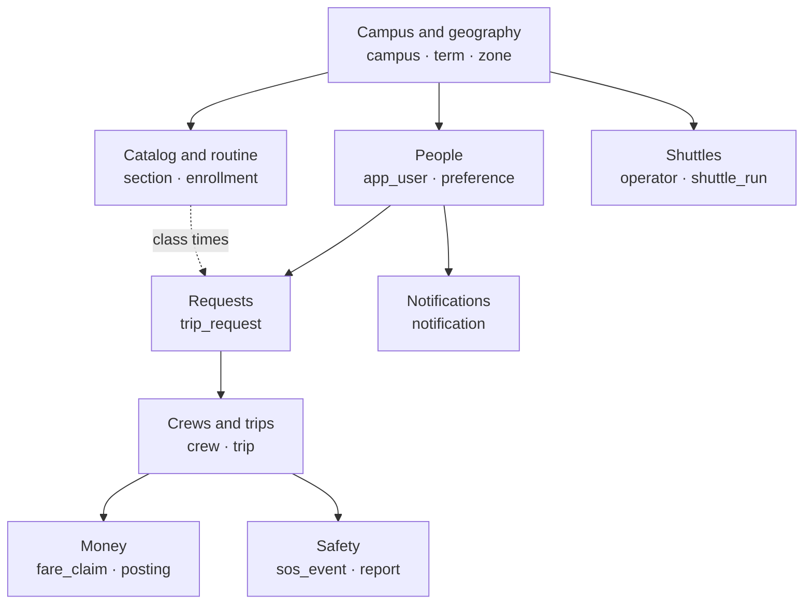

Domain diagrams follow in each section.

---

## 4. Campus and geography

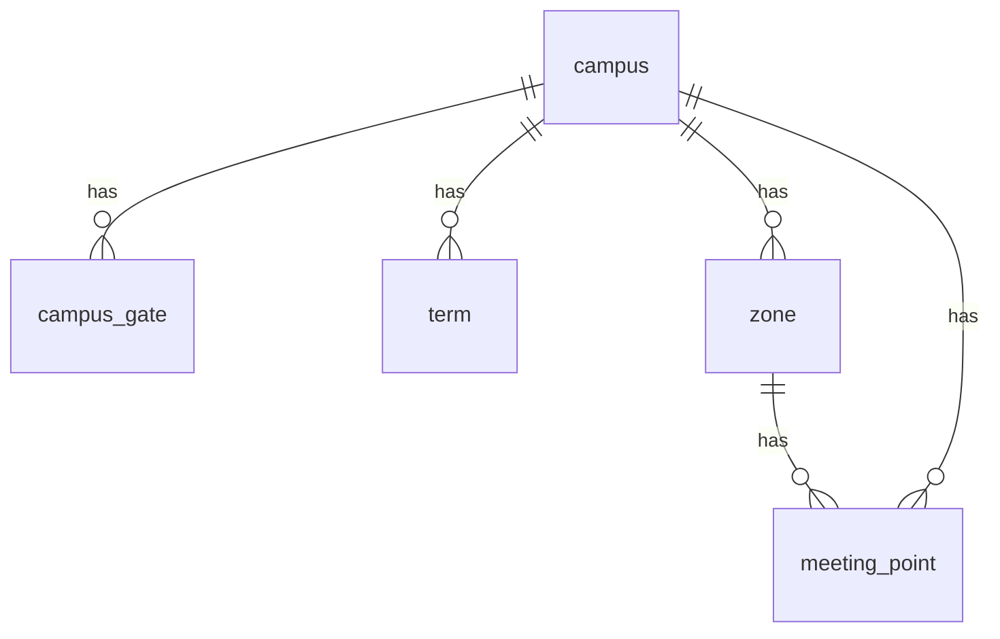

### 4.1 `campus` (exists; columns added)

The tenant. Public facts: anyone may read (sign-in finds a campus by email domain).

| Column         | Type                 | Rules                                                                                        |
| -------------- | -------------------- | -------------------------------------------------------------------------------------------- |
| id             | uuid PK              | `gen_random_uuid()` (existing)                                                               |
| name           | text                 | not null                                                                                     |
| slug           | text                 | not null, unique                                                                             |
| email_domains  | text[]               | not null; lowercase; GIN index for `= any()` lookups                                         |
| location       | geometry(Point,4326) | not null                                                                                     |
| timezone       | text                 | not null, IANA name                                                                          |
| status         | text                 | **new**: `onboarding \| active \| suspended`, default `onboarding`                           |
| catalog_format | text                 | **new**: adapter key, e.g. `aiub_offered_course_v1` or `spec:<onboarding_spec.id>`; nullable |
| is_simulated   | boolean              | **new**: default false; simulator campuses are hidden from public lists                      |
| created_at     | timestamptz          | existing                                                                                     |
| updated_at     | timestamptz          | **new**                                                                                      |

RLS: existing (`campus_read` for all, insert/update only the current campus).

### 4.2 `campus_gate`

Where trips start or end on campus. Every trip has exactly one gate end.

| Column     | Type                 | Rules                                                 |
| ---------- | -------------------- | ----------------------------------------------------- |
| id         | uuid PK              |                                                       |
| campus_id  | uuid → campus        |                                                       |
| name       | text                 | not null; unique per campus                           |
| location   | geometry(Point,4326) | not null                                              |
| cell       | text                 | H3 r8 of `location` (set by the service)              |
| is_primary | boolean              | default false; partial unique: one primary per campus |
| created_at | timestamptz          |                                                       |

### 4.3 `term`

| Column                 | Type          | Rules                                                                    |
| ---------------------- | ------------- | ------------------------------------------------------------------------ |
| id                     | uuid PK       |                                                                          |
| campus_id              | uuid → campus |                                                                          |
| name                   | text          | e.g. `Fall 2026-2027`; unique (campus_id, name)                          |
| starts_on              | date          | not null                                                                 |
| ends_on                | date          | not null; check `ends_on > starts_on`                                    |
| status                 | text          | `draft \| active \| archived`; partial unique (campus_id) where `active` |
| created_at, updated_at | timestamptz   |                                                                          |

### 4.4 `zone`

Named home areas drawn by the admin. Used for the waitlist, the demand board and "home zone" on
the co-rider card.

| Column                 | Type                        | Rules                               |
| ---------------------- | --------------------------- | ----------------------------------- |
| id                     | uuid PK                     |                                     |
| campus_id              | uuid → campus               |                                     |
| name                   | text                        | unique per campus, e.g. `Mirpur 10` |
| area                   | geometry(MultiPolygon,4326) | not null; GiST index                |
| created_at, updated_at | timestamptz                 |                                     |

### 4.5 `meeting_point`

| Column                 | Type                 | Rules                                      |
| ---------------------- | -------------------- | ------------------------------------------ |
| id                     | uuid PK              |                                            |
| campus_id              | uuid → campus        |                                            |
| zone_id                | uuid → zone          | nullable (gate-side points have no zone)   |
| name                   | text                 | not null                                   |
| kind                   | text                 | `gate \| landmark \| bus_stop \| junction` |
| location               | geometry(Point,4326) | GiST index                                 |
| cell                   | text                 | H3 r8                                      |
| is_active              | boolean              | default true                               |
| created_at, updated_at | timestamptz          |                                            |

### 4.6 `cell_distance` (global, not campus-scoped)

Road distance between H3 cells, precomputed offline by `services/roadgraph` (Dijkstra over OSM).
Read-only for the app; loaded by a seed script per region.

| Column      | Type    | Rules                              |
| ----------- | ------- | ---------------------------------- |
| origin_cell | text    | PK part                            |
| dest_cell   | text    | PK part                            |
| metres      | integer | not null, ≥ 0                      |
| seconds     | integer | not null, ≥ 0 (free-flow estimate) |

PK (origin_cell, dest_cell). Size for Dhaka at r8: about 600 cells → 360 k rows (~25 MB).
RLS: exempt (listed in the guard test's exception list); `pulse_app` has `SELECT` only.

---

## 5. Identity and people

Account and settings:

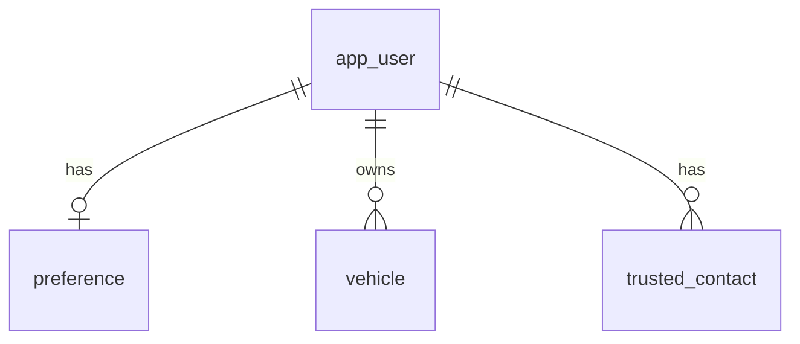

Sessions, devices and exports:

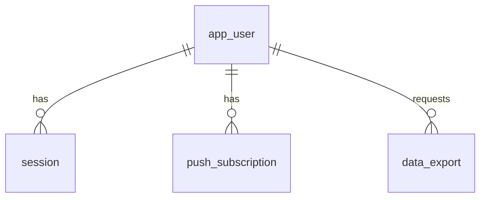

Learned behaviour:

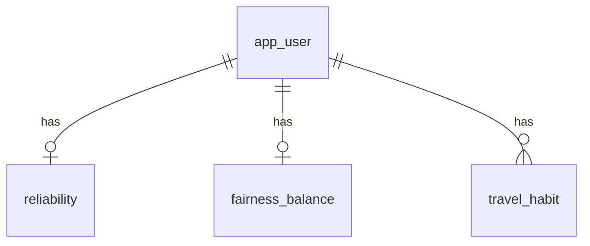

### 5.1 `app_user`

| Column                 | Type               | Rules                                                                                    |
| ---------------------- | ------------------ | ---------------------------------------------------------------------------------------- |
| id                     | uuid PK            |                                                                                          |
| campus_id              | uuid → campus      |                                                                                          |
| email                  | text               | **PII**; not null; check `email = lower(email)`; unique (global)                         |
| role                   | text               | `student \| faculty \| staff \| operator \| campus_admin \| platform_admin`              |
| status                 | text               | `pending_profile \| active \| suspended \| deleted`, default `pending_profile`           |
| first_name             | text               | **PII**; shown to crew-mates                                                             |
| last_name              | text               | **PII**; never shown to other riders                                                     |
| gender                 | text               | `female \| male \| unspecified`; self-declared; used only for gender-preference matching |
| department             | text               | nullable                                                                                 |
| phone_e164             | text               | **PII**; nullable; never shown to anyone                                                 |
| photo_file_id          | uuid → file_object | nullable                                                                                 |
| suspended_until        | timestamptz        | nullable                                                                                 |
| last_seen_at           | timestamptz        |                                                                                          |
| deleted_at             | timestamptz        | set on account deletion; PII columns are then overwritten                                |
| created_at, updated_at | timestamptz        |                                                                                          |

Indexes: unique (email); (campus_id, role).

### 5.2 `email_otp`

| Column      | Type          | Rules                                           |
| ----------- | ------------- | ----------------------------------------------- |
| id          | uuid PK       |                                                 |
| campus_id   | uuid → campus | resolved from the email domain first            |
| email       | text          | **PII**, lowercase                              |
| code_hash   | text          | HMAC-SHA256(code, `OTP_PEPPER`), never the code |
| attempts    | smallint      | default 0; locked at 5                          |
| expires_at  | timestamptz   | created + 10 min                                |
| consumed_at | timestamptz   | nullable                                        |
| ip_hash     | text          | HMAC of the IP, for abuse review                |
| created_at  | timestamptz   |                                                 |

Index: (email, created_at desc). Retention: deleted after 24 h by `retention.purge`.

### 5.3 `session`

One row per refresh token. Rotation creates a child; reusing a rotated token revokes the family.

| Column        | Type            | Rules                                                                |
| ------------- | --------------- | -------------------------------------------------------------------- |
| id            | uuid PK         |                                                                      |
| campus_id     | uuid → campus   |                                                                      |
| user_id       | uuid → app_user |                                                                      |
| family_id     | uuid            | same for every token descended from one sign-in                      |
| parent_id     | uuid → session  | nullable                                                             |
| token_hash    | text            | SHA-256 of the opaque token; unique                                  |
| expires_at    | timestamptz     | created + 30 days                                                    |
| rotated_at    | timestamptz     | set when a child is issued                                           |
| revoked_at    | timestamptz     |                                                                      |
| revoke_reason | text            | `sign_out \| sign_out_all \| reuse_detected \| suspended \| deleted` |
| user_agent    | text            | shortened                                                            |
| ip_hash       | text            |                                                                      |
| created_at    | timestamptz     |                                                                      |

Indexes: unique (token_hash); (user_id, revoked_at); (family_id).

### 5.4 `preference` (PK = user_id)

| Column                  | Type               | Rules                                                                                |
| ----------------------- | ------------------ | ------------------------------------------------------------------------------------ |
| user_id                 | uuid PK → app_user |                                                                                      |
| campus_id               | uuid → campus      |                                                                                      |
| home_cell               | text               | H3 r8 (~0.7 km²); **PII-lite**; never shown to others                                |
| zone_id                 | uuid → zone        | derived from home_cell; shown as "home zone"                                         |
| gender_pref             | text               | `any \| same_gender`, default `any`                                                  |
| modes                   | text[]             | subset of `cng, rickshaw, ride_hail_car, own_car, own_bike, bus, shuttle`; not empty |
| max_wait_min            | smallint           | 0–60, default 10                                                                     |
| max_detour_pct          | smallint           | 0–50, default 30                                                                     |
| autopilot_on            | boolean            | default false                                                                        |
| quiet_start_time        | time               | nullable (with quiet_end_time)                                                       |
| quiet_end_time          | time               | nullable                                                                             |
| daily_notify_budget     | smallint           | 1–20, default 6 (critical alerts ignore the budget)                                  |
| share_text_for_training | boolean            | default false (consent for typed requests, [09](09-ai-and-ml.md))                    |
| updated_at              | timestamptz        |                                                                                      |

### 5.5 `vehicle`

| Column                 | Type            | Rules                              |
| ---------------------- | --------------- | ---------------------------------- |
| id                     | uuid PK         |                                    |
| campus_id              | uuid → campus   |                                    |
| owner_id               | uuid → app_user |                                    |
| type                   | text            | `car \| bike`                      |
| seats                  | smallint        | car 1–6 free seats, bike exactly 1 |
| plate                  | text            | **PII**; shown to crew only        |
| color                  | text            |                                    |
| is_active              | boolean         | default true                       |
| created_at, updated_at | timestamptz     |                                    |

### 5.6 `trusted_contact`

| Column     | Type            | Rules                          |
| ---------- | --------------- | ------------------------------ |
| id         | uuid PK         |                                |
| campus_id  | uuid → campus   |                                |
| user_id    | uuid → app_user | max 3 per user (service check) |
| name       | text            | **PII**                        |
| phone_e164 | text            | **PII**                        |
| relation   | text            | free text, short               |
| created_at | timestamptz     |                                |

### 5.7 `push_subscription`

| Column          | Type            | Rules                               |
| --------------- | --------------- | ----------------------------------- |
| id              | uuid PK         |                                     |
| campus_id       | uuid → campus   |                                     |
| user_id         | uuid → app_user |                                     |
| endpoint        | text            | unique                              |
| p256dh          | text            |                                     |
| auth            | text            |                                     |
| user_agent      | text            |                                     |
| failed_count    | smallint        | deleted after 3 consecutive 404/410 |
| last_success_at | timestamptz     |                                     |
| created_at      | timestamptz     |                                     |

### 5.8 `reliability` (PK = user_id)

| Column     | Type               | Rules     |
| ---------- | ------------------ | --------- |
| user_id    | uuid PK → app_user |           |
| campus_id  | uuid → campus      |           |
| shows      | integer            | default 0 |
| no_shows   | integer            | default 0 |
| late_count | integer            | default 0 |
| updated_at | timestamptz        |           |

Score = (shows + 4) / (shows + no_shows + 5): a Beta(4, 1) prior, so new users start at 0.8.
Only the user and the matcher see it.

### 5.9 `fairness_balance` (PK = user_id)

| Column               | Type               | Rules                                              |
| -------------------- | ------------------ | -------------------------------------------------- |
| user_id              | uuid PK → app_user |                                                    |
| campus_id            | uuid → campus      |                                                    |
| inconvenience_points | integer            | grows with detour %, booker duty and last drop-off |
| booker_count         | integer            |                                                    |
| last_dropoff_count   | integer            |                                                    |
| trips_count          | integer            |                                                    |
| updated_at           | timestamptz        |                                                    |

### 5.10 `travel_habit`

| Column          | Type            | Rules                                                          |
| --------------- | --------------- | -------------------------------------------------------------- |
| id              | uuid PK         |                                                                |
| campus_id       | uuid → campus   |                                                                |
| user_id         | uuid → app_user |                                                                |
| weekday         | smallint        | 0 = Sunday … 6 = Saturday                                      |
| direction       | text            | `to_campus \| from_campus`                                     |
| mean_offset_min | real            | minutes after last class end (from) or before first class (to) |
| m2              | real            | Welford running sum of squares, for the variance               |
| trip_count      | integer         |                                                                |
| updated_at      | timestamptz     |                                                                |

Unique (user_id, weekday, direction). `real` is fine here: it is a statistic, not money.

### 5.11 `data_export`

| Column       | Type               | Rules                                  |
| ------------ | ------------------ | -------------------------------------- |
| id           | uuid PK            |                                        |
| campus_id    | uuid → campus      |                                        |
| user_id      | uuid → app_user    |                                        |
| status       | text               | `queued \| ready \| expired \| failed` |
| file_id      | uuid → file_object | nullable                               |
| requested_at | timestamptz        |                                        |
| ready_at     | timestamptz        |                                        |
| expires_at   | timestamptz        | ready + 7 days                         |

---

## 6. Catalog, routine and calendar

The catalog (one copy per term; a course is shared by every term that offers it):

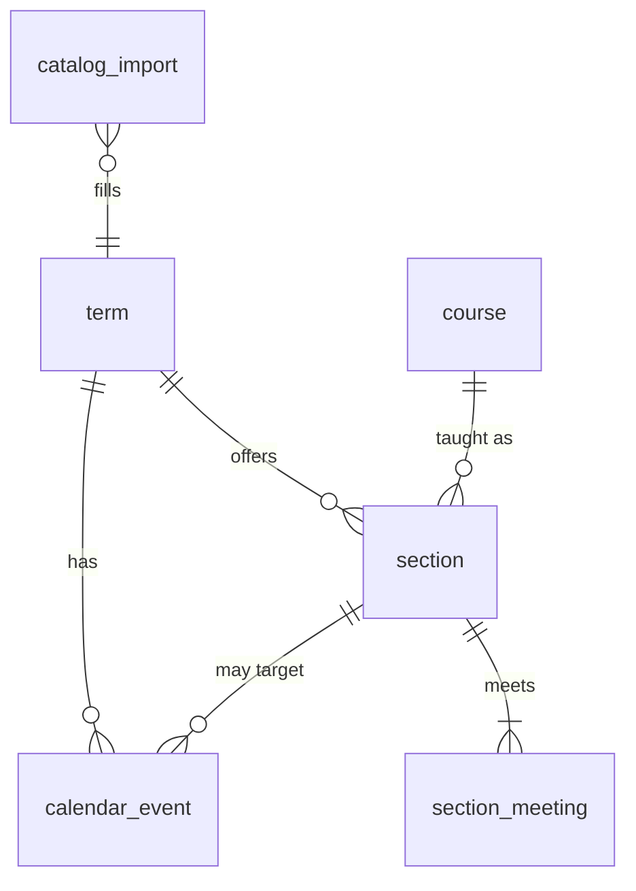

People and the catalog:

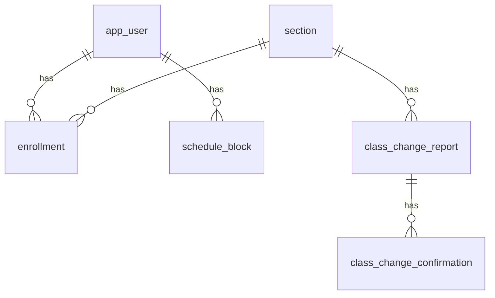

### 6.1 `catalog_import`

| Column      | Type               | Rules                                                          |
| ----------- | ------------------ | -------------------------------------------------------------- |
| id          | uuid PK            |                                                                |
| campus_id   | uuid → campus      |                                                                |
| term_id     | uuid → term        | nullable until the parser finds the term name                  |
| file_id     | uuid → file_object |                                                                |
| adapter     | text               | e.g. `aiub_offered_course_v1`                                  |
| status      | text               | `queued \| parsing \| review \| applying \| applied \| failed` |
| stats       | jsonb              | `{sections, meetings, cancelled, skipped, errors}`             |
| errors      | jsonb              | first 200 problems `{row, field, message}`                     |
| uploaded_by | uuid → app_user    |                                                                |
| created_at  | timestamptz        |                                                                |
| applied_at  | timestamptz        |                                                                |

Parsed rows wait in the import's staging file (JSON in the file store) until the admin applies
them, so a bad file never touches `section`. Applying upserts `course` rows first (by
`(campus_id, code)`), then sections.

`course` exists since S27: `id`, `campus_id`, `code` (e.g. `CSC4161`), `title`, `created_at`;
unique `(campus_id, code)`; `pulse_app` may only read it, inside `withCampus`. S30 adds a trigram
index on `title` for search.

### 6.2 `section`

| Column                 | Type                  | Rules                                                |
| ---------------------- | --------------------- | ---------------------------------------------------- |
| id                     | uuid PK               |                                                      |
| campus_id              | uuid → campus         |                                                      |
| term_id                | uuid → term           |                                                      |
| external_class_id      | text                  | AIUB "Class ID"; unique (term_id, external_class_id) |
| course_id              | uuid → course         | code and title live on the course, stored once       |
| section_label          | text                  | e.g. `B`                                             |
| type                   | text                  | `theory \| lab \| other`                             |
| capacity               | smallint              |                                                      |
| enrolled               | smallint              | from the report                                      |
| status                 | text                  | `open \| closed \| cancelled`                        |
| instructor_name        | text                  | public in the report                                 |
| import_id              | uuid → catalog_import |                                                      |
| created_at, updated_at | timestamptz           |                                                      |

Indexes: unique (term_id, external_class_id); (term_id, course_id); (course_id).

### 6.3 `section_meeting`

| Column     | Type           | Rules                         |
| ---------- | -------------- | ----------------------------- |
| id         | uuid PK        |                               |
| campus_id  | uuid → campus  |                               |
| section_id | uuid → section | on delete cascade             |
| weekday    | smallint       | 0–6                           |
| start_time | time           |                               |
| end_time   | time           | check `end_time > start_time` |
| room       | text           |                               |

Index: (section_id); (campus_id, weekday, end_time) for "who leaves at 16:30 on Sunday".

### 6.4 `enrollment`

| Column     | Type            | Rules                                          |
| ---------- | --------------- | ---------------------------------------------- |
| id         | uuid PK         |                                                |
| campus_id  | uuid → campus   |                                                |
| user_id    | uuid → app_user |                                                |
| section_id | uuid → section  |                                                |
| term_id    | uuid → term     | copied from the section, for fast term filters |
| role       | text            | `student \| instructor`                        |
| source     | text            | `grade_report \| search \| faculty_pick`       |
| created_at | timestamptz     |                                                |

Unique (user_id, section_id). Index (section_id) for "who is affected by this class change".

### 6.5 `schedule_block`

Staff office hours (and any fixed weekly block a rider wants).

| Column     | Type            | Rules             |
| ---------- | --------------- | ----------------- |
| id         | uuid PK         |                   |
| campus_id  | uuid → campus   |                   |
| user_id    | uuid → app_user |                   |
| term_id    | uuid → term     |                   |
| weekday    | smallint        |                   |
| start_time | time            |                   |
| end_time   | time            | check end > start |
| label      | text            |                   |
| created_at | timestamptz     |                   |

### 6.6 `calendar_event`

| Column         | Type            | Rules                                                                           |
| -------------- | --------------- | ------------------------------------------------------------------------------- |
| id             | uuid PK         |                                                                                 |
| campus_id      | uuid → campus   |                                                                                 |
| term_id        | uuid → term     |                                                                                 |
| section_id     | uuid → section  | null = campus-wide                                                              |
| kind           | text            | `holiday \| exam_period \| class_cancelled \| class_rescheduled \| extra_class` |
| on_date        | date            | not null                                                                        |
| end_date       | date            | for `holiday`/`exam_period` ranges                                              |
| new_date       | date            | for `class_rescheduled` to another day                                          |
| new_start_time | time            | for `class_rescheduled`, `extra_class`                                          |
| new_end_time   | time            |                                                                                 |
| room           | text            |                                                                                 |
| note           | text            |                                                                                 |
| source         | text            | `admin \| report`                                                               |
| created_by     | uuid → app_user |                                                                                 |
| created_at     | timestamptz     |                                                                                 |

Index: (campus_id, on_date); (section_id, on_date).

### 6.7 `class_change_report`

| Column                                 | Type                  | Rules                                                 |
| -------------------------------------- | --------------------- | ----------------------------------------------------- |
| id                                     | uuid PK               |                                                       |
| campus_id                              | uuid → campus         |                                                       |
| section_id                             | uuid → section        |                                                       |
| reporter_id                            | uuid → app_user       | must be enrolled in the section                       |
| kind                                   | text                  | `class_cancelled \| class_rescheduled \| extra_class` |
| on_date                                | date                  |                                                       |
| new_date, new_start_time, new_end_time |                       | as in `calendar_event`                                |
| status                                 | text                  | `pending \| applied \| rejected \| expired`           |
| calendar_event_id                      | uuid → calendar_event | set when applied                                      |
| created_at                             | timestamptz           |                                                       |

Rule: a report by the section's instructor applies at once. A student report applies when a
second enrolled student confirms it, or when an admin approves. Unique pending report per
(section_id, on_date, kind).

### 6.8 `class_change_confirmation`

| Column     | Type                       | Rules   |
| ---------- | -------------------------- | ------- |
| report_id  | uuid → class_change_report | PK part |
| user_id    | uuid → app_user            | PK part |
| campus_id  | uuid → campus              |         |
| created_at | timestamptz                |         |

---

## 7. Requests and habits

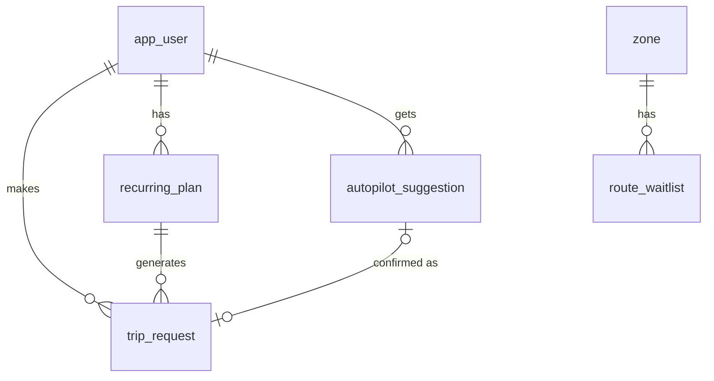

### 7.1 `trip_request`

Go now, plan for later and Autopilot all become this one shape.

| Column                 | Type                  | Rules                                                  |
| ---------------------- | --------------------- | ------------------------------------------------------ |
| id                     | uuid PK               |                                                        |
| campus_id              | uuid → campus         |                                                        |
| user_id                | uuid → app_user       |                                                        |
| kind                   | text                  | `go_now \| planned \| autopilot`                       |
| source                 | text                  | `tap \| text \| autopilot \| recurring`                |
| direction              | text                  | `to_campus \| from_campus`                             |
| home_cell              | text                  | the non-campus end (H3 r8); defaults to the preference |
| gate_id                | uuid → campus_gate    |                                                        |
| window_start           | timestamptz           |                                                        |
| window_end             | timestamptz           | check `window_end > window_start`, ≤ 3 h wide          |
| modes                  | text[]                | copied from preferences unless overridden              |
| gender_pref            | text                  | `any \| same_gender`                                   |
| max_wait_min           | smallint              |                                                        |
| max_detour_pct         | smallint              |                                                        |
| status                 | text                  | `open \| matched \| solo \| expired \| cancelled`      |
| trip_id                | uuid → trip           | nullable                                               |
| recurring_plan_id      | uuid → recurring_plan | nullable                                               |
| parser                 | text                  | `rule@1 \| model@<version>` when `source = text`       |
| created_at, updated_at | timestamptz           |                                                        |

Indexes: (campus_id, status, window_start) where status = 'open'; (user_id, created_at desc).
Partial unique: one `open` request per (user_id, direction) at a time.

### 7.2 `recurring_plan`

| Column                 | Type            | Rules            |
| ---------------------- | --------------- | ---------------- |
| id                     | uuid PK         |                  |
| campus_id              | uuid → campus   |                  |
| user_id                | uuid → app_user |                  |
| direction              | text            |                  |
| weekday                | smallint        |                  |
| local_time             | time            | target departure |
| flex_min               | smallint        | ± minutes, 0–60  |
| home_cell              | text            |                  |
| modes                  | text[]          |                  |
| is_active              | boolean         |                  |
| created_at, updated_at | timestamptz     |                  |

### 7.3 `autopilot_suggestion`

| Column          | Type                | Rules                                                           |
| --------------- | ------------------- | --------------------------------------------------------------- |
| id              | uuid PK             |                                                                 |
| campus_id       | uuid → campus       |                                                                 |
| user_id         | uuid → app_user     |                                                                 |
| for_date        | date                |                                                                 |
| direction       | text                |                                                                 |
| window_start    | timestamptz         |                                                                 |
| window_end      | timestamptz         |                                                                 |
| basis           | jsonb               | `{sectionIds, habitOffsetMin, quantiles: {p10,p50,p90}, model}` |
| status          | text                | `suggested \| confirmed \| skipped \| expired`                  |
| trip_request_id | uuid → trip_request | when confirmed                                                  |
| created_at      | timestamptz         |                                                                 |

Unique (user_id, for_date, direction).

### 7.4 `request_text_sample`

Only written when the user consented (`preference.share_text_for_training`). Used to improve the
request model after removing personal details. Never sent to Gemini.

| Column     | Type          | Rules                                   |
| ---------- | ------------- | --------------------------------------- |
| id         | uuid PK       |                                         |
| campus_id  | uuid → campus |                                         |
| text       | text          | ≤ 280 chars; scrubbed of phone numbers  |
| parsed     | jsonb         | what the parser produced                |
| corrected  | jsonb         | what the user changed before confirming |
| parser     | text          |                                         |
| created_at | timestamptz   |                                         |

No user_id on purpose. Retention: 180 days.

### 7.5 `route_waitlist`

| Column      | Type            | Rules                               |
| ----------- | --------------- | ----------------------------------- |
| id          | uuid PK         |                                     |
| campus_id   | uuid → campus   |                                     |
| zone_id     | uuid → zone     |                                     |
| user_id     | uuid → app_user |                                     |
| direction   | text            |                                     |
| time_slot   | time            | 30-minute slot start, local         |
| weekdays    | smallint[]      |                                     |
| joined_at   | timestamptz     |                                     |
| unlocked_at | timestamptz     | set when the slot reaches 3 members |

Unique (user_id, zone_id, direction, time_slot).

---

## 8. Matching, crews and trips

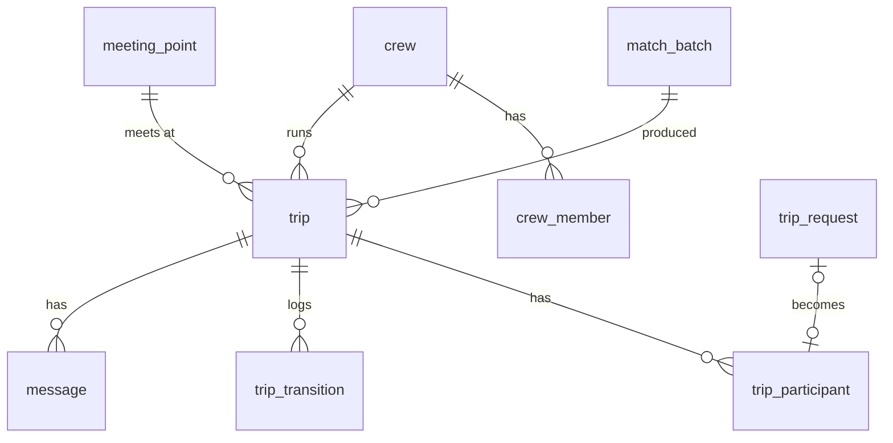

### 8.1 `match_batch`

Every run of the matcher, for replay, the playground and shadow comparison.

| Column            | Type               | Rules                                                                  |
| ----------------- | ------------------ | ---------------------------------------------------------------------- |
| id                | uuid PK            |                                                                        |
| campus_id         | uuid → campus      |                                                                        |
| mode              | text               | `live \| planned \| shadow \| replay`                                  |
| algorithm         | text               | e.g. `matching@1.3.0`                                                  |
| seed              | bigint             | all randomness comes from this                                         |
| as_of             | timestamptz        | the injected clock value                                               |
| input_hash        | text               | SHA-256 of the canonical input; same input → same output               |
| input             | jsonb              | anonymised input (cells, windows, constraints), for replay             |
| result            | jsonb              | groups, unmatched, scores                                              |
| metrics           | jsonb              | `{requests, crews, unmatched, savedMetres, meanDetourPct, durationMs}` |
| baseline_batch_id | uuid → match_batch | for shadow/replay comparisons                                          |
| created_at        | timestamptz        |                                                                        |

Retention: 60 days (input/result can be large).

### 8.2 `crew`

A stable group. The matcher reuses an active crew when the same members match again in the
same direction and mode, so the ledger and fairness build up over weeks.

| Column                 | Type           | Rules                                                                         |
| ---------------------- | -------------- | ----------------------------------------------------------------------------- |
| id                     | uuid PK        |                                                                               |
| campus_id              | uuid → campus  |                                                                               |
| direction              | text           |                                                                               |
| mode                   | text           | one of the modes                                                              |
| vehicle_id             | uuid → vehicle | nullable; set for own car/bike                                                |
| member_hash            | text           | SHA-256 of sorted member ids; index (campus_id, member_hash, direction, mode) |
| status                 | text           | `active \| dissolved`                                                         |
| created_at, updated_at | timestamptz    |                                                                               |

### 8.3 `crew_member`

| Column    | Type            | Rules                                                   |
| --------- | --------------- | ------------------------------------------------------- |
| id        | uuid PK         |                                                         |
| campus_id | uuid → campus   |                                                         |
| crew_id   | uuid → crew     |                                                         |
| user_id   | uuid → app_user |                                                         |
| joined_at | timestamptz     |                                                         |
| left_at   | timestamptz     | partial unique (crew_id, user_id) where left_at is null |

### 8.4 `trip`

| Column                               | Type                      | Rules                                                                                                                |
| ------------------------------------ | ------------------------- | -------------------------------------------------------------------------------------------------------------------- |
| id                                   | uuid PK                   |                                                                                                                      |
| campus_id                            | uuid → campus             |                                                                                                                      |
| crew_id                              | uuid → crew               |                                                                                                                      |
| batch_id                             | uuid → match_batch        | nullable (solo trips have none)                                                                                      |
| direction                            | text                      |                                                                                                                      |
| mode                                 | text                      |                                                                                                                      |
| gate_id                              | uuid → campus_gate        |                                                                                                                      |
| meeting_point_id                     | uuid → meeting_point      |                                                                                                                      |
| booker_id                            | uuid → app_user           | last drop-off (fairness may rotate)                                                                                  |
| planned_depart_at                    | timestamptz               |                                                                                                                      |
| status                               | text                      | `proposed \| confirmed \| boarding \| in_progress \| arrived \| completed \| cancelled \| safety_check \| escalated` |
| next_action_at                       | timestamptz               | when the scheduler must look again; partial index where status not in (completed, cancelled)                         |
| version                              | integer                   | optimistic lock; every update `where version = $v`                                                                   |
| expected_route                       | geometry(LineString,4326) | gate → stops in drop order                                                                                           |
| expected_metres                      | integer                   |                                                                                                                      |
| explanation                          | jsonb                     | "why this crew": shared sections, detour per member, fairness notes                                                  |
| started_at, arrived_at, completed_at | timestamptz               |                                                                                                                      |
| cancel_reason                        | text                      |                                                                                                                      |
| created_at, updated_at               | timestamptz               |                                                                                                                      |

### 8.5 `trip_participant`

| Column                                                  | Type                | Rules                                                                                                   |
| ------------------------------------------------------- | ------------------- | ------------------------------------------------------------------------------------------------------- |
| id                                                      | uuid PK             |                                                                                                         |
| campus_id                                               | uuid → campus       |                                                                                                         |
| trip_id                                                 | uuid → trip         |                                                                                                         |
| user_id                                                 | uuid → app_user     |                                                                                                         |
| trip_request_id                                         | uuid → trip_request |                                                                                                         |
| status                                                  | text                | `invited \| standby \| confirmed \| declined \| replaced \| no_show \| boarded \| arrived_safe \| left` |
| standby_rank                                            | smallint            | for `standby` rows                                                                                      |
| stop_order                                              | smallint            | drop-off (from campus) or pick-up (to campus) order                                                     |
| solo_metres                                             | integer             | gate ↔ home alone                                                                                       |
| detour_pct                                              | smallint            |                                                                                                         |
| share_preview_bp                                        | integer             | Shapley share preview in basis points (sum 10 000 per trip)                                             |
| running_late_min                                        | smallint            |                                                                                                         |
| confirmed_at, boarded_at, arrived_at, safe_confirmed_at | timestamptz         |                                                                                                         |
| created_at, updated_at                                  | timestamptz         |                                                                                                         |

Unique (trip_id, user_id).

### 8.6 `trip_transition` (append-only)

| Column      | Type            | Rules            |
| ----------- | --------------- | ---------------- |
| id          | uuid PK         |                  |
| campus_id   | uuid → campus   |                  |
| trip_id     | uuid → trip     |                  |
| from_status | text            |                  |
| to_status   | text            |                  |
| actor       | text            | `user \| system` |
| actor_id    | uuid → app_user | nullable         |
| reason      | text            |                  |
| at          | timestamptz     |                  |

### 8.7 `message`

| Column     | Type            | Rules                            |
| ---------- | --------------- | -------------------------------- |
| id         | uuid PK         | uuidv7 → cursor pagination by id |
| campus_id  | uuid → campus   |                                  |
| trip_id    | uuid → trip     |                                  |
| sender_id  | uuid → app_user | nullable for system messages     |
| kind       | text            | `text \| system \| running_late` |
| body       | text            | 1–1000 chars                     |
| created_at | timestamptz     |                                  |

Index (trip_id, id). Retention: deleted 30 days after the trip completes.

---

## 9. Safety and trust

### 9.1 `sos_event`

| Column          | Type                 | Rules                                                                       |
| --------------- | -------------------- | --------------------------------------------------------------------------- |
| id              | uuid PK              |                                                                             |
| campus_id       | uuid → campus        |                                                                             |
| trip_id         | uuid → trip          |                                                                             |
| user_id         | uuid → app_user      |                                                                             |
| location        | geometry(Point,4326) | **PII**; the one location Pulse stores, because an emergency needs a record |
| note            | text                 |                                                                             |
| acknowledged_at | timestamptz          |                                                                             |
| acknowledged_by | uuid → app_user      |                                                                             |
| resolved_at     | timestamptz          |                                                                             |
| created_at      | timestamptz          |                                                                             |

Retention: 90 days, then the location is nulled.

### 9.2 `safety_check`

| Column       | Type            | Rules                                                    |
| ------------ | --------------- | -------------------------------------------------------- |
| id           | uuid PK         |                                                          |
| campus_id    | uuid → campus   |                                                          |
| trip_id      | uuid → trip     |                                                          |
| user_id      | uuid → app_user | nullable = whole crew                                    |
| reason       | text            | `route_deviation \| long_stop \| no_safe_arrival \| sos` |
| status       | text            | `open \| escalated \| resolved`                          |
| escalate_at  | timestamptz     | open + 3 min without "I'm OK"                            |
| escalated_at | timestamptz     |                                                          |
| resolved_at  | timestamptz     |                                                          |
| resolution   | text            | `user_ok \| false_alarm \| admin_closed`                 |
| created_at   | timestamptz     |                                                          |

### 9.3 `rating`

| Column     | Type            | Rules                                                      |
| ---------- | --------------- | ---------------------------------------------------------- |
| id         | uuid PK         |                                                            |
| campus_id  | uuid → campus   |                                                            |
| trip_id    | uuid → trip     |                                                            |
| author_id  | uuid → app_user |                                                            |
| subject_id | uuid → app_user | check subject ≠ author                                     |
| score      | smallint        | 1–5                                                        |
| tags       | text[]          | from a fixed list (`on_time`, `friendly`, `late`, `rude`…) |
| created_at | timestamptz     |                                                            |

Unique (trip_id, author_id, subject_id). Ratings are private: nobody sees individual ratings.

### 9.4 `report`

| Column                  | Type            | Rules                                                         |
| ----------------------- | --------------- | ------------------------------------------------------------- |
| id                      | uuid PK         |                                                               |
| campus_id               | uuid → campus   |                                                               |
| author_id               | uuid → app_user |                                                               |
| subject_id              | uuid → app_user |                                                               |
| trip_id                 | uuid → trip     | nullable                                                      |
| category                | text            | `harassment \| unsafe_driving \| no_show \| payment \| other` |
| description             | text            | ≤ 2000 chars                                                  |
| status                  | text            | `open \| reviewing \| actioned \| dismissed`                  |
| handled_by              | uuid → app_user |                                                               |
| resolution              | text            |                                                               |
| created_at, resolved_at | timestamptz     |                                                               |

### 9.5 `block`

| Column     | Type            | Rules   |
| ---------- | --------------- | ------- |
| blocker_id | uuid → app_user | PK part |
| blocked_id | uuid → app_user | PK part |
| campus_id  | uuid → campus   |         |
| created_at | timestamptz     |         |

The matcher treats a block as symmetric: neither person is ever grouped with the other.

### 9.6 `moderation_action`

| Column     | Type            | Rules                          |
| ---------- | --------------- | ------------------------------ |
| id         | uuid PK         |                                |
| campus_id  | uuid → campus   |                                |
| user_id    | uuid → app_user |                                |
| action     | text            | `warn \| suspend \| unsuspend` |
| reason     | text            |                                |
| report_id  | uuid → report   | nullable                       |
| until      | timestamptz     | for `suspend`                  |
| actor_id   | uuid → app_user |                                |
| created_at | timestamptz     |                                |

### 9.7 `sim_sms`

Simulated SMS (proposal: "real SMS delivery" is out of scope). Shown in the admin SMS inbox.

| Column          | Type                | Rules    |
| --------------- | ------------------- | -------- |
| id              | uuid PK             |          |
| campus_id       | uuid → campus       |          |
| to_phone_e164   | text                | **PII**  |
| body            | text                |          |
| safety_check_id | uuid → safety_check | nullable |
| sos_event_id    | uuid → sos_event    | nullable |
| created_at      | timestamptz         |          |

---

## 10. Money

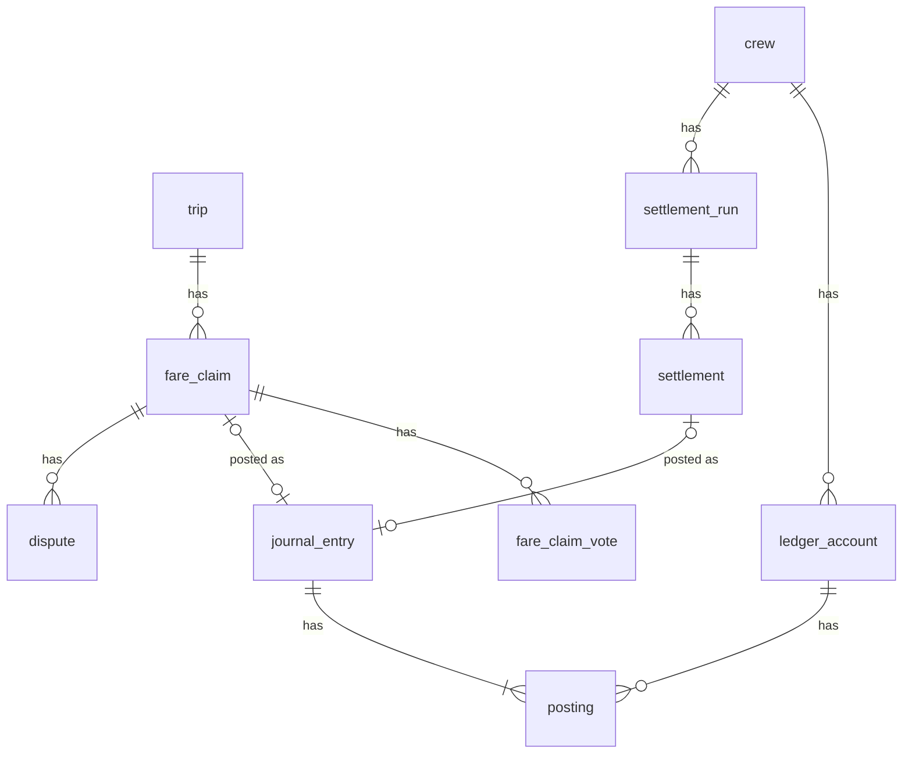

**Sign convention**: a posting's `amount_paisa` is positive when the account holder is **owed**
money, negative when they **owe**. Each journal entry's postings sum to exactly zero.

Example: booker B pays a ৳300 CNG for B, C, D with Shapley shares 80 / 100 / 120:

| Account | Posting                | Meaning                                  |
| ------- | ---------------------- | ---------------------------------------- |
| B       | +30000 − 8000 = +22000 | B paid ৳300 and owes their own ৳80 share |
| C       | −10000                 | C owes 100                               |
| D       | −12000                 | D owes 120                               |
| **Sum** | **0**                  |                                          |

(The service writes one posting per account per entry: B's +30000 and −8000 are combined.)

### 10.1 `fare_claim`

| Column                 | Type                 | Rules                                                          |
| ---------------------- | -------------------- | -------------------------------------------------------------- |
| id                     | uuid PK              |                                                                |
| campus_id              | uuid → campus        |                                                                |
| trip_id                | uuid → trip          | unique where status ≠ `withdrawn` (one live claim per trip)    |
| crew_id                | uuid → crew          |                                                                |
| booker_id              | uuid → app_user      |                                                                |
| amount_paisa           | bigint               | 1 – 500 000 (৳5,000 cap)                                       |
| shares                 | jsonb                | `[{userId, paisa, shapleyCostMetres}]`; sums exactly to amount |
| receipt_file_id        | uuid → file_object   | nullable                                                       |
| status                 | text                 | `pending \| posted \| disputed \| withdrawn`                   |
| confirm_by             | timestamptz          | created + 24 h; then auto-posted unless disputed               |
| entry_id               | uuid → journal_entry | when posted                                                    |
| created_at, updated_at | timestamptz          |                                                                |

### 10.2 `fare_claim_vote`

| Column     | Type              | Rules                |
| ---------- | ----------------- | -------------------- |
| claim_id   | uuid → fare_claim | PK part              |
| user_id    | uuid → app_user   | PK part              |
| campus_id  | uuid → campus     |                      |
| decision   | text              | `confirm \| dispute` |
| created_at | timestamptz       |                      |

### 10.3 `ledger_account`

| Column     | Type            | Rules |
| ---------- | --------------- | ----- |
| id         | uuid PK         |       |
| campus_id  | uuid → campus   |       |
| crew_id    | uuid → crew     |       |
| user_id    | uuid → app_user |       |
| created_at | timestamptz     |       |

Unique (crew_id, user_id). Balance = sum of its postings (a view `v_account_balance`).

### 10.4 `journal_entry` (append-only)

| Column            | Type                 | Rules                                                |
| ----------------- | -------------------- | ---------------------------------------------------- |
| id                | uuid PK              |                                                      |
| campus_id         | uuid → campus        |                                                      |
| crew_id           | uuid → crew          |                                                      |
| trip_id           | uuid → trip          | nullable                                             |
| kind              | text                 | `fare \| settlement \| reversal \| adjustment`       |
| amount_paisa      | bigint               | the headline amount, for display                     |
| description       | text                 |                                                      |
| receipt_file_id   | uuid → file_object   | nullable                                             |
| reverses_entry_id | uuid → journal_entry | for `reversal` (mistakes are reversed, never edited) |
| created_by        | uuid → app_user      | nullable for system                                  |
| created_at        | timestamptz          |                                                      |

### 10.5 `posting` (append-only)

| Column       | Type                  | Rules     |
| ------------ | --------------------- | --------- |
| id           | uuid PK               |           |
| campus_id    | uuid → campus         |           |
| entry_id     | uuid → journal_entry  |           |
| account_id   | uuid → ledger_account |           |
| amount_paisa | bigint                | check ≠ 0 |

Unique (entry_id, account_id). **Balance guarantee**: a `constraint trigger … deferrable
initially deferred` on `posting` checks at commit that each touched entry sums to zero and has
at least two postings. So even a buggy service cannot commit money that appears or vanishes.

### 10.6 `dispute`

| Column                  | Type                 | Rules                            |
| ----------------------- | -------------------- | -------------------------------- |
| id                      | uuid PK              |                                  |
| campus_id               | uuid → campus        |                                  |
| fare_claim_id           | uuid → fare_claim    | nullable                         |
| entry_id                | uuid → journal_entry | nullable (dispute after posting) |
| raised_by               | uuid → app_user      |                                  |
| reason                  | text                 |                                  |
| status                  | text                 | `open \| upheld \| rejected`     |
| resolution_note         | text                 |                                  |
| resolved_by             | uuid → app_user      |                                  |
| created_at, resolved_at | timestamptz          |                                  |

Check: exactly one of fare_claim_id / entry_id is set.

### 10.7 `settlement_run`

| Column         | Type          | Rules                                  |
| -------------- | ------------- | -------------------------------------- |
| id             | uuid PK       |                                        |
| campus_id      | uuid → campus |                                        |
| crew_id        | uuid → crew   |                                        |
| period_start   | date          | Saturday of the week (campus timezone) |
| period_end     | date          |                                        |
| transfer_count | smallint      | the proven minimum                     |
| created_at     | timestamptz   |                                        |

Unique (crew_id, period_start): the weekly job can run twice without harm.

### 10.8 `settlement`

| Column       | Type                  | Rules                          |
| ------------ | --------------------- | ------------------------------ |
| id           | uuid PK               |                                |
| campus_id    | uuid → campus         |                                |
| run_id       | uuid → settlement_run |                                |
| crew_id      | uuid → crew           |                                |
| from_user_id | uuid → app_user       |                                |
| to_user_id   | uuid → app_user       | check ≠ from                   |
| amount_paisa | bigint                | > 0                            |
| status       | text                  | `pending \| paid \| cancelled` |
| reference    | text                  | simulated bKash transaction id |
| entry_id     | uuid → journal_entry  | when paid                      |
| paid_at      | timestamptz           |                                |
| created_at   | timestamptz           |                                |

---

## 11. Shuttles

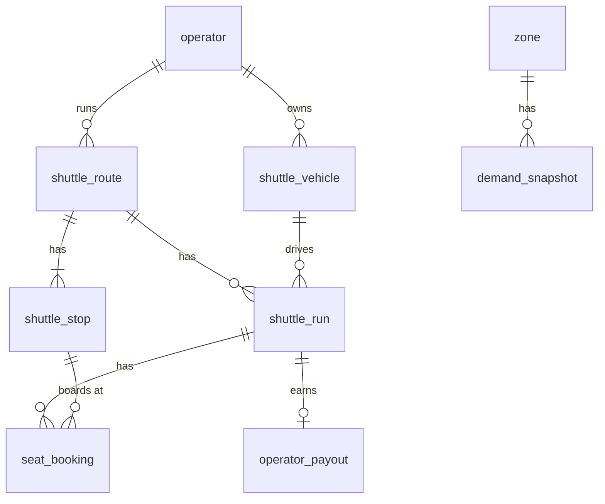

### 11.1 `operator`

| Column                 | Type            | Rules                               |
| ---------------------- | --------------- | ----------------------------------- |
| id                     | uuid PK         |                                     |
| campus_id              | uuid → campus   |                                     |
| owner_id               | uuid → app_user | role becomes `operator` on approval |
| name                   | text            |                                     |
| status                 | text            | `pending \| approved \| suspended`  |
| approved_by            | uuid → app_user |                                     |
| created_at, updated_at | timestamptz     |                                     |

### 11.2 `shuttle_vehicle`

| Column      | Type            | Rules                        |
| ----------- | --------------- | ---------------------------- |
| id          | uuid PK         |                              |
| campus_id   | uuid → campus   |                              |
| operator_id | uuid → operator |                              |
| type        | text            | `microbus \| minibus \| bus` |
| seats       | smallint        | 4–60                         |
| plate       | text            |                              |
| driver_name | text            |                              |
| is_active   | boolean         |                              |
| created_at  | timestamptz     |                              |

### 11.3 `shuttle_route`

| Column                 | Type                      | Rules                             |
| ---------------------- | ------------------------- | --------------------------------- |
| id                     | uuid PK                   |                                   |
| campus_id              | uuid → campus             |                                   |
| operator_id            | uuid → operator           |                                   |
| name                   | text                      |                                   |
| direction              | text                      |                                   |
| path                   | geometry(LineString,4326) |                                   |
| status                 | text                      | `proposed \| approved \| retired` |
| suggested_by_system    | boolean                   |                                   |
| created_at, updated_at | timestamptz               |                                   |

### 11.4 `shuttle_stop`

| Column     | Type                 | Rules                   |
| ---------- | -------------------- | ----------------------- |
| id         | uuid PK              |                         |
| campus_id  | uuid → campus        |                         |
| route_id   | uuid → shuttle_route | on delete cascade       |
| seq        | smallint             | unique (route_id, seq)  |
| name       | text                 |                         |
| location   | geometry(Point,4326) |                         |
| cell       | text                 |                         |
| offset_min | smallint             | minutes after departure |

### 11.5 `shuttle_run`

| Column                  | Type                   | Rules                                                       |
| ----------------------- | ---------------------- | ----------------------------------------------------------- |
| id                      | uuid PK                |                                                             |
| campus_id               | uuid → campus          |                                                             |
| route_id                | uuid → shuttle_route   |                                                             |
| vehicle_id              | uuid → shuttle_vehicle |                                                             |
| departs_at              | timestamptz            |                                                             |
| seat_price_paisa        | bigint                 | ≥ 0                                                         |
| seats_total             | smallint               | copied from the vehicle                                     |
| status                  | text                   | `scheduled \| boarding \| departed \| arrived \| cancelled` |
| departed_at, arrived_at | timestamptz            |                                                             |
| created_at, updated_at  | timestamptz            |                                                             |

### 11.6 `seat_booking`

| Column                 | Type                | Rules                                                           |
| ---------------------- | ------------------- | --------------------------------------------------------------- |
| id                     | uuid PK             |                                                                 |
| campus_id              | uuid → campus       |                                                                 |
| run_id                 | uuid → shuttle_run  |                                                                 |
| user_id                | uuid → app_user     |                                                                 |
| stop_id                | uuid → shuttle_stop |                                                                 |
| seat_no                | smallint            | assigned by min-cost flow at boarding; unique (run_id, seat_no) |
| status                 | text                | `booked \| cancelled \| checked_in \| no_show`                  |
| boarding_token_hash    | text                | the QR pass is an HMAC-signed token; only its hash is stored    |
| checked_in_at          | timestamptz         |                                                                 |
| created_at, updated_at | timestamptz         |                                                                 |

Partial unique (run_id, user_id) where status in (booked, checked_in). A booking takes a row lock
on the run (`select … for update`) and counts seats, so a run can never be overbooked.

### 11.7 `operator_payout`

| Column       | Type               | Rules                    |
| ------------ | ------------------ | ------------------------ |
| id           | uuid PK            |                          |
| campus_id    | uuid → campus      |                          |
| operator_id  | uuid → operator    |                          |
| run_id       | uuid → shuttle_run | unique                   |
| amount_paisa | bigint             | checked-in seats × price |
| status       | text               | `simulated`              |
| created_at   | timestamptz        |                          |

### 11.8 `demand_snapshot`

What operators see. Computed by a job, never from live rows at request time.

| Column       | Type          | Rules                                                                |
| ------------ | ------------- | -------------------------------------------------------------------- |
| id           | uuid PK       |                                                                      |
| campus_id    | uuid → campus |                                                                      |
| zone_id      | uuid → zone   |                                                                      |
| direction    | text          |                                                                      |
| slot_start   | timestamptz   | 30-minute slot                                                       |
| noisy_count  | integer       | Laplace-noised count, rounded, ≥ 0; **null when the true count < 3** |
| epsilon      | real          | privacy budget used                                                  |
| generated_at | timestamptz   |                                                                      |

Unique (zone_id, direction, slot_start). Regenerating replaces, it never re-noises the same slot
(that would leak the true count by averaging).

---

## 12. Notifications

### 12.1 `notification`

| Column                       | Type            | Rules                                                                                                                                                                        |
| ---------------------------- | --------------- | ---------------------------------------------------------------------------------------------------------------------------------------------------------------------------- |
| id                           | uuid PK         |                                                                                                                                                                              |
| campus_id                    | uuid → campus   |                                                                                                                                                                              |
| user_id                      | uuid → app_user |                                                                                                                                                                              |
| kind                         | text            | e.g. `crew_proposed`, `trip_confirmed`, `trip_reminder`, `member_late`, `safety_check`, `fare_to_confirm`, `settlement_due`, `class_changed`, `waitlist_unlocked`, `welcome` |
| priority                     | text            | `critical \| normal \| low`; critical skips budget and quiet hours                                                                                                           |
| title                        | text            |                                                                                                                                                                              |
| body                         | text            |                                                                                                                                                                              |
| data                         | jsonb           | deep link and ids only, no PII                                                                                                                                               |
| dedupe_key                   | text            | unique; e.g. `crew_proposed:<tripId>:<userId>`                                                                                                                               |
| status                       | text            | `pending \| sent \| read \| suppressed \| failed`                                                                                                                            |
| channel                      | text            | final channel that succeeded: `push \| in_app \| email`                                                                                                                      |
| created_at, sent_at, read_at | timestamptz     |                                                                                                                                                                              |

Index (user_id, created_at desc). Retention: 90 days.

### 12.2 `notification_attempt`

| Column          | Type                | Rules                     |
| --------------- | ------------------- | ------------------------- |
| id              | uuid PK             |                           |
| campus_id       | uuid → campus       |                           |
| notification_id | uuid → notification |                           |
| channel         | text                |                           |
| outcome         | text                | `ok \| failed \| skipped` |
| error           | text                | short, no PII             |
| at              | timestamptz         |                           |

### 12.3 `calendar_feed_token` (PK = user_id)

| Column     | Type               | Rules                               |
| ---------- | ------------------ | ----------------------------------- |
| user_id    | uuid PK → app_user |                                     |
| campus_id  | uuid → campus      |                                     |
| token_hash | text               | unique; the URL holds the raw token |
| created_at | timestamptz        |                                     |

---

## 13. Platform, AI and infrastructure tables

### 13.1 `file_object`

| Column       | Type            | Rules                                                           |
| ------------ | --------------- | --------------------------------------------------------------- |
| id           | uuid PK         |                                                                 |
| campus_id    | uuid → campus   |                                                                 |
| owner_id     | uuid → app_user | nullable for system files                                       |
| purpose      | text            | `timetable \| receipt \| avatar \| export \| onboarding_sample` |
| storage_key  | text            | unique; `campus/<id>/<purpose>/<uuid>`                          |
| content_type | text            | verified by magic bytes                                         |
| size_bytes   | integer         | limits: timetable 10 MB, receipt 3 MB, avatar 1 MB              |
| sha256       | text            |                                                                 |
| status       | text            | `uploaded \| accepted \| rejected \| deleted`                   |
| expires_at   | timestamptz     | exports and staging files expire                                |
| created_at   | timestamptz     |                                                                 |

### 13.2 `onboarding_spec`

| Column                 | Type               | Rules                                                             |
| ---------------------- | ------------------ | ----------------------------------------------------------------- |
| id                     | uuid PK            |                                                                   |
| campus_id              | uuid → campus      |                                                                   |
| source_file_id         | uuid → file_object | a **public** timetable file                                       |
| spec                   | jsonb              | the declarative parser spec ([09](09-ai-and-ml.md))               |
| validation_report      | jsonb              | `{rows, valid, errors[], checks{days,times,uniqueIds}}`           |
| rounds                 | smallint           | revise-and-validate rounds used (max 4)                           |
| model                  | text               | e.g. the Gemini model name                                        |
| status                 | text               | `queued \| running \| proposed \| approved \| rejected \| failed` |
| approved_by            | uuid → app_user    |                                                                   |
| created_at, decided_at | timestamptz        |                                                                   |

### 13.3 `ml_model` (global)

| Column          | Type        | Rules                                              |
| --------------- | ----------- | -------------------------------------------------- |
| id              | uuid PK     |                                                    |
| kind            | text        | `forecast \| request_parser`                       |
| version         | text        | semver; unique (kind, version)                     |
| trained_at      | timestamptz |                                                    |
| metrics         | jsonb       | pinball loss, coverage, field accuracy vs baseline |
| artifact_key    | text        | file-store key of the `.onnx`                      |
| artifact_sha256 | text        | checked before loading                             |
| is_active       | boolean     | partial unique (kind) where is_active              |
| activated_by    | uuid        | app_user id (no FK: global table)                  |
| activated_at    | timestamptz |                                                    |

RLS: exempt (global, no personal data). `pulse_app` may `SELECT`, and `UPDATE is_active` only.

### 13.4 `feature_flag`

| Column     | Type          | Rules                                                                                                                           |
| ---------- | ------------- | ------------------------------------------------------------------------------------------------------------------------------- |
| id         | uuid PK       |                                                                                                                                 |
| key        | text          | e.g. `ai.request_model`, `ai.forecast_model`, `ai.onboarding_agent`, `auth.turnstile`, `safety.map_matching`, `shuttle.enabled` |
| campus_id  | uuid → campus | null = global default                                                                                                           |
| enabled    | boolean       |                                                                                                                                 |
| updated_by | uuid          |                                                                                                                                 |
| updated_at | timestamptz   |                                                                                                                                 |

Unique (key, campus_id) `nulls not distinct`. RLS: `campus_id is null or campus_id = current`.
Campus value overrides the global one. Cached in Redis for 30 s.

### 13.5 `audit_log` (append-only)

| Column    | Type            | Rules                                                               |
| --------- | --------------- | ------------------------------------------------------------------- |
| id        | uuid PK         |                                                                     |
| campus_id | uuid → campus   |                                                                     |
| actor_id  | uuid → app_user |                                                                     |
| action    | text            | e.g. `catalog.apply`, `user.suspend`, `flag.set`, `dispute.resolve` |
| entity    | text            |                                                                     |
| entity_id | uuid            |                                                                     |
| metadata  | jsonb           | ids and before/after of non-personal fields only                    |
| ip_hash   | text            |                                                                     |
| at        | timestamptz     |                                                                     |

### 13.6 `analytics_daily`

| Column    | Type             | Rules                                                                                                  |
| --------- | ---------------- | ------------------------------------------------------------------------------------------------------ |
| campus_id | uuid → campus    | PK part                                                                                                |
| on_date   | date             | PK part                                                                                                |
| metric    | text             | PK part: `active_users`, `requests`, `match_rate`, `saved_paisa`, `forecast_pinball`, `fairness_gini`… |
| value     | double precision |                                                                                                        |

Filled by the nightly `analytics.rollup` job.

### 13.7 `outbox_event` (exists)

As in `packages/db/src/schema.ts`: `id`, `seq` (identity), `aggregate`, `aggregate_id`, `type`,
`payload` (jsonb), `created_at`, `published_at`. Partial index on `seq` where unpublished.
**Add (add-only)**: `topic text` and `key text`, written by the producer from `@pulse/events`, so
the relay does not need to know every event type. Retention: published rows deleted after 7 days.

### 13.8 `processed_event` (exists)

`(consumer, event_id)` PK, `processed_at`. Retention: 30 days (longer than Kafka retention, so a
redelivered event is always recognised).

### 13.9 `idempotency_key`

Makes retried POSTs safe (a double tap on "request" or "pay" creates one row).

| Column       | Type            | Rules                                        |
| ------------ | --------------- | -------------------------------------------- |
| user_id      | uuid → app_user | PK part                                      |
| key          | text            | PK part; the `Idempotency-Key` header (UUID) |
| campus_id    | uuid → campus   |                                              |
| request_hash | text            | SHA-256 of method + path + body              |
| status_code  | smallint        |                                              |
| response     | jsonb           |                                              |
| created_at   | timestamptz     | retention 24 h                               |

Same key + different body → `422 IDEMPOTENCY_MISMATCH`.

### 13.10 `scheduled_run`

Makes periodic jobs run once per period, even with two schedulers.

| Column      | Type        | Rules                                         |
| ----------- | ----------- | --------------------------------------------- |
| name        | text        | PK part, e.g. `autopilot.generate:<campusId>` |
| period_key  | text        | PK part, e.g. `2026-11-15`                    |
| started_at  | timestamptz |                                               |
| finished_at | timestamptz |                                               |
| status      | text        | `running \| done \| failed`                   |

Not campus-scoped (infrastructure); exempt from RLS, worker only.

---

## 14. Table count and owners

| Domain                      | Tables                                                                                                                                          | Count  |
| --------------------------- | ----------------------------------------------------------------------------------------------------------------------------------------------- | ------ |
| Campus and geography        | campus, campus_gate, term, zone, meeting_point, cell_distance                                                                                   | 6      |
| Identity and people         | app_user, email_otp, session, preference, vehicle, trusted_contact, push_subscription, reliability, fairness_balance, travel_habit, data_export | 11     |
| Catalog, routine, calendar  | course, catalog_import, section, section_meeting, enrollment, schedule_block, calendar_event, class_change_report, class_change_confirmation    | 9      |
| Requests                    | trip_request, recurring_plan, autopilot_suggestion, request_text_sample, route_waitlist                                                         | 5      |
| Matching, crews, trips      | match_batch, crew, crew_member, trip, trip_participant, trip_transition, message                                                                | 7      |
| Safety                      | sos_event, safety_check, rating, report, block, moderation_action, sim_sms                                                                      | 7      |
| Money                       | fare_claim, fare_claim_vote, ledger_account, journal_entry, posting, dispute, settlement_run, settlement                                        | 8      |
| Shuttles                    | operator, shuttle_vehicle, shuttle_route, shuttle_stop, shuttle_run, seat_booking, operator_payout, demand_snapshot                             | 8      |
| Notifications               | notification, notification_attempt, calendar_feed_token                                                                                         | 3      |
| Platform and infrastructure | file_object, onboarding_spec, ml_model, feature_flag, audit_log, analytics_daily, outbox_event, processed_event, idempotency_key, scheduled_run | 10     |
| **Total**                   |                                                                                                                                                 | **74** |

Views: `v_account_balance`, `v_forecast_training` (anonymised: weekday, class gaps, offsets, no
user ids), `v_week_schedule` (a user's meetings with calendar overrides applied).

## 15. Redis keys

Redis holds only short-lived or rebuildable data. Losing Redis loses no truth.

| Key                               | Type        | TTL          | Purpose                                            |
| --------------------------------- | ----------- | ------------ | -------------------------------------------------- |
| `rl:{route}:{ipHash or userId}`   | counter     | window       | Rate limits (`@nestjs/throttler` Redis store)      |
| `otp:send:{emailHash}`            | counter     | 1 h          | Max 5 codes per email per hour                     |
| `loc:{tripId}:{userId}`           | hash        | 120 s        | Latest location (lat, lng, accuracy, ts)           |
| `loc:trail:{tripId}:{userId}`     | list (≤ 60) | trip end + 0 | Recent points for the monitor; deleted at trip end |
| `flags:{campusId}`                | hash        | 30 s         | Feature flag cache                                 |
| `matcher:dirty`                   | set         | none         | Campuses with new requests since the last batch    |
| `outlook:{campusId}:{dir}:{cell}` | string      | 60 s         | Cached wait-or-go outlook                          |
| `socket.io#…`                     | adapter     | n/a          | Socket.IO Redis adapter channels                   |
| `notify:budget:{userId}:{date}`   | counter     | 36 h         | Normal/low notifications sent today                |

## 16. Retention summary

| Data                       | Kept for                                                         | Job                         |
| -------------------------- | ---------------------------------------------------------------- | --------------------------- |
| Live locations             | trip duration (Redis TTL)                                        | Redis + trip end            |
| Chat messages              | 30 days after the trip                                           | `retention.purge`           |
| `email_otp`                | 24 h                                                             | `retention.purge`           |
| Revoked/expired `session`  | 30 days                                                          | `retention.purge`           |
| `idempotency_key`          | 24 h                                                             | `retention.purge`           |
| Published `outbox_event`   | 7 days                                                           | `retention.purge`           |
| `processed_event`          | 30 days                                                          | `retention.purge`           |
| `notification`             | 90 days                                                          | `retention.purge`           |
| SOS location               | 90 days, then nulled                                             | `retention.purge`           |
| `match_batch` input/result | 60 days                                                          | `retention.purge`           |
| Ledger, audit log          | forever (append-only)                                            | none                        |
| Deleted account            | PII overwritten at once; ledger rows keep the anonymised user id | `export.user` / delete flow |
