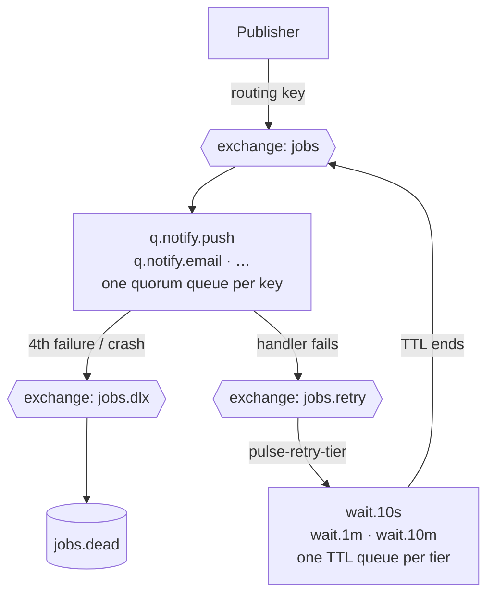

# 05 · Events (Kafka) and jobs (RabbitMQ)

**Events are facts** ("a trip was requested"), named in the past tense, read by many consumers,
kept and replayable. **Jobs are commands** ("send this push"), done once by one worker, retried
on failure. Never mix them (CLAUDE.md rule 3).

## 1. Event rules

| Rule                  | Detail                                                                                                                                                                        |
| --------------------- | ----------------------------------------------------------------------------------------------------------------------------------------------------------------------------- |
| Envelope              | ADR 0005: `{eventId, type, version, occurredAt, payload}`. Checked by Zod with `parseEvent`.                                                                                  |
| `campusId` in payload | Every campus-scoped event's payload has `campusId`, because the envelope has no campus field and consumers need it for `withCampus()`.                                        |
| Add-only              | Never rename or remove a payload field; a breaking change is a new `version` with its own schema. The baseline test in `@pulse/events` enforces it.                           |
| Producer              | Writes the outbox row (`type`, `payload`, `topic`, `key`) in the same transaction as the change. Nobody calls Kafka from a request handler.                                   |
| Consumer              | Inserts `processed_event (consumer, eventId)` in the same transaction as its effect. Unknown event types are skipped and logged, never crash the consumer.                    |
| No personal data      | Payloads carry ids, cells, times and statuses. Never emails, phones, names, exact locations (except `LocationReported`, short retention), message bodies or grades.           |
| Ordering              | Only within a key. A consumer must not assume order across keys or topics; it re-reads PostgreSQL when it needs the current state.                                            |
| Failures              | A consumer retries a failing event 3 times in-process (1 s, 5 s, 30 s), then writes it to `<topic>.dlq` with the error and moves on. An admin replays DLQ events after a fix. |

## 2. Topics

| Topic           | Key                                         | Partitions | Retention | Notes                                                |
| --------------- | ------------------------------------------- | ---------- | --------- | ---------------------------------------------------- |
| `campuses`      | `campusId`                                  | 1          | 30 days   | Campus, term, catalog, onboarding, models            |
| `profiles`      | `userId`                                    | 3          | compacted | Latest snapshot per user; tombstone on deletion      |
| `calendar`      | `sectionId` (or `campusId` for campus-wide) | 3          | 30 days   | Class changes stay in order per section              |
| `trip-requests` | `campusId`                                  | 3          | 30 days   | One matcher instance owns each campus                |
| `trips`         | `tripId`                                    | 3          | 30 days   | A trip's lifecycle in order                          |
| `ledger`        | `crewId`                                    | 3          | 90 days   | Money events per crew in order                       |
| `locations`     | `tripId`                                    | 3          | 1 day     | High volume; route-deviation checks                  |
| `shuttles`      | `runId`                                     | 3          | 30 days   | **New** (needs `topics.ts` + architecture.md update) |
| `moderation`    | `subjectId`                                 | 1          | 90 days   | **New**: reports, warnings, suspensions              |
| `<topic>.dlq`   | same                                        | 1          | 30 days   | One dead-letter topic per topic                      |

30-day retention matters: the simulator replay and shadow matching read a recorded day back from
`trip-requests`.

## 3. Event catalogue

Every payload below also contains `campusId` unless marked _global_. Types are TypeScript-ish;
`cell` = H3 r8 string; times are ISO strings.

### 3.1 `campuses`

| Event                       | Payload                                                                 | Producer | Consumers                                              |
| --------------------------- | ----------------------------------------------------------------------- | -------- | ------------------------------------------------------ |
| `CampusCreated` v1 (exists) | `{campusId, slug, name, emailDomains, timezone}`                        | campus   | notifier (welcome email to platform admins), analytics |
| `CampusUpdated`             | `{campusId, changed: string[]}`                                         | campus   | analytics                                              |
| `TermActivated`             | `{campusId, termId, name, startsOn, endsOn}`                            | campus   | notifier (re-import your routine), projector           |
| `CatalogImported`           | `{campusId, termId, importId, sections, cancelledSectionIds: string[]}` | catalog  | replanner (cancelled sections), notifier               |
| `OnboardingSpecProposed`    | `{campusId, specId, valid: boolean, rounds}`                            | ai job   | notifier (campus admins)                               |
| `OnboardingSpecApproved`    | `{campusId, specId}`                                                    | ai       | analytics                                              |
| `ModelActivated` _global_   | `{modelId, kind, version}`                                              | ai       | API instances reload the model                         |

### 3.2 `profiles` (compacted)

| Event            | Payload                                                                                              | Producer | Consumers                            |
| ---------------- | ---------------------------------------------------------------------------------------------------- | -------- | ------------------------------------ |
| `UserRegistered` | `{campusId, userId, role}`                                                                           | auth     | notifier (welcome), analytics        |
| `ProfileChanged` | `{campusId, userId, role, status, zoneId, homeCell, genderPref, modes, autopilotOn}` (full snapshot) | users    | projector (matcher cache), analytics |
| `RoutineChanged` | `{campusId, userId, termId, sectionCount}`                                                           | routine  | projector (Autopilot), analytics     |
| `UserDeleted`    | `{campusId, userId}` followed by a tombstone (null value) for the key                                | users    | every consumer drops cached data     |

### 3.3 `calendar`

| Event                    | Payload                                                                 | Producer | Consumers           |
| ------------------------ | ----------------------------------------------------------------------- | -------- | ------------------- |
| `ClassCancelled`         | `{campusId, termId, sectionId, onDate, calendarEventId}`                | calendar | replanner, notifier |
| `ClassRescheduled`       | `{…, onDate, newDate, newStartTime, newEndTime}`                        | calendar | replanner, notifier |
| `ExtraClassAdded`        | `{…, onDate, startTime, endTime}`                                       | calendar | replanner, notifier |
| `HolidayDeclared`        | `{campusId, termId, onDate, endDate, kind: 'holiday' \| 'exam_period'}` | calendar | replanner, notifier |
| `CalendarEventWithdrawn` | `{campusId, calendarEventId, sectionId?}`                               | calendar | replanner           |

### 3.4 `trip-requests`

| Event                  | Payload                                                                                                                                         | Producer | Consumers                          |
| ---------------------- | ----------------------------------------------------------------------------------------------------------------------------------------------- | -------- | ---------------------------------- |
| `TripRequested`        | `{campusId, requestId, userId, kind, source, direction, homeCell, gateId, windowStart, windowEnd, modes, genderPref, maxWaitMin, maxDetourPct}` | requests | matcher, matcher-shadow, analytics |
| `TripRequestCancelled` | `{campusId, requestId, userId, reason: 'user' \| 'solo' \| 'deleted' \| 'class_cancelled'}`                                                     | requests | matcher, analytics                 |
| `TripRequestExpired`   | `{campusId, requestId, userId}`                                                                                                                 | matcher  | notifier, analytics                |
| `WaitlistUnlocked`     | `{campusId, zoneId, direction, timeSlot, memberIds}`                                                                                            | requests | notifier                           |

### 3.5 `trips`

| Event                             | Payload                                                                                                                        | Producer                      | Consumers                                            |
| --------------------------------- | ------------------------------------------------------------------------------------------------------------------------------ | ----------------------------- | ---------------------------------------------------- |
| `TripProposed`                    | `{campusId, tripId, crewId, batchId, mode, direction, plannedDepartAt, meetingPointId, participantIds, standbyIds, confirmBy}` | matcher (worker)              | notifier, realtime-fanout, analytics                 |
| `MemberConfirmed`                 | `{campusId, tripId, userId}`                                                                                                   | trips                         | realtime-fanout                                      |
| `MemberDeclined`                  | `{campusId, tripId, userId}`                                                                                                   | trips                         | realtime-fanout, projector (reliability)             |
| `MemberReplaced`                  | `{campusId, tripId, outUserId, inUserId}`                                                                                      | trips / scheduler             | notifier, realtime-fanout                            |
| `MemberLeft`                      | `{campusId, tripId, userId, late: boolean}`                                                                                    | trips                         | notifier, projector                                  |
| `MemberRunningLate`               | `{campusId, tripId, userId, minutes}`                                                                                          | trips                         | notifier (crew), realtime-fanout                     |
| `MemberBoarded`                   | `{campusId, tripId, userId}`                                                                                                   | trips                         | realtime-fanout                                      |
| `NoShowRecorded`                  | `{campusId, tripId, userId}`                                                                                                   | scheduler                     | projector (reliability), notifier                    |
| `TripConfirmed`                   | `{campusId, tripId, participantIds, bookerId}`                                                                                 | trips / scheduler             | notifier, realtime-fanout                            |
| `TripBoardingStarted`             | `{campusId, tripId}`                                                                                                           | scheduler                     | notifier (reminder), realtime-fanout                 |
| `TripStarted`                     | `{campusId, tripId, startedAt}`                                                                                                | trips                         | location-monitor, realtime-fanout                    |
| `TripArrived`                     | `{campusId, tripId, arrivedAt}`                                                                                                | trips                         | location-monitor, notifier (fare prompt)             |
| `SafeArrivalConfirmed`            | `{campusId, tripId, userId}`                                                                                                   | trips                         | location-monitor                                     |
| `SafetyCheckStarted`              | `{campusId, tripId, checkId, userId?, reason, escalateAt}`                                                                     | worker monitor / scheduler    | notifier (critical), realtime-fanout                 |
| `SafetyEscalated`                 | `{campusId, tripId, checkId}`                                                                                                  | scheduler                     | notifier (trusted contact SMS, admins)               |
| `SafetyResolved`                  | `{campusId, tripId, checkId, resolution}`                                                                                      | safety                        | realtime-fanout                                      |
| `SosRaised`                       | `{campusId, tripId, sosId, userId}` (no location in the event)                                                                 | safety                        | notifier (critical: crew, admins, trusted contacts)  |
| `SosAcknowledged` / `SosResolved` | `{campusId, sosId, tripId}`                                                                                                    | safety                        | realtime-fanout                                      |
| `TripCompleted`                   | `{campusId, tripId, crewId, participants: [{userId, status, detourPct, stopOrder}], bookerId, mode}`                           | scheduler                     | projector (habits, reliability, fairness), analytics |
| `TripCancelled`                   | `{campusId, tripId, reason}`                                                                                                   | trips / scheduler / replanner | notifier, realtime-fanout, analytics                 |
| `MessagePosted`                   | `{campusId, tripId, messageId, senderId}` (no body)                                                                            | realtime                      | notifier (push if the app is closed)                 |
| `RatingSubmitted`                 | `{campusId, tripId, authorId, subjectId}` (no score)                                                                           | safety                        | analytics                                            |

### 3.6 `ledger`

| Event                | Payload                                                                                     | Producer           | Consumers                  |
| -------------------- | ------------------------------------------------------------------------------------------- | ------------------ | -------------------------- |
| `FareRecorded`       | `{campusId, crewId, tripId, claimId, amountPaisa, confirmBy}`                               | ledger             | notifier (members confirm) |
| `FarePosted`         | `{campusId, crewId, tripId, claimId, entryId, amountPaisa}`                                 | ledger / scheduler | analytics (savings)        |
| `DisputeRaised`      | `{campusId, crewId, disputeId, claimId?, entryId?}`                                         | ledger             | notifier (admins, booker)  |
| `DisputeResolved`    | `{campusId, crewId, disputeId, decision}`                                                   | ledger             | notifier                   |
| `SettlementProposed` | `{campusId, crewId, runId, transfers: [{settlementId, fromUserId, toUserId, amountPaisa}]}` | settle job         | notifier                   |
| `SettlementPaid`     | `{campusId, crewId, settlementId, amountPaisa}`                                             | ledger             | notifier (receiver)        |

### 3.7 `locations`

| Event              | Payload                                               | Producer                              | Consumers        |
| ------------------ | ----------------------------------------------------- | ------------------------------------- | ---------------- |
| `LocationReported` | `{campusId, tripId, userId, lat, lng, accuracyM, at}` | realtime gateway (**direct**, see §6) | location-monitor |

### 3.8 `shuttles`

| Event                                      | Payload                                                             | Producer | Consumers                                            |
| ------------------------------------------ | ------------------------------------------------------------------- | -------- | ---------------------------------------------------- |
| `ShuttleRunPublished`                      | `{campusId, runId, routeId, departsAt, seatsTotal, seatPricePaisa}` | shuttle  | notifier (waitlisted riders on the route), analytics |
| `ShuttleRunCancelled`                      | `{campusId, runId}`                                                 | shuttle  | notifier (booked riders)                             |
| `SeatBooked`                               | `{campusId, runId, bookingId, userId, stopId}`                      | shuttle  | analytics                                            |
| `SeatCancelled`                            | `{campusId, runId, bookingId}`                                      | shuttle  | analytics                                            |
| `SeatsAssigned`                            | `{campusId, runId}`                                                 | shuttle  | notifier (your seat)                                 |
| `RiderCheckedIn`                           | `{campusId, runId, bookingId}`                                      | shuttle  | analytics                                            |
| `ShuttleRunDeparted` / `ShuttleRunArrived` | `{campusId, runId, at}`                                             | shuttle  | notifier, payout projector                           |

### 3.9 `moderation`

| Event                           | Payload                                     | Producer | Consumers                                               |
| ------------------------------- | ------------------------------------------- | -------- | ------------------------------------------------------- |
| `UserReported`                  | `{campusId, reportId, subjectId, category}` | safety   | notifier (admins)                                       |
| `UserBlocked` / `UserUnblocked` | `{campusId, blockerId, subjectId}`          | safety   | projector (matcher cache)                               |
| `UserWarned`                    | `{campusId, subjectId, actionId}`           | admin    | notifier                                                |
| `UserSuspended`                 | `{campusId, subjectId, until}`              | admin    | notifier; auth revokes sessions in the same transaction |
| `UserUnsuspended`               | `{campusId, subjectId}`                     | admin    | notifier                                                |

That is **64 event types** on 9 topics.

## 4. Consumer groups

| Group              | Topics                                     | Effect                                                                                                               |
| ------------------ | ------------------------------------------ | -------------------------------------------------------------------------------------------------------------------- |
| `notifier`         | all except `locations`                     | Decides who to tell; writes `notification` rows; publishes `notify.*` jobs                                           |
| `matcher`          | `trip-requests`                            | Marks the campus dirty; 30 s batches → crews, trips, `TripProposed`                                                  |
| `matcher-shadow`   | `trip-requests` (replay offsets)           | Runs a candidate algorithm into `match_batch` (mode `shadow`), never into trips                                      |
| `replanner`        | `calendar`, `campuses` (`CatalogImported`) | Finds affected requests, suggestions and trips; re-plans or cancels; target < 10 s                                   |
| `projector`        | `trips`, `profiles`, `moderation`          | Updates `travel_habit`, `reliability`, `fairness_balance`, the matcher's profile cache                               |
| `realtime-fanout`  | `trips`, `trip-requests`, `shuttles`       | Emits Socket.IO events through the Redis emitter                                                                     |
| `location-monitor` | `locations`, `trips`                       | Keeps per-trip state; smoothing, map matching, deviation and long-stop detection; opens safety checks via the outbox |
| `analytics`        | all except `locations`                     | Increments daily counters (rolled up nightly)                                                                        |
| `payouts`          | `shuttles`                                 | `ShuttleRunArrived` → `operator_payout`                                                                              |

## 5. Jobs (RabbitMQ)

### 5.1 Topology (`@pulse/jobs`)

- Exchange `jobs` (topic, durable). One **quorum queue** per job type that has a schema:
  `q.<routing key>`. A type gets its queue in the slice that adds its handler.
- Retry: the handler republishes to `jobs.retry` (a headers exchange) with the **original
  routing key** and headers `pulse-failures` and `pulse-retry-tier` (`10s`, `1m`, `10m`, from
  `retryStep`), waits for the publisher confirm, and **only then acks** the original. A crash in
  between gives a duplicate, which the dedupe key absorbs; acking first could lose the job. Each
  wait queue binds on its tier, has a fixed TTL, and dead-letters to `jobs` without
  `x-dead-letter-routing-key`, so the job keeps its key and returns to its own queue. No `x-`
  prefix: a headers exchange ignores binding arguments that start with `x-`.
- Give up: after the 4th failure, or if the broker nacks the retry publish, the handler nacks
  without requeue (on a dropped channel or a confirm timeout it does nothing: the job comes back
  by itself); the queue dead-letters to `jobs.dlx` (fanout) → `jobs.dead`. `x-delivery-limit: 5`
  sends a job returned more than 5 times (it keeps crashing its handler) the same way. RabbitMQ 4
  counts only crashes (the channel closed with the job unacked), not `nack` with requeue, so a
  handler never requeues a failed job: it would loop forever. Dead-lettering is `at-least-once`
  (with `x-overflow: reject-publish`), so a job is never lost between queues.
- Unroutable: `jobs` and `jobs.retry` have `alternate-exchange: jobs.dlx`, so a job no queue is
  bound for lands in `jobs.dead` instead of being dropped (or, coming back from a wait queue,
  held there forever). `jobs.dead` has `x-delivery-limit: -1`: RabbitMQ 4's default of 20 would
  drop a dead job after 20 peeks. Publishers get no error for an unroutable job (the alternate
  exchange takes it), so alert when `jobs.dead` is not empty.
- Full queues: every queue holds at most 100,000 jobs (`x-max-length`, `reject-publish`). A full
  queue nacks a publisher instead of dropping old jobs, so publishers back off and retry. Two
  effects to know: a full `jobs.dead` leaves given-up jobs inside their work queue (out of the
  handlers' sight; the broker tries again every 180 s), and the wait queues are shared, so one job
  type that fills `wait.10m` sends every type's retries to `jobs.dead` (replay them by hand). A
  quorum queue takes one job past its cap before it refuses.
- Queue arguments cannot change once declared (`PRECONDITION_FAILED`); a wait queue's name says
  its delay, so a new delay is a new queue. Changing a cap or a limit is the same: declare a new
  queue name, stop the old workers, move or drain the old queue, then delete it (ADR 0008).
- Handlers **ack only after success**. Prefetch per queue (below).
- `notify.email` templates carry ids only: `campus-created` (`campusId`), `otp` (`otpId`).
- The email worker claims each `dedupeKey` in `email_delivery` before it sends (claim → send →
  mark, ADR 0011), so two copies of a job never both send. A refused SMTP login retries; any other
  SMTP 5xx goes straight to `jobs.dead`.
- Every job has a `jobId` (UUID) and a `dedupeKey`. Jobs are delivered **at least once**, so every
  handler is idempotent (unique `dedupe_key` rows, `scheduled_run`, or a natural upsert).
- Publishers use **publisher confirms**. A consumer publishes its jobs, waits for confirms, and
  only then commits `processed_event`. A crash in between republishes on redelivery, and the
  dedupe key absorbs the duplicate.

### 5.2 Job catalogue

| Routing key          | Payload                                         | Published by                      | Handler                                                                                                 | Prefetch                 | Idempotency                        |
| -------------------- | ----------------------------------------------- | --------------------------------- | ------------------------------------------------------------------------------------------------------- | ------------------------ | ---------------------------------- |
| `notify.push`        | `{notificationId}`                              | notifier                          | Web Push; on 404/410 delete the subscription; failure → fall back to in-app + `notify.email`            | 20                       | `notification_attempt` per channel |
| `notify.email`       | `{template, …ids}` (§5.1) or `{notificationId}` | notifier, auth                    | SMTP (Mailpit in dev)                                                                                   | 10                       | `email_delivery` claim (ADR 0011)  |
| `notify.sms`         | `{simSmsId}`                                    | notifier (safety)                 | Marks the simulated SMS "delivered" (shows in the admin inbox)                                          | 10                       | row status                         |
| `import.timetable`   | `{importId}`                                    | catalog                           | Runs the adapter on the file; writes the staging JSON; status `review`                                  | 1                        | import status machine              |
| `ai.onboarding`      | `{specId}`                                      | ai                                | Gemini propose → validate → revise (≤ 4 rounds)                                                         | **1** (free-tier limits) | spec status machine                |
| `ledger.settle`      | `{campusId, periodStart}`                       | scheduler (Saturday 21:00 local)  | Per crew: balances → minimum transfers → `settlement_run` + `settlement` + `SettlementProposed`         | 1                        | unique (crew_id, period_start)     |
| `autopilot.generate` | `{campusId, forDate}`                           | scheduler (05:00 local daily)     | Suggestions for every Autopilot user                                                                    | 1                        | unique (user, date, direction)     |
| `forecast.retrain`   | `{kind:'forecast', reason}`                     | scheduler (Friday night) or admin | **Python** worker in `services/forecast` trains, evaluates, uploads ONNX, inserts `ml_model` (inactive) | 1                        | version = date + data hash         |
| `export.user`        | `{exportId}`                                    | users                             | Collects the user's data into a JSON zip; signed link by email                                          | 2                        | export status                      |
| `demand.snapshot`    | `{campusId, forDate}`                           | scheduler (hourly)                | Builds `demand_snapshot` with DP noise                                                                  | 1                        | unique (zone, direction, slot)     |
| `analytics.rollup`   | `{campusId, onDate}`                            | scheduler (02:00 local)           | Writes `analytics_daily`                                                                                | 1                        | upsert by PK                       |
| `retention.purge`    | `{}`                                            | scheduler (03:00)                 | Deletes or anonymises per [03](03-data-model.md) §16                                                    | 1                        | naturally idempotent               |

## 6. Exception needing a decision: live locations

CLAUDE.md rule 1 says: never publish to Kafka from a request handler; write an outbox row. Live
locations are **deliberately not stored in PostgreSQL** (privacy promise: deleted when the trip
ends), so there is no business row to put next to an outbox row. Writing every point to the
outbox would store them in PostgreSQL after all, about 12 rows per rider per minute.

Proposal (ADR to write before S71, decision **D18** in [13](13-decisions-and-risks.md)): the
realtime gateway publishes `LocationReported` **directly** to the `locations` topic
(fire-and-forget, `acks=1`, 1-day retention). A lost point is acceptable: the monitor works on
trails and treats silence as its own signal. Everything that _results_ from locations (a safety
check, an escalation) goes through the outbox as normal.

Alternative if the ADR is rejected: the gateway writes points to a Redis Stream, and the monitor
reads Redis instead of Kafka (no Kafka topic for locations).

## 7. Scheduler timetable

| When (campus local time)    | What                                                                                 |
| --------------------------- | ------------------------------------------------------------------------------------ |
| Every 5 s                   | Claim trips with `next_action_at <= now()` (SKIP LOCKED), apply transitions          |
| Every 30 s                  | Matcher live batches (in the matcher consumer, not the scheduler)                    |
| Every 60 s                  | Expire `go_now` requests whose window ended; auto-post fare claims past `confirm_by` |
| Hourly                      | `demand.snapshot`                                                                    |
| Daily 00:10                 | Recurring plans → tomorrow's `trip_request`s                                         |
| Daily 02:00 / 03:00 / 05:00 | `analytics.rollup` / `retention.purge` / `autopilot.generate`                        |
| Saturday 21:00              | `ledger.settle`                                                                      |
| Friday 23:00                | `forecast.retrain`                                                                   |

Each periodic task first inserts `scheduled_run (name, period_key)`; a conflict means it already ran.
