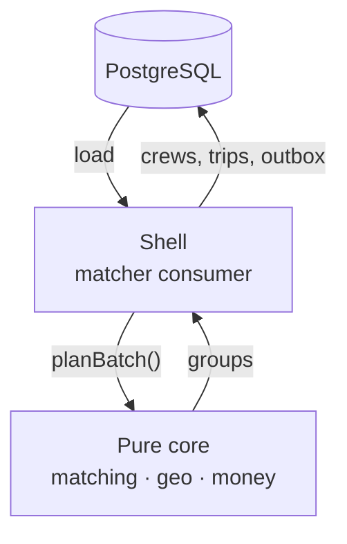
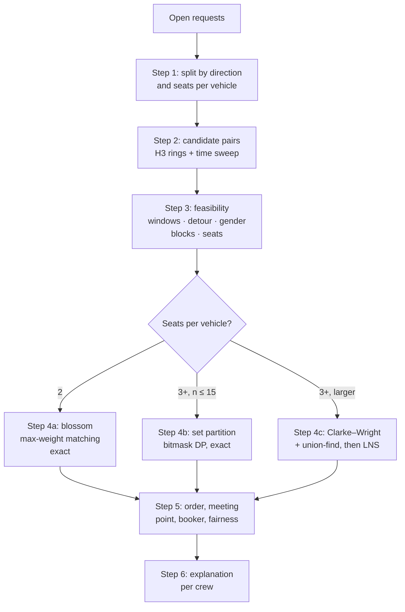

# 06 · Algorithms (the functional core)

`@pulse/matching`, `@pulse/money` and `@pulse/geo` are **pure**: no database, network, `Date.now()`
or unseeded randomness (CLAUDE.md rule 5). The worker or API loads data, calls a pure function
with an injected clock and seed, and writes the result. So every algorithm can be tested alone,
replayed exactly, and compared against a brute-force oracle.



## 1. `@pulse/geo`

| Function                                                          | What it does                                                                                                                                                                                  | Complexity      |
| ----------------------------------------------------------------- | --------------------------------------------------------------------------------------------------------------------------------------------------------------------------------------------- | --------------- |
| `toCell({lat,lng}, res = 8)` / `cellCenter(cell)`                 | H3 index ↔ point (wraps `h3-js`)                                                                                                                                                              | O(1)            |
| `neighbours(cell, k)`                                             | Cells within `k` rings (`gridDisk`)                                                                                                                                                           | O(k²)           |
| `haversineMetres(a, b)`                                           | Straight-line distance, for fallbacks and tests                                                                                                                                               | O(1)            |
| `makeDistance(table): Distance`                                   | Wraps a `Map<origin, Map<dest, {metres, seconds}>>` loaded by the shell; falls back to haversine × 1.4 when a pair is missing (and counts it)                                                 | O(1) lookup     |
| `routeMetres(gateCell, stopCells[], dist)`                        | Length of gate → stops in the given order                                                                                                                                                     | O(n)            |
| `bestOrder(gateCell, stopCells[], dist)`                          | Cheapest drop/pick order by trying every permutation (n ≤ 6 → ≤ 720)                                                                                                                          | O(n!) for n ≤ 6 |
| `bestMeetingPoint(memberCells, points[], dist, walkLimitM = 600)` | The point within walking limit of every member minimising total walking + vehicle detour                                                                                                      | O(m · p)        |
| `kalmanSmooth(points[], q, r)`                                    | Constant-velocity Kalman filter over GPS points (lat/lng projected to metres)                                                                                                                 | O(n)            |
| `mapMatch(points[], graph)`                                       | HMM map matching with Viterbi: hidden states = candidate road segments within 50 m; emission = Gaussian on distance to segment; transition = exp(−\|route distance − straight distance\| / β) | O(n · c²)       |
| `deviation(matchedPath, expectedRoute)`                           | Off-route metres and seconds; long-stop detection (< 1 m/s for > 5 min)                                                                                                                       | O(n)            |

**Road data** comes from `services/roadgraph` (C++17): it reads an OSM `.pbf` extract of Dhaka,
builds a weighted directed graph (car speeds per road class), maps each H3 r8 cell centre to its
nearest node, runs Dijkstra from every cell, and writes `cell_distance.csv` (metres, seconds) plus
`roadgraph.bin` (compact nodes and edges for map matching). A seed script loads the CSV; the
worker loads the binary once at start.

## 2. `@pulse/matching`

### 2.1 Input and output of a batch

```ts
interface BatchInput {
  campusId: string;
  gateCell: string;
  now: string; // injected clock
  requests: RequestInput[]; // open requests in this batch
  profiles: Record<string, ProfileInput>; // gender, reliability, fairness points, vehicle
  blocks: Array<[string, string]>; // symmetric
  sharedSections: Record<string, string[]>; // userId → sectionIds today (bonus)
  meetingPoints: MeetingPointInput[];
  params: MatchParams; // detour cap, weights, batch limits
}
interface BatchResult {
  groups: Group[]; // members in stop order, mode, meeting point, booker, explanation
  unmatched: string[]; // request ids
  metrics: { savedMetres: number; meanDetourPct: number; groupsBySize: Record<number, number> };
}
declare function planBatch(input: BatchInput, opts: { seed: number }): BatchResult;
```

### 2.2 Pipeline



### 2.3 Steps in detail

| Step              | Method                                                                                                                                                                                                                           | Complexity                 |
| ----------------- | -------------------------------------------------------------------------------------------------------------------------------------------------------------------------------------------------------------------------------- | -------------------------- |
| Candidates        | Bucket requests by home cell; for each request look only at buckets within `k` rings (k = 3 ≈ 2.5 km at r8)                                                                                                                      | O(n · k²) instead of O(n²) |
| Time overlap      | Sort window starts; sweep with a min-heap of window ends; emit only pairs whose windows overlap by ≥ 5 min                                                                                                                       | O(n log n + pairs)         |
| Pair weight       | `w(i,j) = saving(i,j) · (1 + αS·shared + αR·(rel_i·rel_j)) − αF·fairnessPenalty`, saving `s(i,j) = d(G,i) + d(G,j) − d(i,j)`                                                                                                     | O(1)                       |
| 2-seat pairs      | Maximum-weight matching on the feasible-pair graph, Edmonds' blossom (Galil's O(V³) version)                                                                                                                                     | O(V³), exact               |
| 3–4-seat, small   | Clusters from connected components of the feasible graph; each cluster ≤ 15 → DP over subsets: `best[mask] = max over valid group g ⊆ mask containing the lowest bit of value(g) + best[mask \ g]`                               | O(3ⁿ), exact               |
| 3–4-seat, large   | Clarke–Wright: sort pairs by saving, merge groups with union-find while every constraint holds; then large-neighbourhood search: destroy 10–20% of groups (seeded RNG), repair greedily, accept if better; 200 iterations or 1 s | heuristic                  |
| Bus companionship | Same as pairs but no vehicle cost: group riders taking the same bus line and time into companions of 2–4 for safety                                                                                                              | O(n log n)                 |
| Booker            | The member dropped off last (stays in the vehicle to pay); the fairness rotation may swap with the lowest `booker_count` member when the extra detour < 5%                                                                       | O(g)                       |
| Determinism       | Ties broken by (weight desc, requestId asc); all randomness from `mulberry32(seed)`; the input is canonically sorted first                                                                                                       | n/a                        |

**Constraints every group must satisfy** (checked in a single `isFeasible(group)` used everywhere,
and by the property tests):

1. Members ≤ seats of the mode (rickshaw 2, CNG 3, ride-hail car 4, own car = vehicle seats + driver, bike 1 + rider).
2. A common time window of at least 5 minutes.
3. Every member's detour ≤ their `maxDetourPct` (default 30%) of their solo distance.
4. Gender preference: if any member wants `same_gender`, all members share that gender.
5. No pair of members has a block in either direction.
6. Each request appears in at most one group.

### 2.4 Wait-or-go

For a go-now request, the forecast gives λ, the rate (per minute) at which compatible people are
expected to request in the next 20 minutes from nearby cells.

- `P(partner within t) = 1 − e^(−λt)`
- Expected value of waiting t minutes: `P(t) · savingPaisa − t · timeValuePaisaPerMin`
- Advice = `wait` with the best `t ≤ maxWaitMin` if that value > 0, else `go`. Going alone is always offered.

`waitOrGo({lambda, savingPaisa, timeValue, maxWait}) → {advice, waitMinutes, curve}` is pure.

### 2.5 Habits, reliability, fairness

| Function                                         | Formula                                                                                            |
| ------------------------------------------------ | -------------------------------------------------------------------------------------------------- |
| `habitOffset(n, userMean, campusMean, k=5)`      | `(n·userMean + k·campusMean) / (n + k)`: one odd day barely moves it; a steady habit wins in weeks |
| `updateHabit(state, x)`                          | Welford update of mean and M2 (variance), so the forecast can show a spread                        |
| `reliabilityScore(shows, noShows)`               | Beta(4, 1) prior: `(shows + 4) / (shows + noShows + 5)`                                            |
| `fairnessPoints(detourPct, wasBooker, lastDrop)` | `detourPct + 15·wasBooker + 10·lastDrop`, accumulated in `fairness_balance`                        |

### 2.6 Shuttle seat assignment (min-cost max-flow)

Source → each booking (capacity 1) → each seat (capacity 1, cost = walking metres from the
booking's stop to the seat's door zone + a penalty for splitting groups who booked together) →
sink. Successive shortest paths with Bellman–Ford/SPFA. Exact. Size ≤ 60 bookings × 60 seats.

### 2.7 Privacy noise for the demand board

`noisyCount(trueCount, epsilon, rng)`: Laplace mechanism, sensitivity 1 (one person changes a
count by at most 1): `trueCount + Laplace(0, 1/ε)`, rounded, clamped at 0, and **null when
`trueCount < 3`**. ε = 1 per snapshot slot. `rng` is injected (seeded in tests, crypto-random in
production via the shell).

## 3. `@pulse/money`

| Function                                         | What it does                                                                                                                                                                           | Complexity        |
| ------------------------------------------------ | -------------------------------------------------------------------------------------------------------------------------------------------------------------------------------------- | ----------------- |
| `largestRemainderSplit(total, weights)` (exists) | Integer split that sums exactly to `total`                                                                                                                                             | O(n log n)        |
| `shapleyShares(members, cost)`                   | Exact Shapley value of a cost game: for each member, average marginal cost over all orders, computed from all subsets: `φ_i = Σ_{S ⊆ N\{i}} \|S\|!(n−\|S\|−1)!/n! · (c(S∪{i}) − c(S))` | O(2ⁿ · n), n ≤ 6  |
| `fareShares(farePaisa, members, cost)`           | `shapleyShares` → weights → `largestRemainderSplit(fare, weights)`; result sums exactly to the fare                                                                                    | O(2ⁿ · n)         |
| `postingsForFare(bookerAccount, shares)`         | One posting per account: booker `+fare − ownShare`, others `−share`; sums to zero                                                                                                      | O(n)              |
| `assertBalanced(postings)`                       | Throws unless the sum is zero and there are ≥ 2 postings                                                                                                                               | O(n)              |
| `balances(postings)`                             | Net balance per account                                                                                                                                                                | O(n)              |
| `minTransfers(balances)`                         | Exact minimum number of transfers: `n − (max number of disjoint zero-sum groups)`; DP over subsets: `dp[mask] = max groups` where `sum(mask) = 0` adds one                             | O(2ⁿ · n), n ≤ 16 |
| `transfersFor(balances)`                         | Builds the actual transfers: for each zero-sum group, settle greedily inside it (k members → k−1 transfers)                                                                            | O(2ⁿ · n)         |
| `settleGreedy(balances)`                         | Fallback for n > 16: largest creditor ↔ largest debtor                                                                                                                                 | O(n log n)        |

Cost function for Shapley: `c(S)` = road metres of the cheapest route serving only the members in
`S` from the gate (`geo.bestOrder`). A member whose home is on the way adds little and pays little.

## 4. Tests every algorithm ships with

| Package  | Property tests (fast-check)                                                                                                                              | Oracle on small inputs                                                                                                                     |
| -------- | -------------------------------------------------------------------------------------------------------------------------------------------------------- | ------------------------------------------------------------------------------------------------------------------------------------------ |
| matching | Every group feasible; no request twice; determinism (same input + seed → same output); unmatched really cannot join any group                            | Blossom = brute force over all matchings (n ≤ 10); set-partition DP = brute force (n ≤ 8); Clarke–Wright+LNS within 10% of exact on n ≤ 12 |
| money    | Shares sum to the fare; Shapley efficiency and symmetry; postings balance; `minTransfers ≤ n − 1`; transfers clear all balances                          | Shapley = permutation average (n ≤ 5); `minTransfers` = brute force over transfer sets (n ≤ 6)                                             |
| geo      | `bestOrder` ≤ any order; Kalman output closer to the truth than the noisy input on synthetic tracks; `mapMatch` recovers a known route from noisy points | `bestOrder` = brute force; meeting point = brute force                                                                                     |
| privacy  | Mean noise ≈ 0 over many draws (seeded); counts < 3 always null                                                                                          | n/a                                                                                                                                        |

Performance targets (benchmarks in CI, warn only): `planBatch` with 3,000 requests < 5 s on a CI
runner; `shapleyShares` n = 6 < 1 ms; `minTransfers` n = 16 < 50 ms.
