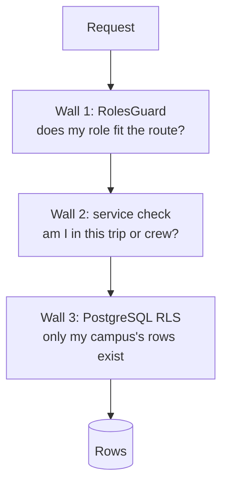

# 08 · Security and privacy

A timetable plus a home location tells someone when and where a person travels every week. So
privacy is a design rule, not a feature. No other user ever sees someone's routine, exact home or
reliability score.

## 1. Authentication

| Item          | Design                                                                                                                                                       |
| ------------- | ------------------------------------------------------------------------------------------------------------------------------------------------------------ |
| Sign-in       | 6-digit code to a campus email. Only domains in `campus.email_domains` are accepted. No passwords, never portal passwords.                                   |
| Code storage  | `HMAC-SHA256(code, OTP_PEPPER)`; expires in 10 min; 5 wrong attempts lock it; constant-time compare.                                                         |
| Rate limits   | 5 codes/hour/email, 20/hour/IP, 10 verify attempts/hour/IP. Responses identical for unknown domains (no account probing).                                    |
| Bot check     | Cloudflare Turnstile on `/auth/otp/request`, behind flag `auth.turnstile` (fallback: stricter IP limits).                                                    |
| Access token  | JWT HS256, 15 min, claims `sub, campusId, role, sid, kid`. In cookie `pulse_at`. Checked on every request; `sid` must not be revoked (cached 60 s in Redis). |
| Refresh token | 256-bit random, stored as SHA-256. Rotated on every use. Reuse of a rotated token → revoke the whole family (likely theft) and sign out.                     |
| Cookies       | `httpOnly; Secure; SameSite=Lax` (access), `SameSite=Strict; Path=/api/auth` (refresh). Same origin via the proxy, so no CORS for the browser.               |
| CSRF          | SameSite plus an `Origin` header check on every non-GET request.                                                                                             |
| Suspension    | Suspending a user revokes all sessions in the same transaction; the access token dies within 15 min (or at once via the `sid` check).                        |

## 2. Authorisation: three walls

Role matrix (✔ = allowed, ◐ = own or member only):

| Capability                        | rider           | operator | campus_admin            | platform_admin |
| --------------------------------- | --------------- | -------- | ----------------------- | -------------- |
| Own profile, preferences, routine | ✔               | ✔        | ✔                       | ✔              |
| Requests, trips, chat, wallet     | ◐               | ◐        | ◐                       | ◐              |
| Co-rider card                     | ◐ (shared crew) | ◐        | ✔                       | ✔              |
| Operator console                  |                 | ✔ (own)  |                         |                |
| Catalog, calendar, zones, gates   |                 |          | ✔ (campus)              | ✔              |
| Reports, moderation, SOS console  |                 |          | ✔                       | ✔              |
| Flags                             |                 |          | ✔ campus                | ✔ global       |
| Models, campuses, appoint admins  |                 |          |                         | ✔              |
| See emails of users               |                 |          | ✔                       | ✔              |
| See exact SOS location            | crew            |          | ✔                       | ✔              |
| See anyone's routine or home cell | never           | never    | never (aggregates only) | never          |

## 3. What other people can see

| Data                                     | Who sees it                                                                                   |
| ---------------------------------------- | --------------------------------------------------------------------------------------------- |
| First name, photo, department, home zone | Crew-mates, only after a crew forms                                                           |
| Last name, email, phone                  | Nobody else (admins see email for support)                                                    |
| Home                                     | Stored only as an H3 r8 cell (~0.7 km²). The exact pin is discarded on save.                  |
| Routine                                  | Only the user. Matching uses it; the "why this crew" text says "you share a class", not which |
| Reliability score                        | Only the user and the matcher                                                                 |
| Live location                            | Crew only, during the trip, Redis only, deleted when the trip ends                            |
| Gender                                   | Self-declared; used only for gender-preference matching; never displayed to others            |
| Ratings                                  | Nobody sees individual ratings                                                                |
| Demand                                   | Operators see Laplace-noised counts; counts < 3 hidden                                        |
| Grades                                   | Never leave the device (rule 9)                                                               |

## 4. Input, uploads and output

- Every input through `.strict()` Zod schemas from `@pulse/contracts`; unknown fields rejected.
- Only parameterised queries (Drizzle); no string-built SQL. `sql` template tags only with bound values.
- Uploads: type by magic bytes (`file-type`), size limits per purpose, random storage keys, never
  served from a public path, parsed by a worker. PDFs and spreadsheets are parsed with libraries
  in a job with a time limit; the API never parses them.
- Output: helmet headers (exists), `X-Content-Type-Options: nosniff` on downloads; error bodies
  never contain stack traces or SQL (the strict error schema enforces it).
- Wrap errors with `new Error('…', { cause })`; never copy `e.message` into a response or log line
  (Drizzle messages contain query values).

## 5. AI and outside services

| Rule                                                            | How it is enforced                                                                                                                           |
| --------------------------------------------------------------- | -------------------------------------------------------------------------------------------------------------------------------------------- |
| Only public timetable files go to the Gemini free tier (rule 8) | `ai-gateway` takes `sensitivity: 'public'` tasks only for remote providers; `personal` is a type error and a runtime refusal; tests for both |
| Typed requests never leave Pulse                                | The request model runs in-process with `onnxruntime-node`                                                                                    |
| Model output never runs as code                                 | The agent returns JSON validated against a JSON Schema, interpreted by our adapter                                                           |
| Every AI feature has a flag and a fallback (rule 10)            | Flags in `feature_flag`; tests run with each flag off                                                                                        |
| Training sentences only with consent, scrubbed                  | `request_text_sample` has no user id; phone/email patterns removed before saving                                                             |

## 6. Logging and audit

- `nestjs-pino` JSON logs with `redact` for `email`, `phone`, `code`, `token`, `authorization`,
  `cookie`, `lat`, `lng`, `body`. Request id on every line. Paths contain no personal data.
- Every admin write → `audit_log` in the same transaction.
- No PII in Kafka events (except `LocationReported`, 1-day retention).

## 7. Supply chain and CI security

CodeQL, Dependabot (weekly, grouped), GitHub secret scanning + push protection, `pnpm`
`allowBuilds` deny-by-default (exists), Trivy image scan with an SBOM (CycloneDX) on release
builds, pinned GitHub Action SHAs, least-privilege `permissions:` per workflow.

## 8. Threat model (short)

| Threat                                  | Mitigation                                                                                         |
| --------------------------------------- | -------------------------------------------------------------------------------------------------- |
| Outsider signs up                       | Campus email domains only; OTP; Turnstile                                                          |
| OTP brute force                         | 5 attempts, 10 min expiry, per-email and per-IP limits                                             |
| Stolen refresh token                    | Rotation + reuse detection revokes the family                                                      |
| Cross-campus data leak by a buggy query | RLS with `FORCE`; app role cannot bypass; guard test fails if a table lacks a policy               |
| Stalking via the app                    | Coarse home cells; co-rider info only after matching; blocks; reports; location only during a trip |
| Money manipulation                      | Append-only ledger; deferred zero-sum check; members confirm fares; disputes; idempotency keys     |
| Fake class change to disrupt crews      | Instructor reports apply; student reports need a second student or an admin                        |
| Prompt injection via a timetable file   | The model only produces JSON; the validator decides; an admin approves; no tools, no code          |
| Abuse of chat                           | Rate limits, report button, admin review, suspension                                               |
| Exposed infrastructure                  | Only the proxy listens publicly (80/443); PostgreSQL, Redis, Kafka, RabbitMQ on a private network  |

## 9. Personal data rights

- **Export**: `POST /me/exports` → a job builds a JSON zip (profile, preferences, routine,
  requests, trips, messages sent, ledger lines, notifications) → a 7-day signed link by email.
- **Delete**: PII columns overwritten (`first_name = 'Deleted'`, email → `deleted+<id>@invalid`),
  vehicles, contacts, push subscriptions, preferences deleted; sessions revoked; open requests
  cancelled; ledger rows stay (balanced books) but point to an anonymous user; `UserDeleted`
  event + compaction tombstone.
