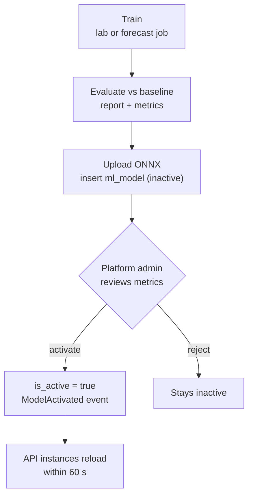

# 09 · AI and machine learning

Three AI features. Each has a **non-AI version that ships first** and stays as the fallback
(CLAUDE.md rule 10). For forecasting and onboarding it is also the baseline the AI must beat
(objective O3); request understanding has a fixed accuracy target instead (ADR 0012).

| Feature                 | Fallback / baseline (ships first)      | AI version                                           | Trains where                      | Runs where                       | Flag                  |
| ----------------------- | -------------------------------------- | ---------------------------------------------------- | --------------------------------- | -------------------------------- | --------------------- |
| Request understanding   | Structured request form (no free text) | Local model, chosen at its slice (ADR 0012)          | Decided with the model            | API, locally, CPU                | `ai.request_model`    |
| Departure forecast      | Habit blend (`habitOffset`)            | LightGBM quantile models (p10, p50, p90) → ONNX      | Laptop / CI (`services/forecast`) | API + worker, `onnxruntime-node` | `ai.forecast_model`   |
| Campus onboarding agent | A hand-written adapter per campus      | Gemini proposes a declarative spec; validator checks | Not trained                       | Worker job `ai.onboarding`       | `ai.onboarding_agent` |

## 1. The AI gateway (`@pulse/ai-gateway`)

```ts
type Sensitivity = 'public' | 'personal';
interface AiTask<I, O> {
  name: string;
  sensitivity: Sensitivity;
  input: I;
  schema: ZodType<O>;
}
interface AiProvider {
  id: string;
  allows: Sensitivity[];
  run<I, O>(task: AiTask<I, O>): Promise<O>;
}
```

- `GeminiProvider.allows = ['public']`. The gateway refuses a `personal` task for it at compile
  time (overloads) and at run time (throws `SensitivityViolation`, tested).
- Rate limiter per provider (token bucket in Redis) sized below the free-tier limits; a 429 from
  the provider becomes a retryable job failure (retry tiers handle backoff).
- Every response is parsed with the task's Zod schema. Invalid output counts as a failed round.
- Model name and API key come from env (`GEMINI_MODEL`, `GEMINI_API_KEY`); no model is hard-coded.

## 2. Request understanding (English + Banglish)

**Goal**: turn "ML class er por Mirpur 10 jabo, shudhu meye rider" into
`{direction: from_campus, place: Mirpur 10 → cell, windowStart: end of ML class, genderPref: same_gender}`.

No typed-language rules (ADR 0012). With the flag off, a failed model or low confidence, the
rider fills the structured request form; the model only pre-fills it, and the rider always edits
and confirms the chips (plan 10 §6).

### 2.1 Output schema (`parsedRequestSchema` in `@pulse/contracts`)

```ts
{ direction?: 'to_campus' | 'from_campus';
  place?: { name: string; cell: string };       // resolved via the gazetteer
  timeRef?: { kind: 'clock'; time: string } | { kind: 'after_class'; course?: string } | { kind: 'now' };
  genderPref?: 'any' | 'same_gender';
  maxWaitMin?: number;
  modes?: string[];
  confidence: number }                          // 0–1
```

### 2.2 What ships now (wave 1, M3): `@pulse/request-parser`

A pure package with no tokeniser and no word rules:

- The gazetteer: public places near AIUB (Kuril, Bashundhara, Mirpur 1–14, Uttara sectors,
  Banani, Gulshan, Badda, Notun Bazar…) with aliases, each with its H3 resolution 8 cell. A JSON
  file in the package; campus-specific lists later.
- `resolvePlace(name)`: exact lookup of a place name or alias (lower case, trimmed) → `{name, cell}`.
  A model names the place; code turns the name into a cell.
- The golden set: hand-labelled English and Banglish sentences with their expected output, the
  start of the model's test set.

`POST /requests/parse` (plan 04 §8) ships with the model.

### 2.3 The model (wave 3)

| Step       | Detail                                                                                                                                                                                                                                    |
| ---------- | ----------------------------------------------------------------------------------------------------------------------------------------------------------------------------------------------------------------------------------------- |
| Choice     | Decided at the start of this slice (ADR 0012): a small multilingual encoder fine-tuned for token tagging and exported to ONNX, or a small local LLM with constrained JSON output. Either runs locally; request text never goes to Gemini. |
| Data       | Synthetic sentences (templates × gazetteer × time phrases × Banglish spelling noise), consented real samples, and the golden set. People check a 10% sample. The test set is written by humans and never used in training.                |
| Serving    | API loads the active `ml_model` artifact (checks SHA-256). Its output goes through the same post-processing: `resolvePlace` for the cell, the routine lookup for "after ML class", then `parsedRequestSchema`.                            |
| Fallback   | Flag off, load failure, confidence < 0.5 or timeout (200 ms) → the structured form, with nothing pre-filled.                                                                                                                              |
| Evaluation | Field-level exact-match accuracy per field and overall on the human-written test set; must meet a fixed target set with the model (O3). Report in `services/request-model/reports/`.                                                      |

## 3. Departure forecast

**Question**: given a rider's classes today, when will they actually leave (or need to arrive)?

| Item          | Baseline (wave 2)                                  | LightGBM (wave 3)                                                                                                                                                                                                  |
| ------------- | -------------------------------------------------- | ------------------------------------------------------------------------------------------------------------------------------------------------------------------------------------------------------------------ |
| Output        | One offset (minutes after the last class)          | Quantiles p10, p50, p90 of the offset                                                                                                                                                                              |
| Features      | user mean, campus mean, trip count                 | weekday, last-class end time, gap since previous class, number of classes today, exam period flag, rain flag (manual/simulated), user's habit mean + variance + count, campus slot mean, section type (lab/theory) |
| Training data | n/a                                                | `v_forecast_training` (anonymised) from real trips + simulator days, time-split (train on earlier weeks, test on the last week)                                                                                    |
| Metric        | pinball loss at p10/p50/p90; 80% interval coverage | must beat the baseline's pinball loss and cover ~80%                                                                                                                                                               |
| Export        | n/a                                                | `onnxmltools` → one ONNX per quantile (or one multi-output)                                                                                                                                                        |
| Retrain       | n/a                                                | `forecast.retrain` job (weekly); new model inserted **inactive**; a platform admin activates it after reading the metrics                                                                                          |

**Where the forecast is used**: Autopilot windows; the wait-or-go λ (sum over compatible people of
the probability that their departure falls in the next minutes); shuttle suggested runs; the
demand board.

## 4. Campus onboarding agent

### 4.1 The declarative spec (what the model writes)

```jsonc
{
  "format": "csv" | "xlsx" | "pdf_table",
  "sheet": "Sheet1",                       // xlsx
  "headerRow": 3,
  "termName": { "from": "cell", "ref": "A1", "regex": "(Fall|Spring|Summer) \\d{4}-\\d{4}" },
  "columns": {
    "classId": "Class ID", "courseCode": "Course Code", "title": "Course Title",
    "section": "Section", "status": "Status", "capacity": "Capacity", "enrolled": "Count",
    "schedule": "Time"
  },
  "schedule": {
    "split": ";",                          // several meetings in one cell
    "pattern": "(?<days>[A-Za-z]+)\\s+(?<start>\\d{1,2}:\\d{2}\\s*[AP]M)\\s*-\\s*(?<end>\\d{1,2}:\\d{2}\\s*[AP]M)\\s*(?<room>.*)",
    "days": { "Sun": 0, "Mon": 1, "Tue": 2, "Wed": 3, "Thu": 4, "Sat": 6 },
    "timeFormat": "h:mm a"
  },
  "skipIf": [{ "column": "Status", "equals": "Cancelled" }]
}
```

The spec schema is a JSON Schema in `@pulse/catalog-adapters`. The **SpecAdapter** interprets it;
the AIUB adapter is hand-written but produces the same output type.

### 4.2 The validator (deterministic)

Runs over the **whole file**: every weekday maps; start < end; times within 07:00–22:00; class
IDs unique per term; ≥ 95% of rows parse; term name found. The report lists failing rows with
reasons, and the agent feeds the first 20 back to the model in the next round.

## 5. Model registry and rollout



## 6. Responsible-AI checklist (per feature, before its flag is turned on for the pilot)

- [ ] Fallback works with the flag off (e2e test).
- [ ] No personal data in any remote call (gateway test + code review).
- [ ] Metrics report committed, and the model beats the baseline (or meets its fixed target).
- [ ] Failure modes listed in the feature's note (wrong place, wrong time) and the UI always
      shows the parsed result for confirmation before creating a request.
