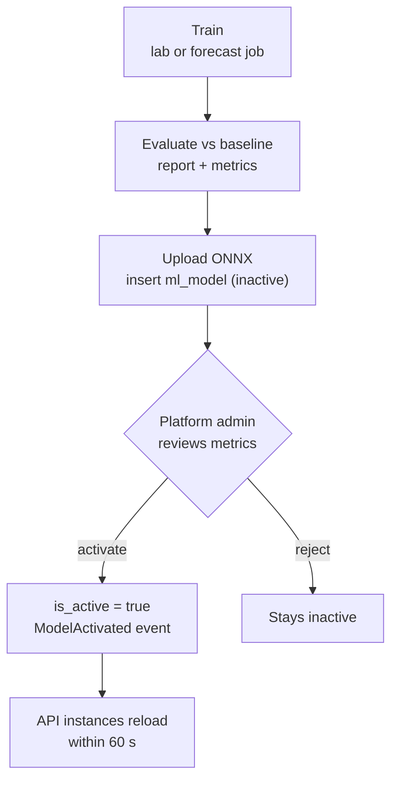

# 09 · AI and machine learning

Three AI features. Each has a **non-AI version that ships first** and stays as the fallback and
the baseline the AI must beat (CLAUDE.md rule 10, objective O3).

| Feature                 | Fallback / baseline (ships first)           | AI version                                           | Trains where                      | Runs where                       | Flag                  |
| ----------------------- | ------------------------------------------- | ---------------------------------------------------- | --------------------------------- | -------------------------------- | --------------------- |
| Request understanding   | Rule-based parser (`@pulse/request-parser`) | Fine-tuned small multilingual model → ONNX           | AIUB AI lab (DGX Spark)           | API, `onnxruntime-node`, CPU     | `ai.request_model`    |
| Departure forecast      | Habit blend (`habitOffset`)                 | LightGBM quantile models (p10, p50, p90) → ONNX      | Laptop / CI (`services/forecast`) | API + worker, `onnxruntime-node` | `ai.forecast_model`   |
| Campus onboarding agent | A hand-written adapter per campus           | Gemini proposes a declarative spec; validator checks | Not trained                       | Worker job `ai.onboarding`       | `ai.onboarding_agent` |

## 1. The AI gateway (`@pulse/ai-gateway`)

```ts
type Sensitivity = 'public' | 'personal';
interface AiTask<I, O> {
  name: string;
  sensitivity: Sensitivity;
  input: I;
  schema: ZodType<O>;
}
interface AiProvider {
  id: string;
  allows: Sensitivity[];
  run<I, O>(task: AiTask<I, O>): Promise<O>;
}
```

- `GeminiProvider.allows = ['public']`. The gateway refuses a `personal` task for it at compile
  time (overloads) and at run time (throws `SensitivityViolation`, tested).
- Rate limiter per provider (token bucket in Redis) sized below the free-tier limits; a 429 from
  the provider becomes a retryable job failure (retry tiers handle backoff).
- Every response is parsed with the task's Zod schema. Invalid output counts as a failed round.
- Model name and API key come from env (`GEMINI_MODEL`, `GEMINI_API_KEY`); no model is hard-coded.

## 2. Request understanding (English + Banglish)

**Goal**: turn "ML class er por Mirpur 10 jabo, shudhu meye rider" into
`{direction: from_campus, place: Mirpur 10 → cell, windowStart: end of ML class, genderPref: same_gender}`.

### 2.1 Output schema (shared by both parsers)

```ts
{ direction?: 'to_campus' | 'from_campus';
  place?: { name: string; cell: string };       // resolved via the gazetteer
  timeRef?: { kind: 'clock'; time: string } | { kind: 'after_class'; course?: string } | { kind: 'now' };
  genderPref?: 'any' | 'same_gender';
  maxWaitMin?: number;
  modes?: string[];
  confidence: number }                          // 0–1
```

### 2.2 Rule-based parser (wave 1, M3)

- Tokenise (lowercase, Banglish spelling variants: `jabo/jaabo/jabe`, `por/pore`, `theke/theika`).
- Gazetteer of Dhaka places near AIUB (Kuril, Bashundhara, Mirpur 1–14, Uttara sectors, Banani,
  Gulshan, Badda, Notun Bazar…), with aliases, each mapped to an H3 cell. Stored as a JSON file in
  the package, campus-specific lists later.
- Patterns: direction (`jabo/going/home` vs `ashbo/coming/campus`), time (`5 tay`, `5:30`, `after
class`, `class er por`, `ekhon/now`), gender (`shudhu meye/only female/ladies`), wait (`10 min
wait`), modes (`cng`, `rickshaw`, `uber`).
- Course references (`ML class`) resolve against the user's routine for today (the parser gets the
  user's section titles as context).

### 2.3 The trained model (wave 3, A)

| Step       | Detail                                                                                                                                                                                                                                                                                                              |
| ---------- | ------------------------------------------------------------------------------------------------------------------------------------------------------------------------------------------------------------------------------------------------------------------------------------------------------------------- |
| Data       | ~8,000 synthetic sentences: templates × gazetteer × time phrases × Banglish spelling noise, plus sentences written and labelled with help from a large open model **hosted in the lab**, plus consented real samples. People check a 10% sample. Test set: 600 sentences written by humans, never used in training. |
| Model      | A small multilingual encoder (e.g. a distilled multilingual BERT-class model or mT5-small) fine-tuned for token classification (BIO tags: PLACE, TIME, COURSE, GENDER, WAIT, MODE) + a direction classifier head.                                                                                                   |
| Export     | Hugging Face Optimum → ONNX, int8 dynamic quantisation, < 150 MB, < 50 ms per sentence on a laptop CPU.                                                                                                                                                                                                             |
| Serving    | API loads the active `ml_model` artifact (checks SHA-256), tokenizer JSON alongside. Spans → the same post-processing (gazetteer, routine lookup) as the rule parser.                                                                                                                                               |
| Fallback   | Flag off, load failure, confidence < 0.5, or timeout (200 ms) → rule parser.                                                                                                                                                                                                                                        |
| Evaluation | Field-level exact-match accuracy per field and overall on the 600-sentence test set; must beat the rule parser (O3). Report in `services/request-model/reports/`.                                                                                                                                                   |

## 3. Departure forecast

**Question**: given a rider's classes today, when will they actually leave (or need to arrive)?

| Item          | Baseline (wave 2)                                  | LightGBM (wave 3)                                                                                                                                                                                                  |
| ------------- | -------------------------------------------------- | ------------------------------------------------------------------------------------------------------------------------------------------------------------------------------------------------------------------ |
| Output        | One offset (minutes after the last class)          | Quantiles p10, p50, p90 of the offset                                                                                                                                                                              |
| Features      | user mean, campus mean, trip count                 | weekday, last-class end time, gap since previous class, number of classes today, exam period flag, rain flag (manual/simulated), user's habit mean + variance + count, campus slot mean, section type (lab/theory) |
| Training data | n/a                                                | `v_forecast_training` (anonymised) from real trips + simulator days, time-split (train on earlier weeks, test on the last week)                                                                                    |
| Metric        | pinball loss at p10/p50/p90; 80% interval coverage | must beat the baseline's pinball loss and cover ~80%                                                                                                                                                               |
| Export        | n/a                                                | `onnxmltools` → one ONNX per quantile (or one multi-output)                                                                                                                                                        |
| Retrain       | n/a                                                | `forecast.retrain` job (weekly); new model inserted **inactive**; a platform admin activates it after reading the metrics                                                                                          |

**Where the forecast is used**: Autopilot windows; the wait-or-go λ (sum over compatible people of
the probability that their departure falls in the next minutes); shuttle suggested runs; the
demand board.

## 4. Campus onboarding agent

### 4.1 The declarative spec (what the model writes)

```jsonc
{
  "format": "csv" | "xlsx" | "pdf_table",
  "sheet": "Sheet1",                       // xlsx
  "headerRow": 3,
  "termName": { "from": "cell", "ref": "A1", "regex": "(Fall|Spring|Summer) \\d{4}-\\d{4}" },
  "columns": {
    "classId": "Class ID", "courseCode": "Course Code", "title": "Course Title",
    "section": "Section", "status": "Status", "capacity": "Capacity", "enrolled": "Count",
    "schedule": "Time"
  },
  "schedule": {
    "split": ";",                          // several meetings in one cell
    "pattern": "(?<days>[A-Za-z]+)\\s+(?<start>\\d{1,2}:\\d{2}\\s*[AP]M)\\s*-\\s*(?<end>\\d{1,2}:\\d{2}\\s*[AP]M)\\s*(?<room>.*)",
    "days": { "Sun": 0, "Mon": 1, "Tue": 2, "Wed": 3, "Thu": 4, "Sat": 6 },
    "timeFormat": "h:mm a"
  },
  "skipIf": [{ "column": "Status", "equals": "Cancelled" }]
}
```

The spec schema is a JSON Schema in `@pulse/catalog-adapters`. The **SpecAdapter** interprets it;
the AIUB adapter is hand-written but produces the same output type.

### 4.2 The validator (deterministic)

Runs over the **whole file**: every weekday maps; start < end; times within 07:00–22:00; class
IDs unique per term; ≥ 95% of rows parse; term name found. The report lists failing rows with
reasons, and the agent feeds the first 20 back to the model in the next round.

## 5. Model registry and rollout



## 6. Responsible-AI checklist (per feature, before its flag is turned on for the pilot)

- [ ] Fallback works with the flag off (e2e test).
- [ ] No personal data in any remote call (gateway test + code review).
- [ ] Metrics report committed, and the model beats the baseline.
- [ ] Failure modes listed in the feature's note (wrong place, wrong time) and the UI always
      shows the parsed result for confirmation before creating a request.
