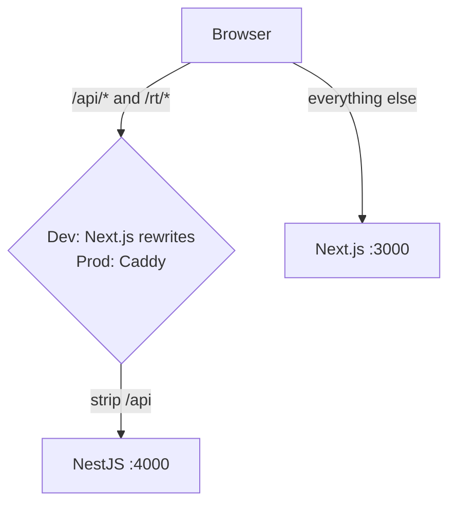

# 10 · Frontend (`apps/web`)

Starts after the midterm (week 3). Owners: **M2** (identity, money, admin, operator), **M3**
(routine, rides, trips, notifications, tests).

## 1. Stack

| Concern      | Choice                                                                                                        | Why                                                       |
| ------------ | ------------------------------------------------------------------------------------------------------------- | --------------------------------------------------------- |
| Framework    | Next.js App Router (created with `create-next-app`, then trimmed)                                             | Routing, server components for static parts, PWA friendly |
| Styling      | Tailwind CSS + shadcn/ui (components copied into `packages/ui`)                                               | Accessible primitives (Radix), full control               |
| Server state | TanStack Query                                                                                                | Caching, retries, optimistic updates                      |
| Forms        | react-hook-form + `@hookform/resolvers/zod` with `@pulse/contracts`                                           | One schema for client and server validation               |
| API client   | Small typed `fetch` wrapper in `apps/web/lib/api.ts`; response parsed with the contract schema in development | Same types as the API; catches drift early                |
| Realtime     | `socket.io-client`, one connection per tab, `useTripRoom(tripId)` hook                                        |                                                           |
| Maps         | MapLibre GL + OpenFreeMap vector tiles (free, no key)                                                         | No paid map APIs                                          |
| PWA          | Serwist (service worker), web manifest, Web Push                                                              | Installable; push on iPhone after "Add to Home Screen"    |
| Grade report | `pdfjs-dist` in a Web Worker                                                                                  | The file never leaves the device (rule 9)                 |
| Dates        | `date-fns` + `date-fns-tz` (campus timezone)                                                                  |                                                           |
| QR           | `qrcode` (boarding pass), `@zxing/browser` (operator scan)                                                    |                                                           |
| Tests        | Vitest + Testing Library (components), Playwright (e2e), axe (a11y)                                           |                                                           |

## 2. How the browser reaches the API



Dev: `next.config.ts` rewrites `/api/:path*` → `http://localhost:4000/:path*`. Socket.IO in dev
connects to `http://localhost:4000` with `withCredentials: true` (the API allows the web origin
via CORS in development only). Cookies work because `localhost:3000` and `localhost:4000` are the
same site. Production: one origin; Caddy routes `/api/*` and `/rt/*` to the API.

Token refresh: the API client retries once on a 401 by calling `POST /api/auth/refresh`, then
repeats the request; a second 401 sends the user to `/sign-in`.

## 3. Route map

`(group)` folders are Next.js route groups (no URL segment). Guards run in `middleware.ts`
(cookie present?) and in layouts (role from `/me`).

| URL                                                                                                                                     | Screen                                                                                    | Role          | Owner | Wave |
| --------------------------------------------------------------------------------------------------------------------------------------- | ----------------------------------------------------------------------------------------- | ------------- | ----- | ---- |
| `/`                                                                                                                                     | Landing (campus list, install prompt)                                                     | public        | M2    | 1    |
| `/sign-in`                                                                                                                              | Email → code                                                                              | public        | M2    | 1    |
| `/onboarding/profile`                                                                                                                   | Name, gender, department, photo                                                           | any           | M2    | 1    |
| `/onboarding/home`                                                                                                                      | Home pin on a map (shows the coarse cell it becomes)                                      | rider         | M2    | 1    |
| `/onboarding/routine`                                                                                                                   | Upload grade report / pick sections (faculty) / office hours (staff)                      | rider         | M3    | 1    |
| `/onboarding/safety`                                                                                                                    | Trusted contact, notifications permission                                                 | rider         | M2    | 2    |
| `/home`                                                                                                                                 | Today: Autopilot suggestions, Go now, Plan, text box                                      | rider         | M3    | 1    |
| `/go`                                                                                                                                   | Direction → outlook (wait-or-go) → waiting screen → matched                               | rider         | M3    | 1    |
| `/plan` · `/plan/new` · `/plans`                                                                                                        | Plan for later; recurring plans                                                           | rider         | M3    | 1    |
| `/autopilot`                                                                                                                            | On/off, learned times, skip a day                                                         | rider         | M3    | 2    |
| `/week`                                                                                                                                 | Week view: classes, overrides, trips; report a class change                               | rider         | M3    | 1    |
| `/waitlists`                                                                                                                            | My route waitlists, invite                                                                | rider         | M3    | 3    |
| `/trips` · `/trips/[id]`                                                                                                                | Crew card (confirm, decline, late, booking links) → live trip screen                      | rider         | M3    | 1    |
| `/trips/[id]/chat`                                                                                                                      | Crew chat                                                                                 | rider         | M3    | 1    |
| `/trips/[id]/fare`                                                                                                                      | Enter fare + receipt (booker) / confirm or dispute (members)                              | rider         | M2    | 2    |
| `/wallet` · `/wallet/[crewId]`                                                                                                          | Balances, ledger with split breakdown, settle (simulated bKash)                           | rider         | M2    | 2    |
| `/shuttle` · `/shuttle/runs/[id]` · `/shuttle/passes/[id]`                                                                              | Browse, book, boarding pass (QR)                                                          | rider         | M2    | 3    |
| `/safety`                                                                                                                               | Ratings to give, reports, blocks, my reliability                                          | rider         | M3    | 2    |
| `/notifications`                                                                                                                        | Notification centre                                                                       | any           | M3    | 1    |
| `/settings/*`                                                                                                                           | Profile, preferences, vehicles, contacts, sessions, calendar feed, export, delete account | any           | M2    | 1–3  |
| `/savings`                                                                                                                              | Savings card (shareable image)                                                            | rider         | M3    | 3    |
| `/operator` · `/operator/fleet` · `/operator/demand` · `/operator/runs` · `/operator/runs/[id]` (run day + scan) · `/operator/earnings` | Operator console                                                                          | operator      | M2    | 3    |
| `/admin`                                                                                                                                | Admin home: KPIs, open SOS, reports                                                       | cadmin        | M2    | 2    |
| `/admin/catalog` · `/admin/catalog/[importId]`                                                                                          | Upload, review errors, apply; terms                                                       | cadmin        | M2    | 2    |
| `/admin/onboarding`                                                                                                                     | Onboarding agent specs                                                                    | cadmin        | M2    | 3    |
| `/admin/calendar`                                                                                                                       | Holidays, exam periods, class changes, pending reports                                    | cadmin        | M2    | 2    |
| `/admin/map`                                                                                                                            | Zones (draw polygons), gates, meeting points                                              | cadmin        | M2    | 2    |
| `/admin/operators`                                                                                                                      | Approve operators and routes                                                              | cadmin        | M2    | 3    |
| `/admin/reports` · `/admin/sos` · `/admin/sms`                                                                                          | Moderation, SOS console, simulated SMS inbox                                              | cadmin        | M2    | 2    |
| `/admin/playground`                                                                                                                     | Replay a day on the map, step through batches, compare algorithms                         | cadmin        | M2    | 3    |
| `/admin/analytics`                                                                                                                      | Charts                                                                                    | cadmin        | M2    | 3    |
| `/admin/flags` · `/admin/models` · `/admin/audit` · `/admin/users`                                                                      | Platform controls                                                                         | cadmin/padmin | M2    | 3    |
| `/platform/campuses`                                                                                                                    | Create campus, appoint admins                                                             | padmin        | M2    | 2    |

## 4. Folder structure

```text
apps/web/
  app/
    (public)/page.tsx, sign-in/
    (app)/layout.tsx            # signed-in shell: bottom nav on mobile, sidebar on desktop
    (app)/home/ go/ plan/ week/ trips/[id]/ wallet/ shuttle/ safety/ notifications/ settings/
    (onboarding)/onboarding/…
    (operator)/operator/…
    (admin)/admin/…  (platform)/platform/…
  components/                   # feature components (CrewCard, OutlookChart, WeekGrid, MapView…)
  features/<module>/            # hooks (useTrip, useWallet), queries, mutations per module
  lib/api.ts  lib/socket.ts  lib/time.ts  lib/grade-report/ (worker + parser + tests)
  public/manifest.webmanifest  sw.ts
packages/ui/                    # shadcn components + Pulse tokens (colours, spacing, type)
```

## 5. Key components

| Component       | Shows                                                                                                                                              |
| --------------- | -------------------------------------------------------------------------------------------------------------------------------------------------- |
| `CrewCard`      | Avatars, first names, department, home zone, shared-class badge, vehicle, meeting point mini-map, booker, share % bar, deadline countdown, actions |
| `OutlookChart`  | Chance of a partner over the next 20 minutes, recommended wait, "Go alone now" button                                                              |
| `WeekGrid`      | 7-day grid of classes with overrides (struck-through cancelled, moved) and trips                                                                   |
| `TripLiveMap`   | Expected route, crew dots (only during the trip), meeting point, SOS button always visible                                                         |
| `LedgerTable`   | Entries with my posting, the split breakdown (Shapley explained in one sentence), receipts                                                         |
| `ZoneEditor`    | MapLibre draw tools for polygons and points                                                                                                        |
| `PlaygroundMap` | Batch-by-batch animation of requests and groups, metrics side panel                                                                                |

## 6. UX rules

- Mobile first (most riders use phones); works at 360 px; dark mode via Tailwind.
- English interface; Banglish only in what users type.
- Every parsed text request is shown as chips ("From campus · Mirpur 10 · after ML · women only")
  that the user edits before confirming: the AI never acts alone.
- "Go alone" is always one tap away (proposal promise).
- Empty states are honest: "3 more people on your route unlock crews" (never fake users).
- Accessibility: WCAG 2.1 AA, keyboard reachable, labels on every control, axe in CI.
- Offline: the shell and the last trip card load offline; actions queue only for chat.
