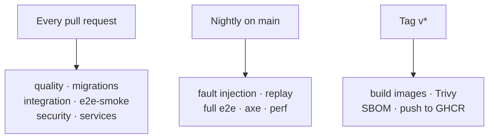
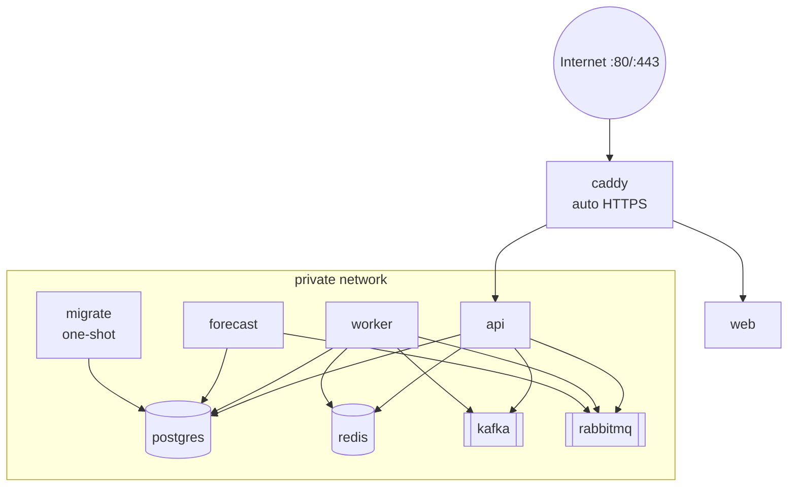
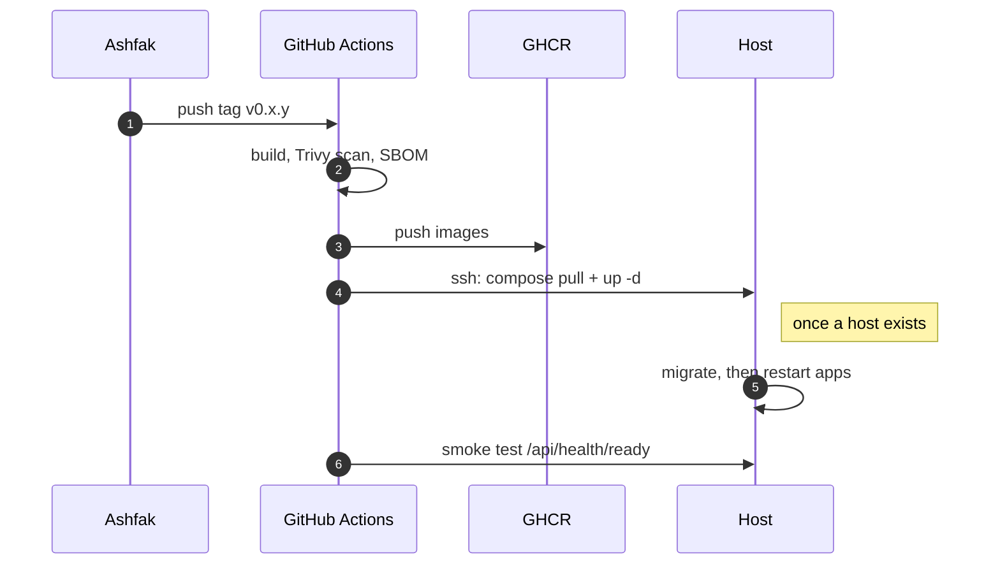

# 11 · Quality, operations and deployment

## 1. Testing strategy

| Layer                | Tool                                            | What it proves                                                                        | Where                                           | Runs                             |
| -------------------- | ----------------------------------------------- | ------------------------------------------------------------------------------------- | ----------------------------------------------- | -------------------------------- |
| Unit                 | Vitest                                          | Services and helpers in isolation                                                     | `*/test/` (D15)                                 | every PR                         |
| Property + oracle    | fast-check                                      | Algorithm invariants; exact = brute force on small inputs ([06](06-algorithms.md) §4) | `packages/{matching,money,geo}`                 | every PR                         |
| Golden files         | Vitest                                          | AIUB offered-course report and grade-report samples parse exactly                     | `catalog-adapters`, `apps/web/lib/grade-report` | every PR                         |
| Database             | Testcontainers PostGIS                          | Migrations, RLS (guard test: every table has a policy), constraints, zero-sum trigger | `packages/db`                                   | every PR                         |
| API e2e              | Vitest + supertest + Testcontainers             | Each endpoint: happy path, 400, 401/403, business rule; outbox row written            | `apps/api/test/`                                | every PR                         |
| Integration (events) | Testcontainers Kafka + RabbitMQ                 | Relay order, idempotent consumers (deliver twice → one effect), retry tiers, DLQ      | `apps/worker/test/`                             | every PR                         |
| Contract             | `@pulse/events` baselines, `@pulse/contracts`   | Event schemas add-only; web and API agree                                             | packages                                        | every PR                         |
| End-to-end (browser) | Playwright                                      | Main journeys on the full stack (sign-in → routine → request → match → trip → fare)   | `apps/web/e2e/`                                 | every PR (smoke), nightly (full) |
| Accessibility        | axe via Playwright                              | No serious WCAG violations on key screens                                             | `apps/web/e2e/`                                 | nightly                          |
| Fault injection      | Toxiproxy + killing consumers                   | 0 lost and 0 double-applied events (O4)                                               | `apps/worker/test/fault/`                       | nightly                          |
| Replay determinism   | Simulator                                       | Same day + seed → identical crews                                                     | `apps/simulator`                                | nightly                          |
| Performance          | Vitest bench + simulator                        | 3,000-user batch < 5 s; API p95 < 300 ms at 50 req/s                                  | `packages/matching`, simulator                  | nightly (warn)                   |
| Model evaluation     | pytest                                          | Model beats baseline (O3)                                                             | `services/*`                                    | on model change                  |
| Python / C++         | pytest + ruff · CTest + `-Wall -Wextra -Werror` | services correct                                                                      | `services/*`                                    | on change                        |

Rules: tests ship with every change; never weaken a test to pass (CLAUDE.md); e2e files own their
rows (unique slugs) because files run in parallel on one database; every list has a limit and a
stable order.

## 2. CI pipeline (GitHub Actions)

| Job           | Status                                     | Required for merge |
| ------------- | ------------------------------------------ | ------------------ |
| `quality`     | exists (S06)                               | yes                |
| `migrations`  | exists (S09)                               | yes                |
| `integration` | add with S10b                              | yes                |
| `e2e-smoke`   | add with the web shell                     | yes (from week 4)  |
| `security`    | add in week 1 (CodeQL + Dependabot config) | yes                |
| `services`    | add with the first Python/C++ code         | when paths change  |
| `nightly`     | add in week 5                              | no (alerts)        |
| `release`     | add in week 4 (S54)                        | n/a                |

## 3. Configuration (environment variables)

Every app validates its env with Zod at startup and refuses to start on a bad value (the API does
this already for `PORT`, `HOST`, `DATABASE_URL`).

| Variable                                                                                 | api                | worker | web | Notes                                                           |
| ---------------------------------------------------------------------------------------- | ------------------ | ------ | --- | --------------------------------------------------------------- |
| `NODE_ENV`, `LOG_LEVEL`                                                                  | ✔                  | ✔      | ✔   |                                                                 |
| `APP_ORIGIN`                                                                             | ✔                  | ✔      | ✔   | e.g. `https://pulse.example.com`; Origin check, links in emails |
| `DATABASE_URL`                                                                           | ✔                  |        |     | `pulse_app`                                                     |
| `WORKER_DATABASE_URL`, `RELAY_DATABASE_URL`                                              |                    | ✔      |     | `pulse_worker`, `pulse_relay`                                   |
| `MIGRATION_DATABASE_URL`                                                                 |                    |        |     | migration step only (owner `pulse`)                             |
| `REDIS_URL`                                                                              | ✔                  | ✔      |     |                                                                 |
| `KAFKA_BROKERS`                                                                          | ✔ (locations only) | ✔      |     |                                                                 |
| `AMQP_URL`                                                                               | ✔ (OTP email)      | ✔      |     |                                                                 |
| `JWT_SECRET`, `JWT_KID`                                                                  | ✔                  |        |     | ≥ 32 random bytes                                               |
| `OTP_PEPPER`, `IP_HASH_KEY`, `FILE_SIGNING_KEY`                                          | ✔                  | ✔      |     |                                                                 |
| `VAPID_PUBLIC_KEY`, `VAPID_PRIVATE_KEY`, `VAPID_SUBJECT`                                 | ✔                  | ✔      |     |                                                                 |
| `SMTP_URL`, `MAIL_FROM`                                                                  |                    | ✔      |     | Mailpit in dev                                                  |
| `FILE_STORE`, `FILE_DIR` or `S3_ENDPOINT`, `S3_BUCKET`, `S3_ACCESS_KEY`, `S3_SECRET_KEY` | ✔                  | ✔      |     | `local` or `s3`                                                 |
| `TURNSTILE_SECRET`                                                                       | ✔                  |        |     | flag `auth.turnstile`                                           |
| `GEMINI_API_KEY`, `GEMINI_MODEL`                                                         |                    | ✔      |     | flag `ai.onboarding_agent`                                      |
| `WORKER_ROLES`                                                                           |                    | ✔      |     | `relay,consumers,jobs,scheduler`                                |
| `SIM_ENABLED`, `SIM_TOKEN`                                                               | ✔                  |        |     | must be off in production (validated)                           |
| `NEXT_PUBLIC_*`                                                                          |                    |        | ✔   | only public values (VAPID public key, tile URL)                 |

Secrets never live in the repo; `.env.example` lists names with fake values.

## 4. Deploy-ready, host-independent

The host is decided later (you chose "decide later"); everything below works on any Linux host
with Docker.

### 4.1 Images

| Image            | Built from                     | Notes                                                                                                                |
| ---------------- | ------------------------------ | -------------------------------------------------------------------------------------------------------------------- |
| `pulse-api`      | `apps/api/Dockerfile`          | Multi-stage: `pnpm deploy --filter @pulse/api --prod` → `node:<lts>-slim`, non-root user, `HEALTHCHECK` on `/health` |
| `pulse-worker`   | `apps/worker/Dockerfile`       | Same pattern; includes `roadgraph.bin`                                                                               |
| `pulse-web`      | `apps/web/Dockerfile`          | Next.js `output: 'standalone'`                                                                                       |
| `pulse-migrate`  | `packages/db/Dockerfile`       | Runs `drizzle-kit migrate` once and exits                                                                            |
| `pulse-forecast` | `services/forecast/Dockerfile` | `uv` slim image; retrain consumer                                                                                    |

Images are multi-arch (`linux/amd64` and `linux/arm64`) via `docker buildx`, tagged with the git
SHA and the release tag, pushed to GitHub Container Registry.

### 4.2 Production Compose (`infra/compose/compose.prod.yaml`)

- Only Caddy publishes ports. Data services have volumes and memory limits (§11 of [02](02-architecture.md)).
- `migrate` runs first (`depends_on: condition: service_completed_successfully`); api and worker
  wait for it.
- Kafka topics are created by a one-shot `topics` container from `@pulse/events` (no
  auto-create, ADR 0004). RabbitMQ topology is declared by the worker at start (idempotent).
- Caddyfile: `/api/*` → `api:4000` (strip prefix), `/rt/*` → `api:4000` (WebSocket), else
  `web:3000`; HSTS; compression.

### 4.3 Release flow

Rollback: deploy the previous tag. Migrations are expand-then-contract (add columns first,
remove later), so the previous version still runs on the new schema.

### 4.4 Hosting options (decide by **21 Nov**, end of week 3, so the pilot can start 29 Nov)

The host must be amd64: the PostGIS image has no arm64 build (ADR 0001), so arm64 VPS offers are
out unless we build our own image.

| Option                                                                                      | Cost / month                          | Pros                                          | Cons                                                           |
| ------------------------------------------------------------------------------------------- | ------------------------------------- | --------------------------------------------- | -------------------------------------------------------------- |
| **One VPS (4–8 GB) + Compose** (recommended)                                                | ~$12–24, or free with student credits | Same Compose as local; simplest; full control | We patch the server; one machine                               |
| AWS (EC2 + RDS or all on EC2)                                                               | free tier / credits, then $30+        | CV value; managed database option             | More setup; costs if credits run out                           |
| Managed mix (Vercel web + Render/Fly API/worker + managed PG/Redis/RabbitMQ + hosted Kafka) | free–$30                              | Less server work                              | Free Kafka is weak; many dashboards; latency between providers |

### 4.5 Operations

| Topic            | Plan                                                                                                                                               |
| ---------------- | -------------------------------------------------------------------------------------------------------------------------------------------------- |
| Health           | `/health` (liveness), `/health/ready` (PG, Redis, Kafka producer, RabbitMQ channel)                                                                |
| Logs             | JSON to stdout; `docker compose logs`; 7-day rotation                                                                                              |
| Metrics (light)  | Admin analytics page. Locally Kafka UI (`console` profile) and the RabbitMQ web UI; in production none is published (S54 decides on an SSH tunnel) |
| Backups          | Nightly `pg_dump` to the file store (S3 bucket in production), 14 days kept; restore tested once before the pilot                                  |
| Secrets          | `.env` on the host, `chmod 600`, never in images                                                                                                   |
| Runbook          | `docs/runbook.md` (S54): start/stop, deploy, rollback, restore, replay a DLQ, rotate secrets                                                       |
| Monitoring stack | Out of scope (proposal); uptime check via a free pinger on `/api/health/ready`                                                                     |

## 5. Definition of done (every slice)

- [ ] Code + tests at the right layer; `/verify` green (format, lint, typecheck, test, build).
- [ ] Migrations reviewed (`migration-reviewer`), RLS policy on every new campus table.
- [ ] Events/jobs reviewed (`events-reviewer`) when touched; add-only baseline updated.
- [ ] Postman request with a saved example for every new endpoint.
- [ ] Docs updated (this plan if the design changed; ADR if a decision was made).
- [ ] PR < ~400 changed lines, template filled, CI green, approved.
