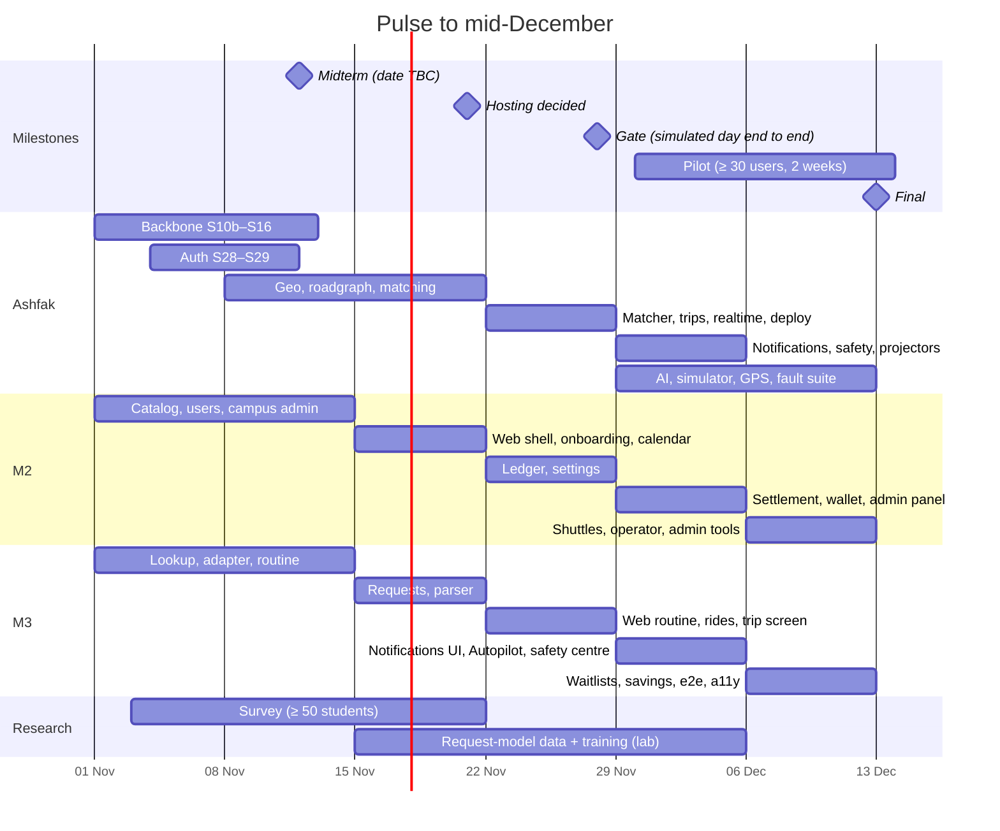

# 12 · Roadmap: six weeks to deploy-ready

Today is Sunday 1 November 2026. The final is in mid-December. The midterm (backend only, shown
with Postman) is in week 2. Weeks run Sunday to Saturday.

## 1. The honest picture

The proposal's full scope is about 1.5× what three people can finish **and test** in six weeks.
So the work is ordered in **waves**. Each wave ends with something that works end to end, and
later waves only add. If time runs out, we stop after a wave, not in the middle of everything.

| Wave                       | Contents                                                                                                                                                               | Must be done by   |
| -------------------------- | ---------------------------------------------------------------------------------------------------------------------------------------------------------------------- | ----------------- |
| 1 · Core journey           | Backbone, auth, campus, catalog, routine, requests, rule parser, matching, crews, trips, chat, web for all of it                                                       | **28 Nov (gate)** |
| 2 · Trust and money        | Notifications + push, safety (SOS, safe arrival), reliability, fairness, standby, habits, Autopilot, ledger, settlement, disputes, admin panel, PWA                    | 5 Dec             |
| 3 · Intelligence and scale | Request model, LightGBM, onboarding agent, shuttles + operator, simulator + shadow matching, HMM map matching, waitlists, savings, ICS, export/delete, fault injection | 12 Dec            |

## 2. Slices by week

A **slice** = one branch, one PR under ~400 changed lines, with tests (the existing workflow:
`/slice` → `/verify` → `/review` → PR). IDs continue from the current board. "Dep." lists slices
that must be merged first.

### Week 1 · 1–7 Nov · backbone and identity

| ID   | Slice                                                                                                                                         | Owner | Wave | Dep. |
| ---- | --------------------------------------------------------------------------------------------------------------------------------------------- | ----- | ---- | ---- |
| S12  | `@pulse/events`: envelope, topics, `CampusCreated` (PR #20)                                                                                   | A     | 1    |      |
| S10b | `apps/worker`: outbox relay to Kafka (`pulse_relay` role, advisory lock, `seq` order); add `topic`/`key` columns to `outbox_event`            | A     | 1    | S12  |
| S13  | `POST /admin/campuses`: campus + outbox row in one transaction (padmin guard comes with S29)                                                  | A     | 1    | S12  |
| S11  | Compose `queue` + `@pulse/jobs`: exchange, quorum queues, retry tiers, `jobs.dead`                                                            | A     | 1    |      |
| S24  | `GET /campuses/lookup?email=` (done, PR #26)                                                                                                  | M3    | 1    |      |
| S24b | Lookup moves to `POST /campuses/lookup {email}`: emails stay out of URLs and logs (see [04](04-api.md))                                       | M3    | 1    | S24  |
| S28  | Auth 1: `app_user`, `email_otp`, `POST /auth/otp/request` + `/verify`, rate limits; code sent via an `OtpMailer` port (logs in dev until S15) | A     | 1    |      |
| S29  | Auth 2: `session`, JWT cookies, refresh rotation + reuse detection, `AuthGuard`, `@Roles`, Origin check, `/auth/sessions`                     | A     | 1    | S28  |
| S30  | Catalog tables `term`, `section`, `section_meeting` (+ RLS) under `course`, and `GET /terms`, `/sections`                                     | M2    | 1    | S27  |
| S31  | `@pulse/catalog-adapters`: AIUB offered-course adapter + golden-file tests on the real report                                                 | M3    | 1    |      |

The first tasks S24–S27 are merged (PRs #26–#30): lookup and distance by M3, fare split preview
and the `course` table by M2. Ashfak took auth (S28–S29), so M2 moved to the catalog (S30).
S29 must land by about 12 Nov: S35, S36 and S38 wait for it.

### Week 2 · 8–14 Nov · midterm week

| ID  | Slice                                                                                                            | Owner | Wave | Dep.          |
| --- | ---------------------------------------------------------------------------------------------------------------- | ----- | ---- | ------------- |
| S14 | Idempotent `CampusCreated` consumer → `notify.email` job                                                         | A     | 1    | S10b, S11     |
| S15 | Email job worker → Mailpit; ack after success; retries; OTP email moves onto `notify.email`                      | A     | 1    | S11           |
| S16 | End-to-end test: create campus → Kafka → consumer → job → one email, even with a duplicate event                 | A     | 1    | S14, S15      |
| S17 | Midterm readiness: Postman "Midterm demo" folder; each member explains a part they did not build                 | all   | 1    | S16           |
| S32 | `@pulse/geo`: H3 helpers, distance port, `bestOrder`, `bestMeetingPoint` + oracles                               | A     | 1    |               |
| S35 | Users: profile, preferences (pin → H3 cell), vehicles, trusted contacts, `ProfileChanged`                        | M2    | 1    | S29           |
| S36 | Campus admin: gates, zones, meeting points, terms + activate (`TermActivated`); audit log table                  | M2    | 1    | S29           |
| S37 | Files port + `POST /files`; catalog import job (`import.timetable`), review, apply (`CatalogImported`)           | M3    | 1    | S11, S30, S31 |
| S38 | Routine: `/me/routine/resolve`, `PUT /me/routine`, `/me/week`, faculty teaching, staff blocks (`RoutineChanged`) | M3    | 1    | S30           |

**Midterm demo** (Postman): sign in with a code (Mailpit) → create a campus → event → email job →
import the AIUB catalog → search sections → resolve and save a routine → week view → preferences.

### Week 3 · 15–21 Nov · matching and the web shell (web work starts)

| ID  | Slice                                                                                                              | Owner | Wave | Dep.     |
| --- | ------------------------------------------------------------------------------------------------------------------ | ----- | ---- | -------- |
| S33 | `services/roadgraph` (C++17): OSM extract → Dijkstra per cell → `cell_distance` CSV + seed loader                  | A     | 1    | S32      |
| S34 | `@pulse/matching` 1: candidates (H3 + sweep line), feasibility, blossom pairs + brute-force oracle                 | A     | 1    | S32      |
| S39 | `@pulse/matching` 2: set-partition DP, Clarke–Wright + LNS, `planBatch`, explanations, booker                      | A     | 1    | S34      |
| S40 | Web shell: Next.js app, Tailwind, shadcn in `packages/ui`, API client, sign-in, onboarding (profile, home pin map) | M2    | 1    | S29, S35 |
| S41 | Calendar: admin events, class change reports + confirmations, `Class*` events                                      | M2    | 1    | S30      |
| S42 | Requests: `POST /requests` (go now, planned), recurring plans, cancel, go-solo, `TripRequested`                    | M3    | 1    | S35      |
| S43 | `@pulse/request-parser`: rule-based English + Banglish parser, gazetteer, `/requests/parse`                        | M3    | 1    |          |

Decide hosting by 21 Nov ([11](11-quality-and-ops.md) §4.4).

### Week 4 · 22–28 Nov · crews, trips, first full journey

| ID  | Slice                                                                                                                            | Owner | Wave | Dep.           |
| --- | -------------------------------------------------------------------------------------------------------------------------------- | ----- | ---- | -------------- |
| S44 | Matcher consumer: dirty campuses, 30 s batches, crews/trips/participants, `match_batch`, `TripProposed`                          | A     | 1    | S39, S42, S10b |
| S45 | Trip lifecycle: confirm/decline/leave/late/board/start/arrive, scheduler (`next_action_at`), transitions log                     | A     | 1    | S44            |
| S46 | Realtime: Socket.IO gateway + Redis adapter, fanout consumer (emitter), chat (`message`), live location (after ADR D18)          | A     | 1    | S45            |
| S54 | Deploy-ready: Dockerfiles, `compose.prod.yaml`, Caddy, topics/migrate one-shots, release workflow, runbook; first staging deploy | A     | 1    | S44            |
| S47 | Ledger 1: `shapleyShares`, `fareShares`, fare claims + votes, journal/postings with the deferred zero-sum trigger                | M2    | 2    | S45            |
| S48 | Web: settings (profile, preferences, vehicles, contacts, sessions)                                                               | M2    | 1    | S40            |
| S49 | Web: routine import (pdf.js in a worker, privacy test) + week view + class change report                                         | M3    | 1    | S38, S40, S41  |
| S50 | Web: home, go now (outlook stub), plan, text request with editable chips                                                         | M3    | 1    | S42, S43, S40  |
| S55 | Web: crew card + trip screen (chat, MapLibre map, start/arrive)                                                                  | M3    | 1    | S45, S46       |

**Gate, Saturday 28 Nov**: on staging, a scripted AIUB day runs end to end: catalog imported,
routines saved, requests made, crews formed, confirmed, ridden, arrived, fare entered. If the gate
fails, week 5 starts by fixing it and wave 3 shrinks (§4).

### Week 5 · 29 Nov – 5 Dec · trust and money (pilot starts 30 Nov)

| ID  | Slice                                                                                                                 | Owner | Wave | Dep.          |
| --- | --------------------------------------------------------------------------------------------------------------------- | ----- | ---- | ------------- |
| S51 | Notifications: notifier consumer, budget, quiet hours, Web Push (VAPID), in-app, email fallback                       | A     | 2    | S15, S45      |
| S52 | Safety: SOS, safety checks, safe-arrival deadlines, escalation, `sim_sms`, admin SOS console API                      | A     | 2    | S45, S51      |
| S53 | Projectors: habits, reliability, fairness; standby backfill; no-shows; Autopilot generation job + baseline wait-or-go | A     | 2    | S45           |
| S56 | Request model: dataset build + fine-tune in the lab; ONNX export; eval report vs rules                                | A     | 3    | S43           |
| S57 | Ledger 2: weekly `ledger.settle` (`minTransfers`), simulated bKash pay, disputes + admin resolve                      | M2    | 2    | S47           |
| S58 | Web: fare entry/confirm/dispute, wallet, crew ledger, settle                                                          | M2    | 2    | S47, S57      |
| S59 | Web admin 1: catalog review, calendar, zones/gates/meeting-points map editor, reports, SOS, SMS inbox                 | M2    | 2    | S36, S37, S52 |
| S60 | Web: notification centre, push opt-in, PWA (Serwist, manifest, install)                                               | M3    | 2    | S51           |
| S61 | Autopilot + recurring plans: screens and suggestion confirm/skip                                                      | M3    | 2    | S53           |
| S62 | Safety centre: ratings, reports, blocks (backend + web), moderation actions                                           | M3    | 2    | S45           |

### Week 6 · 6–12 Dec · intelligence, shuttles, hardening

| ID  | Slice                                                                                                                                         | Owner | Wave | Dep.     |
| --- | --------------------------------------------------------------------------------------------------------------------------------------------- | ----- | ---- | -------- |
| S63 | Forecast: LightGBM quantiles in `services/forecast`, ONNX in the API, `forecast.retrain`, model registry, wait-or-go with λ                   | A     | 3    | S53      |
| S64 | Onboarding agent: `@pulse/ai-gateway`, Gemini adapter, spec schema + SpecAdapter, validator, `ai.onboarding`                                  | A     | 3    | S31, S37 |
| S65 | `apps/simulator` + replay + `matcher-shadow` + playground/compare API                                                                         | A     | 3    | S44      |
| S66 | GPS: Kalman + HMM map matching + deviation/long-stop in `location-monitor`                                                                    | A     | 3    | S46, S52 |
| S67 | Fault-injection suite (Toxiproxy, killed consumers), replay determinism, 3,000-user benchmark (nightly)                                       | A     | 3    | S44, S65 |
| S68 | Shuttle backend: operators, vehicles, routes/stops, runs, bookings, seat assignment (min-cost flow), check-in, payouts, demand snapshots (DP) | M2    | 3    | S36      |
| S69 | Web: operator console + rider shuttle screens + boarding pass                                                                                 | M2    | 3    | S68      |
| S70 | Web admin 2: playground, analytics, flags, models, audit, users; platform campuses                                                            | M2    | 3    | S65      |
| S71 | Waitlists, savings card, calendar feed (ICS)                                                                                                  | M3    | 3    | S42      |
| S72 | Playwright e2e of the main journeys + axe accessibility in CI                                                                                 | M3    | 2    | S55      |
| S73 | Data export and account deletion                                                                                                              | M3    | 3    | S35      |

### After 12 Dec · finish

| ID  | Slice                                                                       | Owner |
| --- | --------------------------------------------------------------------------- | ----- |
| S74 | Pilot report + survey analysis; final report; demo script; viva preparation | all   |

## 3. Load check

| Person | W1  | W2                | W3  | W4  | W5  | W6    |
| ------ | --- | ----------------- | --- | --- | --- | ----- |
| A      | 4   | 5 (incl. midterm) | 3   | 4   | 4   | **5** |
| M2     | 3   | 2                 | 2   | 2   | 3   | 3     |
| M3     | 2   | 2                 | 2   | 3   | 3   | 3     |

Ashfak's week 6 is overloaded. That is where the cut order applies first.

## 4. Cut order (if a week slips)

Move items to "Future" in this order. Items lower in the list hurt the proposal's objectives more.

1. S66 HMM map matching → keep the simple deviation check from S52 (corridor distance only).
2. S65 shadow matching and the playground replay → keep the simulator for load tests.
3. S64 onboarding agent → keep the hand-written AIUB adapter.
4. S68–S69 shuttles and operator console.
5. S71 waitlists, savings card, ICS feed; S73 export/delete (keep delete only).
6. S63 LightGBM → keep the habit-blend baseline (**objective O3 half-met**).
7. S56 request model → keep the rule parser (**O3 not met**). Last to cut, because O3 needs it.

Never cut: tests, the outbox/idempotency rules, RLS, the money invariants, the privacy rules.

## 5. Research track (runs alongside)

| When            | What                                                                                             | Owner |
| --------------- | ------------------------------------------------------------------------------------------------ | ----- |
| 3–22 Nov        | Survey of ≥ 50 AIUB students (Google Form: commute mode, cost, times, interest, safety concerns) | M3    |
| 15 Nov – 5 Dec  | Request-model data and training in the lab                                                       | A     |
| by 21 Nov       | ≥ 20 volunteer grade reports tested **in the browser only** (we record pass/fail, never files)   | M3    |
| 30 Nov – 13 Dec | Pilot with ≥ 30 users on staging; daily check-in; feedback form at the end                       | all   |

## 6. How we run the weeks

- **Sunday**: pick the week's slices on the board; check the gate status.
- **Daily**: async stand-up (done, next, blocked).
- **Wednesday**: 45-minute walkthrough of one slice by its owner (viva practice).
- **Saturday**: demo on a simulated day; update `docs/plan/` if the design changed.
