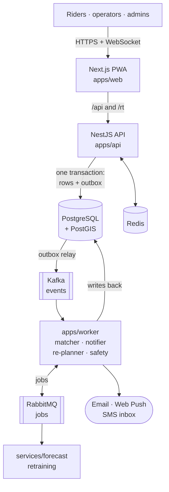

# Pulse: the complete plan

This folder is the full plan for Pulse, from today to a deploy-ready product. It replaces the
proposal as the working design: the proposal says _what_ and _why_, this folder says _exactly
how_. `docs/architecture.md` stays the one-page summary, and `docs/adr/` records each decision.

Status: draft for team review · Written 2026-11-01 · Scope: everything in proposal Section 8.

## How to read it

| #   | File                                                    | Read it when you…                                                      |
| --- | ------------------------------------------------------- | ---------------------------------------------------------------------- |
| 01  | [Product](01-product.md)                                | want to know who uses Pulse, what they can do, and what "done" means   |
| 02  | [Architecture](02-architecture.md)                      | need the big picture: apps, modules, how parts talk, environments      |
| 03  | [Data model](03-data-model.md)                          | write a migration or a query: **every table**, column and policy       |
| 04  | [API](04-api.md)                                        | build or call an endpoint: every route, body, response and role        |
| 05  | [Events and jobs](05-events-and-jobs.md)                | publish or consume a Kafka event or a RabbitMQ job                     |
| 06  | [Algorithms](06-algorithms.md)                          | work on matching, money, geo, forecasting or privacy maths             |
| 07  | [Flows and state machines](07-flows-and-states.md)      | need to see a journey step by step, or a status lifecycle              |
| 08  | [Security and privacy](08-security-and-privacy.md)      | touch sign-in, roles, personal data or uploads                         |
| 09  | [AI and ML](09-ai-and-ml.md)                            | work on the request model, the forecast or the onboarding agent        |
| 10  | [Frontend](10-frontend.md)                              | build a screen in `apps/web`                                           |
| 11  | [Quality, operations and deploy](11-quality-and-ops.md) | write tests, change CI, or prepare a deployment                        |
| 12  | [Roadmap](12-roadmap.md)                                | want to know what to build this week, who builds it, and the cut order |
| 13  | [Decisions and risks](13-decisions-and-risks.md)        | want the open questions, ADRs to write, and risks                      |

New teammates: read 01, 02, then the parts of 03 and 04 for your module, then 12.

## Pulse in one picture

## The plan in ten lines

1. **One product, five roles**: student, faculty/staff, shuttle operator, campus admin, platform admin.
2. **Modular monolith**: one NestJS API with ~20 modules, one worker app, one database.
3. **PostgreSQL is the truth**. Every change that others care about writes an `outbox_event` row
   in the same transaction; a relay publishes it to **Kafka**. Consumers are idempotent.
4. **RabbitMQ runs jobs** (send a push, parse a file, settle a week, retrain a model) with retry tiers.
5. **73 tables** across 10 domains, all campus-scoped tables protected by row-level security.
6. **About 185 endpoints** with Zod contracts shared by the API and the web app.
7. **Pure algorithm packages** (`matching`, `money`, `geo`) with property tests and brute-force oracles.
8. **AI with fallbacks**: rule-based parser → lab-trained ONNX model; habit blend → LightGBM;
   Gemini only for public timetable files. Every AI feature sits behind a flag.
9. **Deploy-ready for any host**: one Docker image per app, Compose for production, health checks,
   migrations as a one-shot step. The host is chosen by week 3 (see [11](11-quality-and-ops.md)).
10. **Six weeks in three waves**: core journey → money and safety → AI, shuttles and simulator.
    Whatever date we stop on, every finished wave works end to end ([12](12-roadmap.md)).

## Where this plan changes the proposal

The proposal was a sample. These are the deliberate changes, each explained in its chapter.

| Change                                                                                  | Why                                                                     | Where  |
| --------------------------------------------------------------------------------------- | ----------------------------------------------------------------------- | ------ |
| `user` table is named `app_user`                                                        | `user` is a reserved word in PostgreSQL                                 | 03     |
| `preference`, `reliability`, `fairness_balance` use `user_id` as their primary key      | They are strictly one row per user; a separate `id` adds nothing        | 03     |
| Shuttle stops get their own table (`shuttle_stop`)                                      | Seat booking and check-in need a stop id, not a point on a line         | 03     |
| Fares are first a `fare_claim` that members confirm, then ledger postings               | "Fares confirmed by members" needs a state before money moves           | 03, 07 |
| Event envelope stays as in ADR 0005 (no campus field); every payload carries `campusId` | ADR 0005 is accepted; consumers still need the campus to set RLS        | 05     |
| Two new Kafka topics: `shuttles`, `moderation`                                          | Shuttle and moderation facts have their own ordering keys               | 05     |
| Live locations need an explicit exception to the outbox rule (ADR to write)             | Locations are deliberately not stored in PostgreSQL, so no outbox row   | 05, 13 |
| Campus lookup by email is `POST /campuses/lookup`, not a query string                   | Emails must not appear in URLs, which end up in logs                    | 04     |
| The drafted `course` table (S27) becomes `term` / `section` / `section_meeting`         | The catalog is stored once per term; users point to sections            | 03, 12 |
| Simulated SMS goes to a `sim_sms` table shown in the admin "SMS inbox"                  | Trusted contacts are not users, so they cannot receive a `notification` | 03     |
